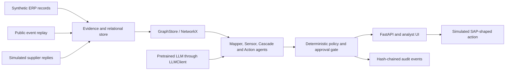
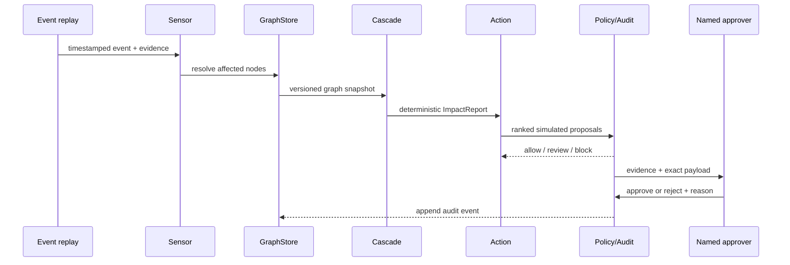

# Substrata

> **See what your suppliers secretly share.** <sup>[Design]</sup>


**Project name:** `Substrata` <sup>[Design]</sup> &nbsp; **Team:** `{{TEAM}}` <sup>[TBD]</sup>

An agentic early-warning and response layer that infers hidden shared dependencies across supplier tiers, measures how long remains before production is hit, and proposes governed mitigations on top of SAP's existing supply-chain stack. <sup>[Design]</sup>

> **Status — proposal stage:** no application, integration, trained model, benchmark result, customer validation, or SAP deployment exists yet. <sup>[Design]</sup> Every demo record described below will be synthetic and modelled on public facts. <sup>[Design]</sup> No SAP endorsement is claimed. <sup>[Design]</sup>

## Evidence legend

Every non-trivial statement uses one of these labels.

| Label | Meaning |
|---|---|
| **[Sourced]** | Backed by a link in the approved fact sheet. |
| **[Design]** | A proposed team decision; not an established fact or completed feature. |
| **[Assumption]** | A placeholder belief or value that must be validated. |
| **[TBD]** | Unknown or unavailable; must be checked before implementation. |

## Contents

1. [Problem](#1-problem)
2. [Why now](#2-why-now)
3. [Core definitions and worked example](#3-core-definitions-and-worked-example)
4. [Solution and differentiators](#4-solution-and-differentiators)
5. [User and business design](#5-user-and-business-design)
6. [System design](#6-system-design)
7. [Agents and human control](#7-agents-and-human-control)
8. [Data model](#8-data-model)
9. [Link inference](#9-link-inference)
10. [Models and training](#10-models-and-training)
11. [Cascade, runway and priority](#11-cascade-runway-and-priority)
12. [API sketch](#12-api-sketch)
13. [Demo replay](#13-demo-replay)
14. [Tech stack and deployment](#14-tech-stack-and-deployment)
15. [Evaluation plan](#15-evaluation-plan)
16. [Roadmap and phasing](#16-roadmap-and-phasing)
17. [Risks and mitigations](#17-risks-and-mitigations)
18. [Prior art and positioning](#18-prior-art-and-positioning)
19. [Judge Q&A](#19-judge-qa)
20. [Repository layout](#20-repository-layout)
21. [Getting started](#21-getting-started)
22. [Glossary](#22-glossary)
23. [Team](#23-team)
24. [Sources](#24-sources)

---

## 1. Problem

Manufacturers usually transact with Tier-1 suppliers, while the factories, materials and firms behind those suppliers may sit several relationships away. Industry surveys report sharply different levels of deep-tier visibility: one 2025 survey, reported by a secondary source, says 95% of respondents can see Tier-1 risk but 42% can see Tier 2 or beyond; an older CPO survey reports only 15% visibility beyond Tier 1. The figures are not directly comparable because their year, population and wording differ. <sup>[[Sourced]](https://www.certaintysoftware.com/multi-tier-supply-chain-visibility/) [[Sourced]](https://www.sedex.com/blog/supply-chain-visibility-beyond-tier-1/)</sup>

That gap can create false diversification: three direct suppliers may look independent while sharing the same upstream chip source, raw-material plant, owner, geography or logistics bottleneck. Research at Cambridge treats reconstruction and prediction of hidden supply-network links as an active research problem because incomplete inter-firm relationships obstruct disruption planning and cascade analysis. <sup>[[Sourced]](https://www.ifm.eng.cam.ac.uk/research/supply-chain-ai-lab/current-themes/supply-chain-link-prediction/)</sup>

The visual metaphor is literal enough to explain the design: several wells can look independent above ground while drawing from one hidden water table below. <sup>[Design]</sup> The proposed user is a supply-risk analyst or procurement planner who needs an evidence-backed answer to four questions: **where do supposedly independent supply paths converge, how certain is that inference, when does the business run out of time, and what action is permitted now?** <sup>[Design]</sup>


*Figure 1 — The direct-supplier view hides a shared Tier-3 dependency; every proposed inferred link keeps its source and confidence. <sup>[Design]</sup>*

### 1.1 Design challenge

> **How might we help a supply-risk analyst discover and verify shared Tier-N dependencies early enough to protect production, without allowing uncertain AI inferences to trigger irreversible procurement actions?** <sup>[Design]</sup>

### 1.2 In scope and out of scope

| In scope for the finale prototype <sup>[Design]</sup> | Explicitly out of scope <sup>[Design]</sup> |
|---|---|
| Synthetic SAP-shaped vendor, purchasing, BOM, stock and lead-time data | Production access to a company's SAP landscape |
| Confidence-scored inferred links and simulated supplier confirmations | Claiming that every hidden dependency can be discovered |
| Deterministic cascade and runway calculations | LLM-generated graph mathematics or inventory arithmetic |
| Replayed public event feed and node matching | Unbounded web crawling or live automated trading/procurement |
| Ranked mitigation drafts, approval gate and audit history | Automatic strategic supplier replacement |
| SAP adapters with local stand-ins | Representing stand-ins as real SAP transactions |

---

## 2. Why now

Sub-tier data is structurally difficult to maintain. A vendor analysis in the approved fact sheet estimates that roughly 70% of organizations lack accurate Tier 2–4 data and describes supplier-provided information as commonly stale by about 18 months; these are secondary vendor figures, not universal benchmarks. <sup>[[Sourced]](https://www.jaggaer.com/blog/why-supply-chain-visibility-breaks-down-beyond-tier-1-in-2026)</sup> Suppliers may also resist disclosure because of competitive sensitivity and weak direct relationships with the end buyer. <sup>[[Sourced]](https://www.sedex.com/blog/supply-chain-visibility-beyond-tier-1/)</sup>

Regulatory regimes including CSDDD, UFLPA and Germany's LkSG are cited as drivers for looking beyond direct vendors, although obligations and timelines vary by jurisdiction and continue to evolve. <sup>[[Sourced]](https://www.certaintysoftware.com/multi-tier-supply-chain-visibility/)</sup> Substrata therefore treats provenance, confirmation status and auditability as first-class data rather than decorating an inferred map after the fact. <sup>[Design]</sup>

SAP announced Supply Chain Orchestration as an AI-centric solution using Business Network and Business Data Cloud information for multi-tier insight, impact analysis and prioritized actions. <sup>[[Sourced]](https://news.sap.com/2025/10/sap-connect-innovative-updates-supply-chain-management/)</sup> Substrata deliberately complements that direction: the hackathon prototype explores a narrow confidence-to-confirmation and runway workflow, with adapters shaped for SAP targets, without claiming a product gap or SAP endorsement. <sup>[Design]</sup>

### 2.1 Hero backtest: the October 2025 Nexperia disruption

The demo will replay the following public chronology against a **synthetic** automotive network. It will not reproduce any manufacturer's confidential supplier graph, inventory or revenue. <sup>[Design]</sup>

| Date | Public event | Why it matters to the demo | Evidence |
|---|---|---|---|
| 2025-09-30 | The Dutch government took control of Nexperia. | Establishes the first disruption signal. | [[Sourced]](https://blog.findchips.com/nexperia-supply-disruption/) |
| 2025-10-04 | China restricted exports of Nexperia's China output. | Converts a governance event into a supply event. | [[Sourced]](https://blog.findchips.com/nexperia-supply-disruption/) |
| 2025-10-10 | Automakers and suppliers were told delivery could no longer be guaranteed. | Provides the replayed alert that the Sensor must match. | [[Sourced]](https://news.dealershipguy.com/p/chipmaker-seizure-could-snarl-u-s-car-production-as-early-as-next-month-2025-10-22) |
| 2025-10-22 | Reporting described Nexperia chips embedded in Tier-1 components from Bosch and Denso. | Illustrates why an OEM-facing Tier-1 view can hide the shared chip source. | [[Sourced]](https://news.dealershipguy.com/p/chipmaker-seizure-could-snarl-u-s-car-production-as-early-as-next-month-2025-10-22) |
| 2025-10-28 | ACEA said stocks would last only a few weeks while homologating alternatives could take several months. | Motivates the proposed runway comparison. | [[Sourced]](https://www.european-rubber-journal.com/article/2098231/acea-calls-for-immediate-resolution-to-critical-chip-supply-shortage) |
| 2025-10-29 | Honda suspended production at a Mexico plant amid the Nexperia disruption. | Supplies an observed downstream consequence for the narrative, not evaluation ground truth. | [[Sourced]](https://blog.findchips.com/nexperia-supply-disruption/) |

**Research takeaway:** a disruption may become operationally visible before an alternative component can be qualified. The project hypothesis is that exposing a likely common dependency and comparing stock cover with requalification time can create decision runway earlier than a Tier-1-only view. <sup>[Design]</sup>

A second vertical—essential medicines that share a hidden raw-material source—is only a social-impact hypothesis at this stage. <sup>[TBD]</sup> It has no approved evidence pack, domain model or demo data yet and will not be presented as researched until those gaps are closed. <sup>[Design]</sup>

---

## 3. Core definitions and worked example

All formulas below are starting-point product definitions, not established industry standards or measured performance. <sup>[Design]</sup>

| Concept | Proposed definition | Synthetic example | Status |
|---|---|---|---|
| **Cover days** | `cover_days = (on_hand + in_transit) / avg_daily_consumption` | `(1,200 + 600) / 100 = 18 days` | [Design] |
| **Exposure window** | `exposure_window = requalification_days - cover_days`; a positive value is an uncovered gap | `90 - 18 = 72 days` | [Design] |
| **Path confidence** | Product of edge confidences along one path | `0.90 × 0.80 = 0.72` | [Design] |
| **Multiple-path confidence** | Noisy-OR across independent candidate paths: `1 - product(1 - p_i)` | Paths `0.72` and `0.40` combine to `0.832` | [Design] |
| **Shared-dependency score** | For an upstream node reached from at least two distinct Tier-1 suppliers, sum their volume shares weighted by path confidence | `0.40×0.80 + 0.35×0.70 + 0.25×0.60 = 0.715` | [Design] |
| **Priority** | `max(0, exposure_window) × daily_revenue_at_risk × path_confidence` | `72 × ₹2,000,000 × 0.70 = ₹100.8M` priority proxy | [Design] |

> **Synthetic worked example:** the demo component has 18 days of cover and requires 90 days to requalify an alternative, producing a 72-day exposure window. <sup>[Design]</sup> The currency value is a prioritization proxy, not a forecast, accounting measure or claimed result. <sup>[Design]</sup>


*Figure 2 — Runway is the relationship between available cover and time to qualify recovery, not a prediction that production will certainly stop. <sup>[Design]</sup>*

The formula intentionally keeps confidence visible in the final priority. <sup>[Design]</sup> Whether volume shares are additive, whether candidate paths are independent enough for noisy-OR, and whether revenue is the correct business-impact measure must be validated with domain mentors. <sup>[Assumption]</sup>

---

## 4. Solution and differentiators

Substrata is proposed as an evidence-aware workflow between fragmented supply data and a planner's decision. <sup>[Design]</sup> It will not treat an inferred relationship as equivalent to a supplier declaration: every edge will carry `confidence`, `source`, `status` and `last_verified`, and uncertain links will create confirmation work rather than silent truth. <sup>[Design]</sup>

| Stage | What Substrata is planned to do | Output | Status |
|---|---|---|---|
| **See** | Load synthetic ERP-style records, declared relationships, ownership context, public events and simulated confirmations. | Normalized evidence records | [Design] |
| **Infer** | Combine heuristics with structured extraction from a pretrained LLM; retain evidence quotes. | Candidate graph edges with confidence | [Design] |
| **Verify** | Ask a simulated supplier or analyst to confirm or reject uncertain relationships. | `confirmed` or `rejected` edge status | [Design] |
| **Simulate** | Traverse the graph and calculate affected components, plants, cover, exposure window and priority. | Deterministic impact report | [Design] |
| **Act** | Rank allowed mitigations by cost, time and risk; draft—not execute—SAP-shaped actions. | Action options and rationale | [Design] |
| **Govern** | Auto-run only pre-approved low-risk steps; pause high-value steps; append every decision to a hash-chained log. | Approval record and audit report | [Design] |

### 4.1 Three deliberate differentiators

| Differentiator | Design decision | What it does **not** claim |
|---|---|---|
| **Inference that asks** | A high-confidence candidate can enter the graph as `inferred`; lower confidence or conflicting evidence opens a confirmation request. <sup>[Design]</sup> | It does not claim that an LLM discovers ground truth. <sup>[Design]</sup> |
| **Runway, not only risk** | Compare stock cover with alternative requalification time to make the decision gap visible. <sup>[Design]</sup> | It does not predict an exact stoppage date from incomplete data. <sup>[Design]</sup> |
| **Governed action** | Rules determine autonomy boundaries; the LLM may draft rationale but cannot override spend, supplier-switch or route-risk gates. <sup>[Design]</sup> | It does not make strategic sourcing autonomous. <sup>[Design]</sup> |

### 4.2 Real versus planned

| Item | Current reality | Intended next state | Label |
|---|---|---|---|
| Proposal and research notes | Written in this repository | Iterate after mentor and stakeholder review | [Design] |
| Architecture and data model | Documented only | Implement interfaces and migrations | [Design] |
| Diagrams | Repository artifacts, visually reviewed | Keep synchronized with implementation | [Design] |
| Synthetic dataset | Not created | Seeded automotive network with hidden ground truth | [Design] |
| Agents and UI | Not built | Finale prototype scope | [Design] |
| Model training | Not planned | Use pretrained models; optional synthetic-only GNN stretch baseline | [Design] |
| SAP connectivity | No environment or entitlement confirmed | Adapter first; real service only if supplied | [TBD] |
| Evaluation results | None | Targets measured on held-out synthetic edges | [Design] |

---

## 5. User and business design

The regional-round design work is a draft to validate, not evidence of stakeholder demand. <sup>[Design]</sup> The team must replace invented persona details with interview observations before presenting them as research. <sup>[TBD]</sup>

### 5.1 Stakeholders

| Stakeholder | Need in the proposed workflow | Decision or contribution | Status |
|---|---|---|---|
| Supply-risk analyst | Trace an event to hidden suppliers and inspect evidence | Accept, reject or investigate ambiguous matches | [Design] |
| Procurement/category manager | Compare feasible mitigation options | Approve supplier outreach, expedite or sourcing action | [Design] |
| Production planner | Understand when component shortages affect plants | Reallocate inventory or production | [Design] |
| Supplier contact | Correct incomplete or commercially sensitive links | Confirm or reject a relationship | [Design] |
| Compliance reviewer | See provenance, policy checks and accountability | Review exceptions and audit history | [Design] |
| Executive sponsor | Compare avoided exposure with action cost | Set guardrails and risk appetite | [Design] |


*Figure 15 — Draft empathy map to be replaced or corrected after stakeholder interviews. <sup>[Design]</sup> <sup>[TBD]</sup>*

### 5.2 Draft Business Model Canvas


*Figure 16 — Business Model Canvas, draft and explicitly unvalidated. <sup>[Design]</sup>*

| Canvas area | Draft hypothesis | Label |
|---|---|---|
| Customer segments | Manufacturers with complex multi-tier component networks; supply-risk and procurement teams as users | [Assumption] |
| Value proposition | Evidence-backed hidden-dependency discovery, decision runway and governed response | [Design] |
| Channels | Integration into existing supply-planning and procurement workflows | [Assumption] |
| Relationships | Enterprise implementation plus ongoing supplier/data-quality program | [Assumption] |
| Revenue | Enterprise subscription and implementation services | [Assumption] |
| Key resources | Enterprise data access, graph logic, pretrained models, domain rules and supplier participation | [Design] |
| Key activities | Data normalization, inference, confirmation, impact simulation, governance and audit | [Design] |
| Partners | SAP ecosystem, risk-data providers, suppliers and implementation partners | [Assumption] |
| Costs | Integration, data licensing, model inference, hosting, validation and supplier enablement | [Assumption] |

The canvas does not yet establish who pays, procurement cycle length, willingness to share Tier-N data, or whether the proposed buyer values runway enough to fund a separate layer. <sup>[TBD]</sup>

---

## 6. System design

Substrata is designed as an explainable decision layer, not a replacement ERP. <sup>[Design]</sup> The architecture keeps evidence ingestion, graph mathematics, language-model calls, policy checks and user approval behind separate interfaces so that each can fail safely and be tested independently. <sup>[Design]</sup>


*Figure 3 — Proposed system boundary. SAP and external systems are integration targets; local adapters will stand in until access and entitlements are confirmed. <sup>[Design]</sup> <sup>[TBD]</sup>*


*Figure 4 — Proposed layers and technology boundaries. No service shown here is implemented. <sup>[Design]</sup>*

| Layer | Proposed responsibility | Planned implementation | Truth boundary |
|---|---|---|---|
| Sources | ERP-shaped vendor, BOM, stock, purchasing and lead-time records; declared relationships; public events; simulated supplier replies | Seeded JSON/CSV and replay fixtures first; adapters later | No production SAP access exists. [TBD] |
| Persistence | Relational records, evidence, approvals and immutable audit events | SQLAlchemy with SQLite WAL locally and PostgreSQL as the deployment target | Storage design only. [Design] |
| Graph | Multi-tier traversal, shared-dependency detection, path confidence and cascade impact | A `GraphStore` interface backed by NetworkX; SAP HANA graph adapter is a stretch target | No Neo4j dependency; no HANA entitlement assumed. [Design] [TBD] |
| Agents | Orchestrate mapping, sensing, simulation, action drafting and compliance | LangGraph state machine; MCP tools for typed access; optional A2A demonstration | Agents coordinate tools; they do not replace deterministic calculations. [Design] |
| API and experience | Scenario control, graph views, evidence, approvals and streamed run status | FastAPI plus Next.js/TypeScript, Cytoscape.js, MapLibre and SSE/WebSocket updates | UI is a client; business rules stay in Python services. [Design] |
| Execution | Show the proposed action and resulting audit record | Simulator and SAP-shaped payload preview | No real purchase order, sourcing event or shipment is changed. [Design] |

<details>
<summary>Mermaid fallback for the proposed architecture</summary>



</details>

### 6.1 Architecture decisions

- **One authoritative service layer:** FastAPI owns calculations, policies and persistence; the web client renders and requests them. <sup>[Design]</sup>
- **Replaceable integrations:** `GraphStore`, `LLMClient`, event-source and SAP-action interfaces prevent a local demo adapter from being confused with a production integration. <sup>[Design]</sup>
- **Reproducible replay:** a seeded clock and fixture bundle make the judge demo deterministic even if the network is unavailable. <sup>[Design]</sup>
- **Evidence before confidence:** every inferred edge points to source records and retained excerpts; confidence without evidence is invalid. <sup>[Design]</sup>
- **Human authority:** high-impact actions cannot leave the simulation boundary without an explicit approval record. <sup>[Design]</sup>

See [Architecture](docs/ARCHITECTURE.md) for component contracts and failure handling, and [Tech stack](docs/TECH_STACK.md) for the proposed libraries and deployment caveats.

---

## 7. Agents and human control

“Agent” means a bounded workflow participant with typed inputs, allowed tools and stop conditions—not a free-running chatbot. <sup>[Design]</sup> Each agent can call only the Model Context Protocol (MCP) tools assigned to it. A deterministic policy engine, not the LLM, decides whether an operation can run automatically. <sup>[Design]</sup>


*Figure 5 — Proposed collaboration: pretrained models may extract or explain; graph, inventory, policy and audit services remain deterministic. <sup>[Design]</sup>*

<details>
<summary>Mermaid fallback for the agent and approval sequence</summary>



</details>


*Figure 6 — Proposed autonomy policy. Thresholds are configuration values to validate with mentors and domain users. <sup>[Assumption]</sup>*

### 7.1 Mapper agent

| Contract item | Proposed design |
|---|---|
| Purpose | Propose missing supplier, facility, material, ownership or logistics relationships and preserve the supporting evidence. |
| Inputs / outputs | Normalized entities and evidence records → candidate `SupplyEdge` objects plus confirmation tasks. |
| MCP tools | `evidence.search`, `entity.resolve`, `graph.neighbours`, `graph.propose_edge`, `confirmation.create`. |
| May decide alone | Deduplicate a strong identifier match; store a candidate as `inferred`; queue a confirmation. |
| Must escalate | Conflicting identifiers, confidence below threshold, sensitive ownership allegation, or any request to mark an edge `confirmed`. |
| LLM vs deterministic | A pretrained LLM extracts typed relationship candidates; deterministic code resolves identifiers, combines signals, validates schemas and enforces status transitions. |
| Failure modes | Hallucinated parties, entity collision, duplicated evidence and correlated signals treated as independent. Invalid JSON or missing evidence fails closed. |

<details>
<summary>Mapper structured-output example</summary>

```json
{
  "from_entity_id": "supplier_t1_b",
  "to_entity_id": "nexperia_site_x",
  "relationship": "sources_component_from",
  "confidence": 0.72,
  "evidence_ids": ["evt_2025_10_22_01"],
  "status": "inferred",
  "requires_confirmation": true
}
```

</details>

### 7.2 Sensor agent

| Contract item | Proposed design |
|---|---|
| Purpose | Classify replayed events, resolve affected entities and open a scenario when an event intersects the known or inferred graph. |
| Inputs / outputs | Timestamped event records → matched entities, severity, evidence and scenario trigger. |
| MCP tools | `events.next`, `entity.resolve`, `graph.neighbours`, `scenario.open`, `audit.append`. |
| May decide alone | Ignore a duplicate; attach a low-risk event for analyst review; start an analysis-only scenario. |
| Must escalate | Ambiguous entity match, conflicting event reports, or a trigger that would lead to an external action. |
| LLM vs deterministic | A pretrained LLM produces event type, entity candidates and a short rationale; deterministic matching, timestamps, thresholds and deduplication control the trigger. |
| Failure modes | Headline ambiguity, stale reports, false entity matches and event bursts. Network failure falls back to the signed replay fixture. |

<details>
<summary>Sensor structured-output example</summary>

```json
{
  "event_id": "evt_2025_10_10_01",
  "event_type": "supply_assurance_loss",
  "entity_candidates": [{"entity_id": "nexperia", "score": 0.94}],
  "severity": "high",
  "evidence_ids": ["source_findchips_01"],
  "analysis_only": true
}
```

</details>

### 7.3 Cascade agent

| Contract item | Proposed design |
|---|---|
| Purpose | Traverse the graph from an affected node and calculate paths, components, plants, cover, exposure windows and priority. |
| Inputs / outputs | Confirmed/inferred graph snapshot, stock and consumption records → deterministic `ImpactReport`. |
| MCP tools | `graph.paths`, `inventory.snapshot`, `bom.where_used`, `simulation.calculate`, `audit.append`. |
| May decide alone | Run read-only calculations and rank already computed impacts. |
| Must escalate | Never escalates or decides; it returns an explicit incomplete/validation result for cycles, missing units, stale inventory, inconsistent BOM quantities or a path below the analysis threshold. |
| LLM vs deterministic | No LLM performs traversal or arithmetic. A pretrained LLM may summarize the completed report, clearly preserving uncertainty. |
| Failure modes | Double-counted paths, unit mismatch, stale stock and missing lead times. Snapshot IDs and validation errors prevent silent continuation. |

<details>
<summary>Cascade deterministic-output example</summary>

```json
{
  "scenario_id": "scenario_nexperia_replay",
  "component_id": "component_demo_42",
  "cover_days": 18,
  "requalification_days": 90,
  "exposure_window_days": 72,
  "path_confidence": 0.70,
  "priority_proxy_inr": 100800000,
  "calculation_version": "v0.1-design"
}
```

</details>

### 7.4 Action agent

| Contract item | Proposed design |
|---|---|
| Purpose | Generate feasible mitigation options and compare cost, time, policy and residual exposure. |
| Inputs / outputs | Impact report, approved playbooks and supplier/inventory constraints → ranked action proposals. |
| MCP tools | `inventory.transfer_options`, `sourcing.alternatives`, `logistics.routes`, `policy.evaluate`, `approval.request`. |
| May decide alone | Draft options and run reversible simulations; auto-record a low-risk simulated step below a configurable spend limit. The limit is an unvalidated placeholder. [Assumption] |
| Must escalate | Spend, supplier switch, production-plan change, cross-border route, restricted-party concern, or missing source data. |
| LLM vs deterministic | A pretrained LLM may compose rationale and compare already computed options; solvers and rules calculate cost, feasibility and thresholds. |
| Failure modes | Invented alternatives, obsolete pricing, incompatible parts and locally optimal recommendations. Only tool-returned options are allowed. |

<details>
<summary>Action proposal example</summary>

```json
{
  "action_id": "act_transfer_01",
  "type": "inventory_transfer",
  "from_plant": "plant_b",
  "to_plant": "plant_a",
  "quantity": 600,
  "estimated_cover_gain_days": 6,
  "estimated_cost_inr": 180000,
  "approval": "required",
  "external_execution": "simulated_only"
}
```

</details>

### 7.5 Compliance and audit agent

| Contract item | Proposed design |
|---|---|
| Purpose | Evaluate configured controls, assemble provenance and make an append-only record of inputs, tool calls, decisions and approvals. |
| Inputs / outputs | Proposed action, policy version, evidence and prior events → policy result and audit bundle. |
| MCP tools | `policy.evaluate`, `evidence.get`, `approval.status`, `audit.append`, `audit.verify_chain`. |
| May decide alone | Block a prohibited or malformed action; record events; verify the hash chain. |
| Must escalate | Policy conflict, missing approver, restricted-party signal, unexplained evidence gap or audit-chain failure. |
| LLM vs deterministic | Rules decide allow/block/review. A pretrained LLM may draft a plain-language explanation but cannot change the result. |
| Failure modes | Misconfigured rules, incomplete evidence and identity/role errors. Default outcome is `block` or `review`, never silent approval. |

<details>
<summary>Compliance and audit output example</summary>

```json
{
  "proposal_id": "act_transfer_01",
  "policy_result": "review",
  "policy_version": "policy_v0.1-design",
  "reasons": ["inventory_transfer_requires_named_approver"],
  "snapshot_valid": true,
  "audit_event_id": "audit_demo_0042",
  "external_execution": "simulated_only"
}
```

</details>

### 7.6 Human approval gate

The planner sees the triggering evidence, graph path, confidence, runway math, alternatives, policy result and the exact simulated payload before deciding. <sup>[Design]</sup> Approval requires an authenticated role, reason, timestamp, policy version and scenario snapshot; rejection or expiry is equally auditable. <sup>[Design]</sup>

| Autonomy class | Examples | Proposed treatment |
|---|---|---|
| Automatic and reversible | Deduplicate an event, refresh a read-only analysis, queue a confirmation | Run, record and allow replay. [Design] |
| Review required | Contact a supplier, reallocate inventory, expedite freight, propose an alternate source | Pause for a named approver. [Design] |
| Prohibited in prototype | Issue or change a purchase order, onboard a supplier, make a compliance representation, move a real shipment | Simulate only; no connector method exists. [Design] |

The detailed state machine, timeout behavior and tool boundaries are in [Architecture](docs/ARCHITECTURE.md).

---

## 8. Data model

The graph is a projection of versioned relational records, not an opaque model artifact. <sup>[Design]</sup> Entity identity, evidence and approvals remain queryable even when the in-memory graph is rebuilt. <sup>[Design]</sup>


*Figure 7 — Proposed graph schema. An inferred edge is never silently promoted to confirmed. <sup>[Design]</sup>*

### 8.1 Core graph objects

| Object | Minimum proposed fields | Notes |
|---|---|---|
| `Product` | `id`, `name`, `product_family`, `manufacturer_id` | Synthetic product IDs in the prototype. [Design] |
| `Component` | `id`, `part_number`, `description`, `unit`, `requalification_days` | Synthetic part numbers and values in the prototype. [Design] |
| `SupplierSite` | `id`, `legal_entity_name`, `site_name`, `country_code`, `identifiers` | Separates legal entity and producing site; tier is path-relative. [Design] |
| `Plant` | `id`, `name`, `country_code`, `capacity_unit` | Represents the manufacturer's consuming site. [Design] |
| `Region` | `id`, `name`, `region_type`, `geometry_ref` | Shared geography is a signal, not proof of supply. [Design] |
| `Event` | `id`, `event_type`, `observed_at`, `source_id`, `severity` | Event time and replay time stay separate. [Design] |
| `AlternativeSupplier` | `id`, `supplier_site_id`, `component_id`, `qualification_status` | Candidate, not an approved source. [Design] |
| `SupplyEdge` | `from_id`, `to_id`, `relationship`, `confidence`, `status`, `source_ids`, `last_verified`, validity range | Status is `declared`, `inferred`, `confirmed`, `rejected` or `expired`. [Design] |
| `EvidenceRecord` | `id`, `source_uri`, `source_type`, `observed_at`, `excerpt_hash`, `license_note` | Stores a short licensed excerpt or pointer, not an uncontrolled copy. [Design] |
| `InventorySnapshot` | `material_id`, `plant_id`, `on_hand`, `in_transit`, `daily_consumption`, `as_of` | All quantities carry units and snapshot time. [Design] |
| `Scenario` | `id`, `trigger_event_id`, `graph_version`, `inventory_snapshot_id`, `clock_time`, `status` | Freezes the inputs used by a calculation. [Design] |

### 8.2 Persistence records


*Figure 11 — The graph is rebuilt from versioned records; the hash chain detects later changes but cannot prove an original input was true. <sup>[Design]</sup>*

| Table | Purpose |
|---|---|
| `entities`, `entity_identifiers` | Normalized graph nodes and aliases |
| `supply_edges`, `edge_evidence` | Relationships, confidence, status and provenance |
| `events`, `event_entity_matches` | Replayed disruption signals and resolved entities |
| `inventory_snapshots`, `bom_items`, `lead_times` | Deterministic impact inputs |
| `scenarios`, `impact_results`, `action_proposals` | Reproducible analysis outputs |
| `confirmation_requests`, `confirmation_responses` | Supplier/analyst verification loop |
| `approval_requests`, `approval_decisions` | Human gate and role evidence |
| `audit_events` | Append-only hash chain over actions and state changes |

<details>
<summary>Canonical edge example</summary>

```json
{
  "id": "edge_t1b_nexperia_x",
  "from_entity_id": "supplier_t1_b",
  "to_entity_id": "nexperia_site_x",
  "relationship": "sources_component_from",
  "confidence": 0.72,
  "status": "inferred",
  "source_ids": ["evt_2025_10_22_01"],
  "last_verified": null,
  "valid_from": "2025-10-22T00:00:00Z",
  "valid_to": null,
  "graph_version": 3
}
```

</details>

See [Data model](docs/DATA_MODEL.md) for constraints, indexes, retention choices and a complete entity-relationship view.

---

## 9. Link inference

Link inference is a layered evidence-ranking pipeline, not end-to-end model training. <sup>[Design]</sup> Strong deterministic matches are evaluated first; pretrained embeddings and an LLM can add structured candidates from text; a versioned rule combines signals; humans or suppliers resolve uncertainty. <sup>[Design]</sup>


*Figure 8 — Planned link-inference pipeline. Confidence is a workflow aid to evaluate, not a certified probability. <sup>[Design]</sup>*

### 9.1 Proposed signal order

1. Normalize names, identifiers, addresses, materials, units and observation dates. <sup>[Design]</sup>
2. Apply exact and rule-based signals such as the same legal identifier, supplier declaration, BOM reference or facility address. <sup>[Design]</sup>
3. Use pretrained embeddings for candidate retrieval and a pretrained LLM for schema-constrained relationship extraction with evidence spans. <sup>[Design]</sup>
4. Combine only documented signals with a versioned scoring rule; correlated evidence must not be counted as independent. <sup>[Design]</sup>
5. Store a qualifying candidate as `inferred`, never `confirmed`; conflicting or weaker candidates open a review request. <sup>[Design]</sup>
6. Convert an edge to `confirmed` only after a recorded authoritative response; expire it when its validity window or verification policy requires. <sup>[Design]</sup>

The first scoring rule may use a weighted sum with explicit caps, for example `score = min(1, Σ weight_i × signal_i)`. <sup>[Design]</sup> Signal weights, thresholds and calibration method are not known yet; they must be selected against a held-out synthetic set and reviewed with domain mentors. <sup>[TBD]</sup> Until measured, no number is described as precision, recall or learned accuracy. <sup>[Design]</sup>

### 9.2 Guardrails

- A candidate without at least one retained evidence record is rejected by schema validation. <sup>[Design]</sup>
- Source recency, independence and reliability are features, not hidden prompt instructions. <sup>[Design]</sup>
- Legal-entity and facility matches are separated; a shared address alone cannot prove a supply relationship. <sup>[Design]</sup>
- Negative confirmations remain available so the same unsupported edge is not repeatedly proposed. <sup>[Design]</sup>
- Review screens display the original evidence beside the extracted claim and score breakdown. <sup>[Design]</sup>

---

## 10. Models and training

> **No model training is planned for the core system.** Substrata will use pretrained LLMs and embeddings through prompts, retrieval and schema-constrained outputs, while deterministic graph code performs traversal, scoring inputs, cascade calculations and policy checks. <sup>[Design]</sup>

| Capability | Planned technique | Training in this project? | Evaluation |
|---|---|---|---|
| Entity candidate retrieval | Pretrained embedding model behind `LLMClient` | **No** | Recall@k on synthetic aliases [Design] |
| Relationship extraction | Pretrained LLM, evidence span and JSON schema | **No** | Schema validity and edge precision/recall on synthetic text [Design] |
| Event classification | Pretrained LLM plus deterministic label validation | **No** | Macro-F1 target on synthetic/replayed fixtures [Design] |
| Graph traversal and impact | NetworkX algorithms and versioned formulas | Not applicable | Exact unit tests and hand-calculated scenarios [Design] |
| Action feasibility and policy | Rules/optimizers over tool-returned options | Not applicable | Constraint and policy tests [Design] |
| Optional GNN comparison | Link-prediction baseline trained only on synthetic graph data | **Stretch only** | Report separately and label synthetic [Design] |

The `LLMClient` interface will support structured generation and embeddings without binding the domain code to one provider. <sup>[Design]</sup> SAP AI Core generative AI hub is the preferred SAP-aligned adapter if the event supplies access and entitlements; a local or other permitted provider is the fallback for development. <sup>[Design]</sup> Availability, model catalog, quotas, regional access, free-tier coverage and data-processing terms are all **TBD** until verified in the actual account. <sup>[TBD]</sup>

Published graph-language and generative link-prediction research shows that these techniques are actively explored, but its datasets and reported results are not Substrata results. <sup>[[Sourced]](https://arxiv.org/abs/2412.03390) [[Sourced]](https://arxiv.org/abs/2510.09735)</sup> This repository will never transfer another paper's accuracy figure to this project. <sup>[Design]</sup>

---

## 11. Cascade, runway and priority

When a disruption matches a graph node, the Cascade agent takes an immutable graph and inventory snapshot, traverses downstream relationships, removes rejected/expired edges, carries confidence along each path and aggregates affected materials and plants without double-counting. <sup>[Design]</sup>


*Figure 9 — Proposed cascade calculation. The LLM may explain the result but does not calculate it. <sup>[Design]</sup>*

### 11.1 Proposed calculation sequence

1. Resolve the event to one or more graph entities and record match uncertainty. <sup>[Design]</sup>
2. Enumerate bounded downstream paths, with cycle detection and configurable maximum depth. <sup>[Design]</sup>
3. Calculate path confidence and retain every contributing path rather than hiding it behind one score. <sup>[Design]</sup>
4. Join the impacted materials to BOM usage, plants, inventory, in-transit quantity, consumption and requalification lead time. <sup>[Design]</sup>
5. Calculate cover, exposure window and the priority proxy defined in [Section 3](#3-core-definitions-and-worked-example). <sup>[Design]</sup>
6. Run sensitivity cases for uncertain consumption, arrivals, requalification and edge confidence. <sup>[Design]</sup>
7. Persist the result with graph, inventory, formula and policy versions. <sup>[Design]</sup>

The default output must distinguish **known impact**, **inferred exposure** and **unknown because data is missing**. <sup>[Design]</sup> Missing consumption, units or requalification time produces an explicit incomplete result; it does not produce a guessed zero. <sup>[Design]</sup>

### 11.2 Example sensitivity view

| Case | Cover | Requalification | Exposure window | Interpretation |
|---|---:|---:|---:|---|
| Optimistic <sup>[Design]</sup> | 24 days | 60 days | 36 days | Still an uncovered gap in the synthetic example |
| Base <sup>[Design]</sup> | 18 days | 90 days | 72 days | Primary replay value |
| Stress <sup>[Design]</sup> | 12 days | 120 days | 108 days | Prioritize immediate review |

These are demonstration inputs, not observed Nexperia inventory or qualification values. <sup>[Design]</sup>

---

## 12. API sketch

The API is proposed as versioned JSON over FastAPI, with Server-Sent Events for replay progress and WebSocket support only if two-way live interaction proves necessary. <sup>[Design]</sup> Authentication and role mapping must precede any non-read-only connector. <sup>[Design]</sup>

| Method and path | Purpose | Guardrail |
|---|---|---|
| `POST /api/v1/scenarios` | Create an analysis from a replay event and snapshot IDs | Reject mutable or missing snapshot references |
| `GET /api/v1/scenarios/{id}` | Read status, inputs, results and uncertainty | Role-filter sensitive evidence |
| `GET /api/v1/scenarios/{id}/stream` | Stream deterministic replay steps over SSE | Resumable event IDs; no hidden state mutation |
| `GET /api/v1/graph/subgraph` | Return a bounded evidence-aware neighborhood | Enforce depth, node and time limits |
| `POST /api/v1/edges/{id}/confirmations` | Confirm or reject one candidate relationship | Named role, reason and evidence required |
| `POST /api/v1/scenarios/{id}/actions` | Generate simulation-only mitigation options | Options must come from allowed tools |
| `POST /api/v1/approvals/{id}/decisions` | Approve or reject a queued proposal | Prevent self-approval and stale-snapshot approval |
| `GET /api/v1/audit/{scenario_id}` | Export and verify the scenario audit chain | Redact according to role and source license |
| `GET /health/live` / `GET /health/ready` | Process and dependency checks | Readiness reports unavailable adapters honestly |

<details>
<summary>Proposed error envelope</summary>

```json
{
  "error": {
    "code": "INCOMPLETE_IMPACT_INPUT",
    "message": "Daily consumption is missing; cover days were not calculated.",
    "correlation_id": "req_demo_0042",
    "retryable": false,
    "missing_fields": ["inventory.daily_consumption"]
  }
}
```

</details>

The sketch is not an implemented or stable API contract. <sup>[Design]</sup>

---

## 13. Demo replay

The finale demonstration is designed to run in six minutes, offline, from a fixed seed. <sup>[Design]</sup> It replays public Nexperia milestones over an invented automotive network; names used from reporting provide context only and are not claims about a real company's confidential graph. <sup>[Design]</sup>

The minimum fixture is planned as one focal product, eight components, twelve supplier sites across four regions, three apparent Tier-1 alternatives sharing one hidden Tier-3 source, two plants, five alternative-supplier candidates, six dated public-event records and three confirmation outcomes. <sup>[Design]</sup> Final size and generator parameters remain <sup>[TBD]</sup> until implementation.


*Figure 10 — Proposed judge flow. Every screen remains accessible after the replay so evidence and calculations can be inspected. <sup>[Design]</sup>*

| Time | Presenter action | Visible proof point |
|---:|---|---|
| 0:00 | Open the Tier-1 map and ask whether the network appears diversified. | Three direct suppliers; no hidden link displayed yet. [Design] |
| 0:45 | Toggle inferred edges and inspect one evidence card. | Multiple Tier-1 paths converge on the same synthetic Tier-N source; status is `inferred`. [Design] |
| 1:45 | Start the October 10 replay event. | Sensor resolves the event, cites its source and opens analysis only. [Design] |
| 2:30 | Open the cascade report. | Graph paths, confidence, 18-day cover, 90-day requalification and 72-day gap are shown with formulas. [Design] |
| 3:30 | Compare three tool-returned mitigations. | Cost, time, cover gain, constraints and residual risk appear side by side. [Design] |
| 4:45 | Approve one simulated inventory transfer. | Policy requires a named reviewer; exact payload is marked `simulated_only`. [Design] |
| 5:30 | Verify the audit chain and return to the evidence. | Trigger, snapshots, tool calls, policy version, decision and hashes are linked. [Design] |
| 6:00 | Close with the outcome. | Substrata converts hidden dependency evidence into decision runway without autonomous procurement. [Design] |

### 13.1 Demo resilience

- The public-event fixture is stored with timestamp, URL, content hash and a short permitted excerpt. <sup>[Design]</sup>
- A seeded clock, graph version and inventory snapshot make repeated runs identical. <sup>[Design]</sup>
- Live feeds and real SAP services are optional adapters; the demo does not depend on them. <sup>[Design]</sup>
- A static walkthrough and exported scenario JSON are the final fallback if the application cannot run. <sup>[Design]</sup>
- The presenter states “synthetic” on the opening screen, impact screen and closing screen. <sup>[Design]</sup>

---

## 14. Tech stack and deployment

All technologies in this section are proposed, not installed application dependencies. <sup>[Design]</sup> The selection favors a small Python service boundary, a browser-based graph experience, portable storage and explicit adapters for event-specific SAP access. <sup>[Design]</sup>


*Figure 12 — Proposed technology map; SAP service availability and entitlement are not assumed. <sup>[Design]</sup> <sup>[TBD]</sup>*

| Concern | Default proposal | Fallback or boundary |
|---|---|---|
| Web experience | Next.js App Router, TypeScript, Cytoscape.js, MapLibre | Vite/React if static deployment constraints make Next.js unnecessary [Design] |
| API | FastAPI and Pydantic | One service owns business logic; no duplicate Next.js API logic [Design] |
| Realtime updates | SSE for one-way replay status | WebSocket only for demonstrated two-way need [Design] |
| Agent workflow | LangGraph | Plain state machine if the framework adds more ceremony than value [Design] |
| Tool contracts | Three local MCP servers: evidence/graph, planning, governance | In-process adapters use the same typed contracts in tests [Design] |
| Agent interoperability | Optional A2A stretch demonstration | Not required for the core demo [Design] |
| Graph | `GraphStore` + NetworkX | SAP HANA graph adapter only if access is confirmed; no Neo4j [Design] [TBD] |
| Relational store | SQLAlchemy/Alembic; SQLite WAL locally | PostgreSQL for shared deployment [Design] |
| LLM and embeddings | `LLMClient`; SAP AI Core generative AI hub preferred if supplied | Other permitted pretrained provider or deterministic fixtures [Design] [TBD] |
| Quality | pytest, type checking, schema tests, JSON logs | OpenTelemetry is optional [Design] |


*Figure 13 — Local Docker Compose is the reliable prototype target; SAP BTP Cloud Foundry is a stretch deployment after entitlements and service plans are verified. <sup>[Design]</sup> <sup>[TBD]</sup>*

### 14.1 Deployment truth table

| Environment | Planned components | Current status |
|---|---|---|
| Local development | Web, API/agents and SQLite in Docker Compose; replay fixtures mounted read-only | Design only; no containers exist. [Design] |
| Shared preview | Web, API/agents and PostgreSQL on a conventional container host | Provider and budget undecided. [TBD] |
| SAP-aligned stretch | HTML5/static web option, Python app on Cloud Foundry, managed database/graph and AI adapter where entitled | Architecture target only; account access, regions, quotas, service plans and costs unverified. [TBD] |

No SAP free-tier service is promised in this proposal. <sup>[Design]</sup> Before implementation the team must verify the actual event account, data residency, network egress, model access, quotas, trial expiry and whether each desired service accepts student accounts. <sup>[TBD]</sup> See [Tech stack](docs/TECH_STACK.md) for decision records and a preflight checklist.

---

## 15. Evaluation plan

There are no evaluation results yet. <sup>[Design]</sup> Every number below is a **target or protocol** until the prototype is built, run and reported with dataset version, seed and limitations. <sup>[Design]</sup>


*Figure 14 — Evaluation gates share one diagram with the phased roadmap: measurement must unlock claims, not merely follow implementation. <sup>[Design]</sup>*

### 15.1 Synthetic evaluation dataset

Generate a versioned graph with suppliers, facilities, materials, plants and known hidden edges; create realistic aliases, missing fields, stale records, duplicate reports, negative confirmations and evidence text; then hold out links and events before tuning any score or prompt. <sup>[Design]</sup> The public Nexperia chronology is a narrative replay, not ground truth for link accuracy. <sup>[Design]</sup>

### 15.2 Target metrics

| Area | Metric and proposed target | Measurement rule |
|---|---|---|
| Entity retrieval | Recall@5 ≥ 0.90 [Design] | Hidden synthetic entity appears among five candidates |
| Link inference | Precision ≥ 0.80 and recall ≥ 0.70 at the proposed review threshold [Design] | Held-out synthetic edges; report confidence intervals and class balance |
| Structured extraction | Valid JSON ≥ 0.98 [Design] | Schema pass without repair; repaired output reported separately |
| Event classification | Macro-F1 ≥ 0.80 [Design] | Fixed held-out synthetic/replayed fixture set |
| Cascade math | 100% exact on curated calculation tests [Design] | Compare with hand-calculated paths, units and cycle cases |
| Policy safety | 100% prohibited actions blocked in test suite [Design] | Include stale approval, self-approval and missing-evidence cases |
| Audit integrity | 100% injected mutations detected [Design] | Modify each link in copied audit chains |
| Replay reliability | 10/10 identical seeded runs [Design] | Compare canonical result hashes offline |
| Analyst utility | Median scenario comprehension time and error rate [TBD] | Small moderated study; protocol and participants not yet defined |

Targets can be missed without invalidating the experiment; they become evidence about what to improve. <sup>[Design]</sup> Results must show dataset size, generation method, prevalence, threshold-selection procedure, prompt/model version, seed, cost and failure examples. <sup>[Design]</sup> Synthetic performance cannot establish production accuracy, supplier willingness, regulatory compliance or business value. <sup>[Design]</sup>

See [Evaluation](docs/EVALUATION.md) for the proposed splits, ablations, baselines and reporting template.

---

## 16. Roadmap and phasing

The regional round requires structured thinking rather than code; the finale requires a functional prototype if the team advances. <sup>[[Sourced]](https://events.sap.com/in-hackfest-bangalore-2026/en_us/home.html)</sup> The plan therefore protects the ideation work first and adds implementation only behind explicit gates. <sup>[Design]</sup>

| Phase | Exit evidence | Scope |
|---|---|---|
| **0 — Regional proposal** | Problem framing, empathy assumptions, Business Model Canvas, architecture, safety boundaries and source register reviewed | Current repository deliverable [Design] |
| **1 — Deterministic spine** | Seeded data, schema, graph traversal, runway math, policy tests and audit chain pass | No LLM required [Design] |
| **2 — Evidence-assisted mapper** | Pretrained extraction and retrieval beat simple rule baselines on held-out synthetic data | No training; confirmation workflow included [Design] |
| **3 — Judge experience** | Six-minute replay succeeds offline 10/10 times; accessibility and failure states reviewed | Web UI and simulation-only approval [Design] |
| **4 — SAP adapter stretch** | Event-provided account and service plan verified; one read-only integration demonstrated | Never block core demo on entitlement [Design] [TBD] |
| **5 — Optional research stretch** | Synthetic-only GNN baseline reported honestly beside rules and pretrained models | Excluded if it risks core reliability [Design] |

### 16.1 Round 1 learning plan

The SAP Learning Hub student edition is a learning and practice environment, not evidence that the project has integrated SAP products. <sup>[Design]</sup> The team should use it to learn the relevant business process and vocabulary, capture course completion/screenshots only where event rules allow, and convert the learning into process maps, data-field assumptions and design decisions. <sup>[Design]</sup> Course availability and live practice-system access can vary, so exact learning journeys must be confirmed after sign-in. <sup>[TBD]</sup>

Suggested focus areas are design thinking, SAP Integrated Business Planning or supply-chain planning concepts, SAP Business Network, SAP BTP fundamentals, SAP HANA Cloud graph concepts, SAP AI Core/generative AI hub concepts and responsible AI. <sup>[Design]</sup> The team must not claim certification, system access or completion until actually obtained. <sup>[Design]</sup>

---

## 17. Risks and mitigations

| Risk | Why it matters | Proposed mitigation | Residual truth |
|---|---|---|---|
| Hallucinated link | Could misdirect procurement or harm a supplier | Require evidence IDs, status separation, score breakdown and confirmation | Inference remains uncertain. [Design] |
| False diversification or false convergence | Aggregation can hide path dependence | Preserve paths and sensitivity cases; test double-counting | Formula needs domain validation. [Assumption] |
| Confidential supplier data | Multi-tier relationships may be commercially sensitive | Least privilege, field-level redaction, retention policy and simulated demo data | Production controls are not designed fully. [TBD] |
| Stale evidence | Relationships and inventories change | Validity windows, snapshot time and expiry queues | Source refresh cadence is unknown. [TBD] |
| Automation overreach | A recommendation could be mistaken for authorization | No execution connector in prototype; named approval and exact payload preview | Human decisions can still be wrong. [Design] |
| Regulatory misuse | A graph inference is not legal due diligence | Rules flag review only; counsel/authorized compliance staff decide | No compliance certification claimed. [Design] |
| SAP entitlement mismatch | Desired services may not be available in the event tenant | Adapter-first local demo and early preflight | Real access is TBD. [TBD] |
| Synthetic-to-real gap | Clean generated data can overstate performance | Add missingness/noise, publish generator, seek later real-data validation | Synthetic results remain non-generalizable. [Design] |
| LLM/provider outage | Could interrupt extraction during judging | Cached structured fixtures and deterministic replay | Live behavior is not demonstrated offline. [Design] |
| Prompt/model change | Reproducibility and extraction quality may drift | Version prompt, model, provider and test suite | Provider determinism may be limited. [Design] |
| Source licensing | Full-text storage or redistribution may be restricted | Store URLs, hashes, metadata and short permitted excerpts | Each source license needs review. [TBD] |
| Audit overclaim | A hash chain can sound like proof of truth | State that it detects modification only; preserve source uncertainty | It cannot prove input accuracy. [Design] |

---

## 18. Prior art and positioning

Substrata is not presented as the first multi-tier risk, graph or disruption-intelligence product. <sup>[Design]</sup> Established offerings and current SAP direction validate the problem space; the hackathon contribution is the narrow combination of evidence-aware inferred edges, confirmation, decision runway and an explicit human gate in a transparent educational prototype. <sup>[Design]</sup>

| Reference | Relevant overlap | Substrata's proposed emphasis |
|---|---|---|
| SAP Supply Chain Orchestration | Multi-tier insight, impact analysis and prioritized action within SAP's supply-chain direction <sup>[[Sourced]](https://news.sap.com/2025/10/sap-connect-innovative-updates-supply-chain-management/)</sup> | Complementary confidence-to-confirmation and runway demonstration; no product-gap claim |
| SAP reference architecture for AI agents | SAP Cloud SDK for AI, generative AI hub, HANA vector/knowledge graph and agent/tool protocols <sup>[[Sourced]](https://architecture.learning.sap.com/docs/golden-path/ai-golden-path/build-and-deliver/build-ai-agents)</sup> | Adapter-first prototype that can align if event access exists |
| Prewave, Resilinc, Everstream and Sphera | Commercial supply-risk and resilience landscape summarized by an approved neutral comparison <sup>[[Sourced]](https://suplari.com/blog/supplier-risk-management-solutions-compared-standalone-risk-tools-vs-spend-integrated-platforms)</sup> | Open proposal and reproducible synthetic evaluation, not a feature-superiority claim |
| Cambridge Supply Chain AI Lab | Hidden-link reconstruction and prediction as a research problem <sup>[[Sourced]](https://www.ifm.eng.cam.ac.uk/research/supply-chain-ai-lab/current-themes/supply-chain-link-prediction/)</sup> | Operational human-verification and runway workflow around candidate links |
| Meridian | Adjacent open-source supply-chain mapping reference <sup>[[Sourced]](https://github.com/askmy-stack/meridian)</sup> | Hackathon-specific multi-agent simulation and governance framing |

The comparison is directional and may become stale; vendor capabilities, packaging and terminology should be rechecked before presentation. <sup>[TBD]</sup>

---

## 19. Judge Q&A

### 1. What is the one-sentence value?

Substrata helps a supply-risk analyst see when apparently independent Tier-1 suppliers share a hidden upstream dependency, calculate the remaining decision runway and prepare a governed response. <sup>[Design]</sup>

### 2. What is actually built today?

Only the research-backed proposal, architecture, data/evaluation specifications and editable diagrams in this repository. There is no application or live integration. <sup>[Design]</sup>

### 3. Did you train a model?

No. Core scope uses pretrained LLMs/embeddings through prompts and structured outputs, plus deterministic graph code. An optional GNN trained only on synthetic data is a separately reported stretch baseline. <sup>[Design]</sup>

### 4. Is the claimed accuracy proven on real data?

No accuracy result is claimed at all yet. Proposed numbers are targets; planned evaluation uses held-out synthetic data and cannot establish real-world performance. <sup>[Design]</sup>

### 5. Why is this agentic instead of one workflow?

The bounded agents own different evidence, tools and escalation conditions, which makes collaboration and human control inspectable. A plain state machine remains the fallback if an agent framework adds no measurable benefit. <sup>[Design]</sup>

### 6. What prevents hallucinated supplier links?

Nothing can make extraction infallible. The design requires source-backed candidates, deterministic validation, explicit `inferred` status, negative evidence and human/supplier confirmation before `confirmed`. <sup>[Design]</sup>

### 7. Can it autonomously change a purchase order?

No. The prototype deliberately has no method for real purchase-order, onboarding or shipment mutation; it can show a simulated payload only. <sup>[Design]</sup>

### 8. Why SAP?

The problem sits beside ERP, BOM, inventory, planning and supplier-network data. SAP has announced AI-centric supply-chain orchestration and publishes agent architectures relevant to this direction, but actual service use depends on event access. <sup>[[Sourced]](https://news.sap.com/2025/10/sap-connect-innovative-updates-supply-chain-management/) [[Sourced]](https://architecture.learning.sap.com/docs/golden-path/ai-golden-path/build-and-deliver/build-ai-agents)</sup>

### 9. How is Substrata different from an existing risk platform?

It is not claiming broader coverage. Its hackathon thesis is a transparent loop from evidence-backed hidden-link inference, through confirmation and deterministic runway, to a constrained approval and audit record. <sup>[Design]</sup>

### 10. Is the Nexperia story your dataset?

No. It supplies public chronology for a replay. The companies, relationships, inventory and impact values used by the prototype are synthetic and cannot be attributed to the real organizations. <sup>[Design]</sup>

### 11. What happens without SAP or internet access?

The core demo uses local adapters, a seeded clock, synthetic graph/inventory fixtures and cached structured event records. SAP and live feeds are optional integration targets. <sup>[Design]</sup>

### 12. What would invalidate the idea?

Failure to beat simple rules on held-out synthetic links, reviewers being unable to understand or act on confidence/runway, supplier confirmation being impractical, or integration costs exceeding the decision value would all weaken or invalidate the thesis. <sup>[Design]</sup>

More detailed answer prompts and red-flag wording are in [Judge Q&A](docs/JUDGE_QA.md).

---

## 20. Repository layout

```text
.
├── README.md
└── docs/
    ├── ARCHITECTURE.md
    ├── DATA_MODEL.md
    ├── EVALUATION.md
    ├── JUDGE_QA.md
    ├── RESEARCH.md
    ├── TECH_STACK.md
    └── diagrams/
        ├── README.md
        ├── 01-visibility-gap.{excalidraw,svg,png}
        └── ...
```

No application source tree, dependency lockfile, environment file, dataset or deployment manifest exists yet. <sup>[Design]</sup>

---

## 21. Getting started

At the current proposal stage, “getting started” means reviewing and validating the design:

1. Read the [research register](docs/RESEARCH.md), paying attention to source limits and open questions.
2. Trace the proposed flow in [Architecture](docs/ARCHITECTURE.md) and challenge every autonomous boundary.
3. Review [Data model](docs/DATA_MODEL.md) and [Evaluation](docs/EVALUATION.md) with a supply-chain mentor.
4. Open any `.excalidraw` source from the [diagram manifest](docs/diagrams/README.md) to edit the visuals.
5. Replace `{{TEAM}}` and `[TBD]` items only with verified information.

There is intentionally no `npm install`, `pip install` or run command because no prototype has been implemented. <sup>[Design]</sup>

<details>
<summary>Planned commands after a scaffold exists</summary>

```bash
# Planned only — these files do not exist yet.
docker compose up --build
python -m pytest
npm run lint
npm run build
```

The implementation phase must replace this placeholder with exact, tested commands and pinned prerequisites. <sup>[Design]</sup>

</details>

---

## 22. Glossary

| Term | Meaning in this proposal |
|---|---|
| Tier 1 / Tier N | A direct supplier / a supplier or dependency multiple relationships upstream |
| Hidden dependency | A relevant relationship absent from the buyer's current declared view |
| Shared dependency | One upstream entity, facility, material, geography or route reached by multiple apparent supply paths |
| Declared edge | Relationship imported from an identified authoritative system or declaration |
| Inferred edge | Evidence-backed candidate relationship that has not been authoritatively confirmed |
| Confirmed edge | Relationship accepted through a recorded confirmation process |
| Provenance | The source records, transformations and versions supporting a statement or output |
| Cover days | Available on-hand plus in-transit quantity divided by average daily consumption |
| Exposure window | Requalification days minus cover days; positive means an uncovered time gap |
| Decision runway | The time and options remaining before the modeled exposure reaches production |
| MCP | Model Context Protocol; typed tool boundary used by proposed agents |
| A2A | Agent-to-Agent protocol; optional interoperability demonstration |
| Replay | Deterministic execution of stored events and snapshots against a seeded clock |

---

## 23. Team

| Role | Owner |
|---|---|
| Product / design research | `{{NAME}}` [TBD] |
| Supply-chain domain and business model | `{{NAME}}` [TBD] |
| Graph, data and simulation | `{{NAME}}` [TBD] |
| Agents, API and governance | `{{NAME}}` [TBD] |
| Experience and demo | `{{NAME}}` [TBD] |

The team composition, institutional affiliation, mentor and contact details have not been supplied. <sup>[TBD]</sup>

---

## 24. Sources

External factual claims in this proposal are restricted to the approved fact sheet and are indexed with context and limitations in [Research](docs/RESEARCH.md). Key links:

- [SAP Hackfest Bengaluru 2026 event page](https://events.sap.com/in-hackfest-bangalore-2026/en_us/home.html)
- [SAP Learning Hub, student edition](https://learning.sap.com/students)
- [SAP Supply Chain Orchestration announcement](https://news.sap.com/2025/10/sap-connect-innovative-updates-supply-chain-management/)
- [SAP golden path: build AI agents](https://architecture.learning.sap.com/docs/golden-path/ai-golden-path/build-and-deliver/build-ai-agents)
- [Cambridge Supply Chain AI Lab: link prediction](https://www.ifm.eng.cam.ac.uk/research/supply-chain-ai-lab/current-themes/supply-chain-link-prediction/)
- [Certainty Software: multi-tier visibility summary](https://www.certaintysoftware.com/multi-tier-supply-chain-visibility/)
- [Sedex: visibility beyond Tier 1](https://www.sedex.com/blog/supply-chain-visibility-beyond-tier-1/)
- [JAGGAER: why visibility breaks down beyond Tier 1](https://www.jaggaer.com/blog/why-supply-chain-visibility-breaks-down-beyond-tier-1-in-2026)
- [Findchips: Nexperia disruption timeline](https://blog.findchips.com/nexperia-supply-disruption/)
- [DealershipGuy: Nexperia automotive impact](https://news.dealershipguy.com/p/chipmaker-seizure-could-snarl-u-s-car-production-as-early-as-next-month-2025-10-22)
- [European Rubber Journal: ACEA supply warning](https://www.european-rubber-journal.com/article/2098231/acea-calls-for-immediate-resolution-to-critical-chip-supply-shortage)
- [Suplari: supplier-risk platform landscape](https://suplari.com/blog/supplier-risk-management-solutions-compared-standalone-risk-tools-vs-spend-integrated-platforms)
- [Meridian open-source repository](https://github.com/askmy-stack/meridian)
- [Generative AI-enhanced supply-chain link prediction](https://arxiv.org/abs/2412.03390)
- [Graph-language models for supply networks](https://arxiv.org/abs/2510.09735)

Source presence does not make every statement on a linked page correct or current. <sup>[Design]</sup> Before judging, the team should recheck dates, availability and wording and retain a reviewed evidence snapshot subject to source terms. <sup>[TBD]</sup>
