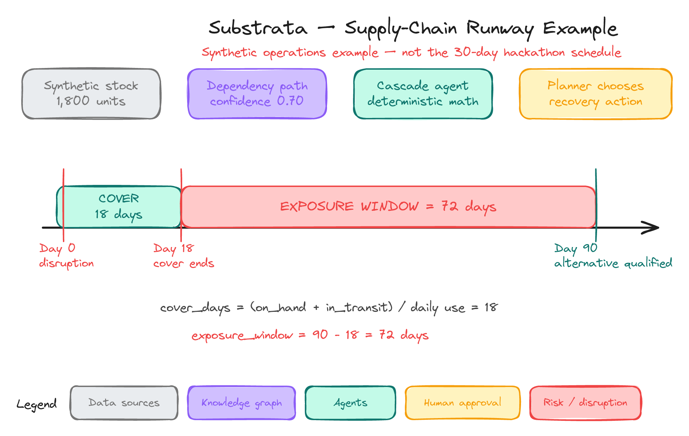
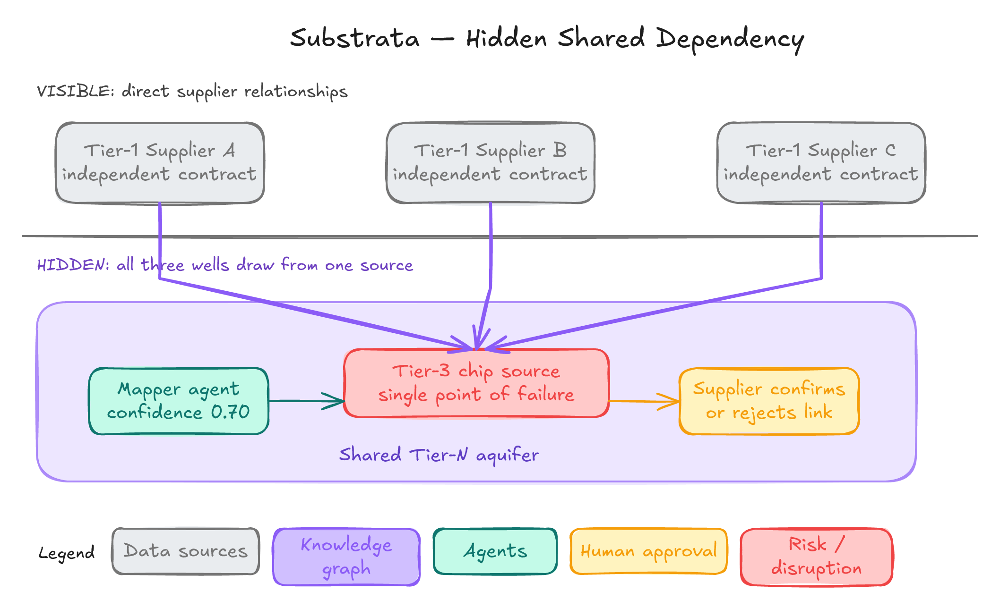
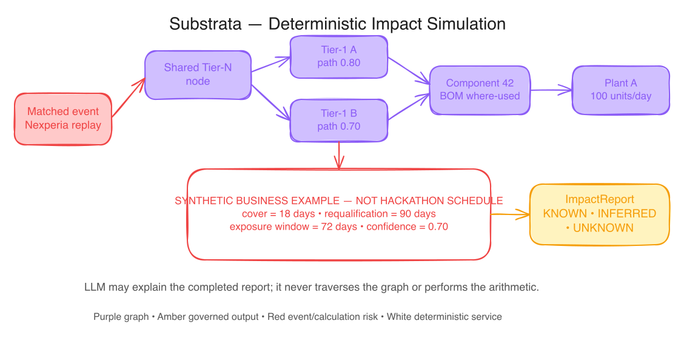
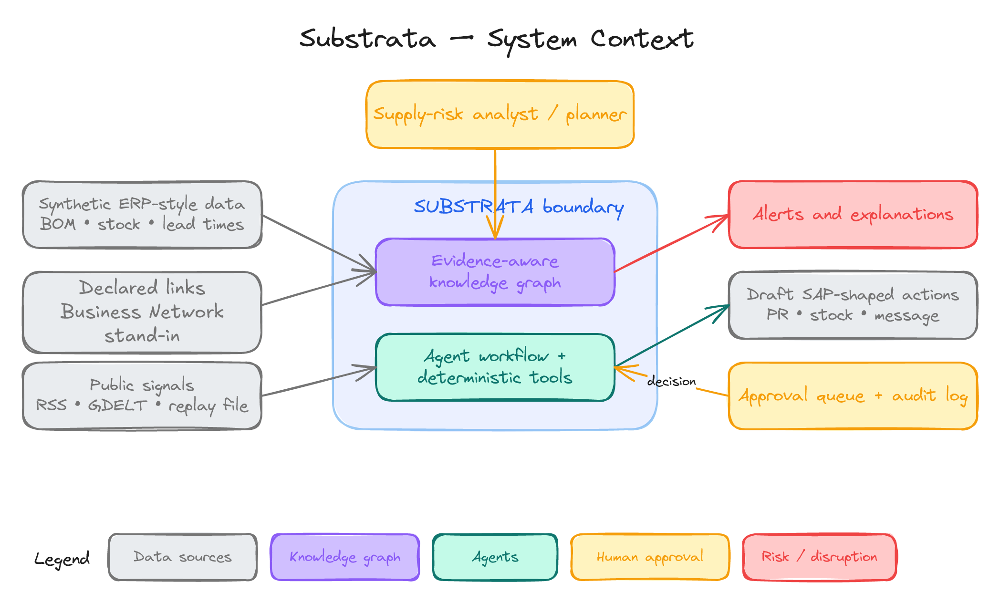
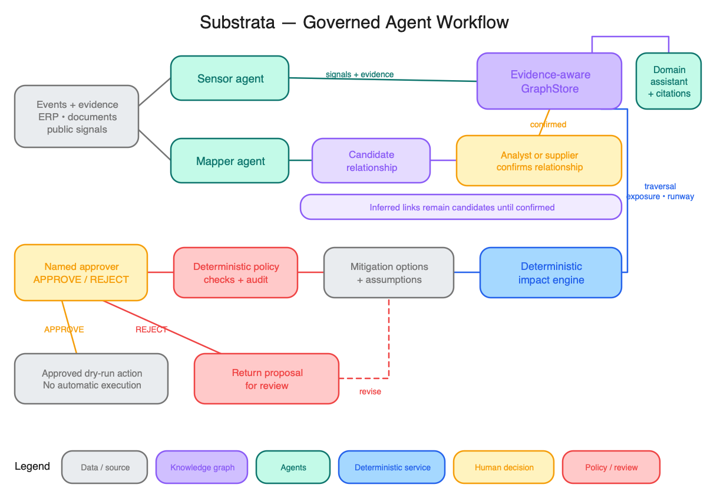
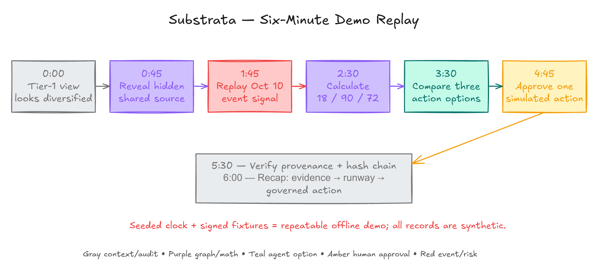

# Substrata

The approved industry-neutral platform migration is tracked in
[Platform migration](docs/PLATFORM_MIGRATION.md). The original synthetic demo
remains available during the migration; new tenant features use a separate schema.
For manual Python installs, use `python -m pip install -e ".[dev,platform]"`;
the setup runner installs these extras for the complete test suite.
Platform API access requires verified tokens; see the migration guide for setup.
The platform includes automotive, pharma and food fixtures and a deterministic
assessment endpoint with sourced inputs and inferred-dependency exposure ranges.
CSV/Excel imports are staged with column mapping, validation and identity review;
optional semantic embeddings add scored, review-only entity candidates when a
provider and tenant cost budget are configured. History and safe rollback preserve
graph revisions.
Tenant policies enforce named approval, separation of duties, delegation, SLA
expiry and dry-run execution of sourced mitigation drafts.
Read-only OData, authenticated REST and signed webhook adapters are available,
with a synthetic local mock and an explicit Business Network/Ariba stub.
Open `/platform/` for onboarding, imports, graph history, scenarios, policies,
approval review, notifications and audit/CSV/PDF report exports. The platform
workspace, printable report and supplier confirmation portal support English and
Hindi with a browser-persisted language choice; broader locale and accessibility
QA remains open.
The workspace now connects the existing evidence and job APIs: save sourced
documents, index/search passages, discover cited links, request a signed supplier
preview and queue/run a graph-pinned risk review. Development previews send no
supplier email. Completed reviews refresh the runway, assessment and audit views.
Saved assessment reports retain their original graph revision after later replies.
Evidence retrieval supports pgvector and exact passage citations; configurable
OpenAI/Anthropic/local extraction is isolated from deterministic exposure arithmetic.
Supplier portal replies use signed, expiring tokens and preserve historical link
states while producing confirm/reject training labels. SMTP-over-TLS supplier
email and tenant-configured approval notices are optional in production and
disabled in development.
The scorer training script calibrates a small gradient-boosted model on supplier
labels with grouped holdouts and a versioned registry; it never fine-tunes an LLM.
Tenant event feeds use HTTPS host allowlists and explicit license notes; RSS, GDELT
DOC, U.S. NWS alerts, European MeteoAlarm weather warnings, review-only OFAC SDN
and ITA consolidated screening candidates, and field-mapped JSON APIs run through
the same tenant event pipeline.
Event polls and graph assessments can run as durable, retryable jobs via `scripts/platform_worker.py`.
Authenticated MCP tools and an A2A task endpoint call the same deterministic cascade
engine, with named Mapper, Sensor, Cascade-caller, Action and Compliance/Audit
skills. Tenant-scoped durable jobs persist typed agent-task inputs, retries and
results. The fixed risk-review plan checkpoints a pinned cascade assessment and
audit verification across retries. A2A clients can enqueue that plan and poll its
tenant-scoped task; clients cannot delegate exposure arithmetic to an LLM.
Run a synthetic graph traversal load check with
`python -m scripts.platform_graph_load --nodes 4095 --queries 200 --workers 8`.
Its local timings are not production service-level objectives.
For the local PostgreSQL/API/worker scaffold and production operations gates, see
[Operations](docs/OPERATIONS.md). CI runs Python, frontend and container-build checks.
Backup primitives encrypt custom PostgreSQL archives and their manifests with
AES-256-GCM and authenticate the complete artifact before exposing restore input.
Plaintext dumps are streamed; only ciphertext is staged temporarily for recovery.

Run `python scripts/verify_recovery.py` with Docker running to verify encrypted
backup/restore using two disposable PostgreSQL/pgvector databases and clearly
synthetic automotive/food fixtures. The drill checks a consistent snapshot during
concurrent writes, graph history, audit heads, forced tenant isolation, vector
retrieval and durable job resumption. It writes a safe local JSON report under
ignored `data/recovery-drills/` and removes its own containers. Operational commands
are available through `python scripts/platform_backup.py --help`; see the
[backup/recovery runbook](docs/OPERATIONS.md#database-backup-and-restore).
HTTP observability includes route-template latency/status metrics and W3C trace
context correlation. Optional OTLP/HTTP export uses a bounded queue and local
sampling; credentials, query strings, path parameters and business inputs are
excluded from span attributes and request logs.
Durable jobs store their producer traceparent and worker attempts resume the same
trace. Provider/connector HTTP calls create child spans and propagate traceparent
without vendor state or baggage. Worker logs contain execution summaries rather
than graph or mitigation payloads; queued assessment dates are restored to aware
datetimes before deterministic calculation.
PostgreSQL integration checks exercise forced tenant policies on every business
table, pgvector retrieval/model versions, import history and rollback, concurrent
graph/audit writes, and resumed risk-review jobs followed by named approval.
With Docker running, `python scripts/verify_postgres.py --full-suite` runs all
Python tests against synthetic fixtures with PostgreSQL integration enabled in
an isolated database container that is removed afterward.

> **See what your suppliers secretly share.** <sup>[Design]</sup>


**Project:** Substrata <sup>[Design]</sup> · **Team:** `{{TEAM}}` <sup>[TBD]</sup>

Substrata is a proposed agentic supply-chain resilience layer that discovers hidden dependencies across supplier tiers, estimates how much decision time remains before production is exposed, and recommends governed mitigation options. <sup>[Design]</sup>

> **Current status:** the complete synthetic vertical slice is implemented: evidence-backed graph discovery, simulated supplier confirmations, event replay, deterministic exposure calculations, ranked mitigation drafts, named approval and hash-chained audit. Gemini is the primary LLM and Groq is its backup. Live extraction needs your provider keys; explicit mock mode works offline after installation. No model training, SAP connection, live supplier contact or real purchase execution is claimed.

See the [three-minute demo](docs/DEMO_SCRIPT.md), [build checklist](docs/BUILD_PLAN.md) and [decision register](docs/DECISIONS.md). The latest working agreement is to complete the pass and push every five meaningful commits.

## Getting started

Requires Python 3.12+, Node.js 24.x and npm. Verified on Windows with Python 3.13.5, Node.js 24.14.0 and npm 11.9.0. Run from the repository root. Setup needs internet to install dependencies.

```powershell
python scripts/dev.py setup
python scripts/dev.py migrate
python scripts/dev.py seed
python scripts/dev.py demo
```

Before starting the demo, add `GEMINI_API_KEY` and `GROQ_API_KEY` to the root `.env`. See [LLM setup and failover](docs/LLM_SETUP.md). To follow the exact offline demo instead, set `SUBSTRATA_LLM_PROVIDER=mock`.

Open [the local workspace](http://127.0.0.1:3000), [API health](http://127.0.0.1:8000/health), [readiness](http://127.0.0.1:8000/ready), process metrics at `/metrics`, or [API documentation](http://127.0.0.1:8000/docs). `Ctrl+C` stops both servers. The documentation page uses FastAPI's default CDN assets; the workspace, `/health` and `/openapi.json` work offline after installation.

```json
{"status":"ok","service":"substrata-api","data_mode":"synthetic"}
```

`seed` creates or resets the deterministic synthetic scenario and the ignored SQLite database, including demo approvals and audit history. Stop servers before CLI reseeding. Normal schema upgrades use `migrate` and preserve data. Health reports process liveness; `/state` checks seeded workspace readiness. The UI fetches the API directly and receives live events through SSE.

Use **Discover links → Simulate supplier replies → Replay next event**, inspect the 18/90/72-day runway, enter a name and reason, approve a simulated draft, then verify the audit chain. [Exact click path and recovery](docs/DEMO_SCRIPT.md).

Run the current checks:

```powershell
python scripts/dev.py test
python scripts/dev.py lint
python scripts/dev.py build
python scripts/dev.py evaluate
```

`test` runs pytest and frontend type checking. `lint` checks Python lint/formatting and frontend ESLint. `build` exports the frontend to `frontend/out/`. The exported UI still requires the running FastAPI API. `evaluate` regenerates measured fixture results and persists the evaluation run; it does not train a model. Frontend dependency limitations are recorded in the [decision register](docs/DECISIONS.md#d006-static-frontend-scaffold).

## Individual services and local configuration

To run services separately, use these commands in separate terminals:

```powershell
python scripts/dev.py api
```

```powershell
python scripts/dev.py ui
```

Setup creates a root `.env` from `.env.example` when absent and preserves an existing file. Set `SUBSTRATA_API_PORT` / `SUBSTRATA_UI_PORT` there to change the default 8000 / 3000 ports; shell values take precedence. Both development and the static build use the configured API port; `NEXT_PUBLIC_API_URL` explicitly overrides the browser API URL and is embedded at build time. Rebuild after changing it. Stop running servers before rerunning setup. All commands after setup use `.venv` automatically.

The Makefile forwards the same tasks for GNU Make users. GNU Make is unavailable on this workstation, so those wrappers have not been locally executed; use the Python commands above. See the [scripts guide](scripts/README.md) for all tasks.

## Read this first: what do 18, 90 and 72 days mean?

These numbers describe a **synthetic supply-chain incident**, not our hackathon schedule. <sup>[Design]</sup>

| Number | Meaning in the business example |
|---:|---|
| **18 days** | Available stock and in-transit supply can support production for 18 days. <sup>[Design]</sup> |
| **90 days** | A replacement component is assumed to require 90 days to qualify. <sup>[Design]</sup> |
| **72 days** | The uncovered exposure period: `90 − 18 = 72 days`. <sup>[Design]</sup> |
| **30 days** | Time remaining to prepare for the hackathon; unrelated to the calculation above. |

The 90-day value is only a demonstration assumption. It must be replaced by the real qualification lead time for each component and company. <sup>[Assumption]</sup>



*Figure 1 — A synthetic operational example: stock ends before an alternative is qualified. <sup>[Design]</sup>*

## The problem

Companies may believe that several Tier-1 suppliers give them diversification while those suppliers secretly depend on the same deeper manufacturer, facility, material, owner, region or route. <sup>[Design]</sup>

Available surveys indicate that deep-tier visibility remains difficult: one 2025 survey reported 95% visibility into Tier-1 risk but only 42% into Tier 2 or beyond; an older survey reported 15% visibility beyond Tier 1. These figures differ by year, population and wording and should not be directly compared as one benchmark. <sup>[[Sourced]](https://www.certaintysoftware.com/multi-tier-supply-chain-visibility/) [[Sourced]](https://www.sedex.com/blog/supply-chain-visibility-beyond-tier-1/)</sup>



*Figure 2 — Three apparently independent suppliers can share one hidden upstream dependency. <sup>[Design]</sup>*

### Design question

> How might we help a supply-risk analyst discover and verify shared Tier-N dependencies early enough to protect production, without allowing uncertain AI inferences to trigger irreversible procurement actions? <sup>[Design]</sup>

## Proposed solution

Substrata follows a five-stage workflow. <sup>[Design]</sup>

| Stage | Proposed behavior |
|---|---|
| **Map** | Combine declared relationships, ERP-shaped records and public evidence to propose missing supplier links with confidence and provenance. |
| **Verify** | Keep links marked `inferred` until a supplier or analyst confirms or rejects them. |
| **Sense** | Match a replayed disruption event to affected graph nodes. |
| **Simulate** | Deterministically calculate affected components, plants, stock cover and exposure windows. |
| **Act safely** | Rank mitigation options, pause high-impact actions for a named approver and audit every decision. |

### What makes the idea different

1. **Inference that asks:** uncertain relationships create confirmation work instead of silently becoming truth. <sup>[Design]</sup>
2. **Runway instead of a generic risk score:** compare stock cover with the time required to qualify recovery. <sup>[Design]</sup>
3. **Governed action:** analysis may run automatically, while supplier switches, spend and real operational changes require human authority. <sup>[Design]</sup>

## Worked example

All values below are synthetic demonstration inputs, not Nexperia or customer data. <sup>[Design]</sup>

```text
on_hand                 = 1,200 units
in_transit              =   600 units
daily_consumption       =   100 units/day
requalification_days    =    90 days

cover_days = (1,200 + 600) / 100 = 18 days
exposure_window = 90 - 18 = 72 days
```

The exposure window means production cover ends 72 days before the alternative is ready. It does **not** predict that the hackathon or project will take 72 days. <sup>[Design]</sup>



*Figure 3 — The graph identifies affected paths; deterministic code performs the calculation. <sup>[Design]</sup>*

## Hero scenario: October 2025 Nexperia disruption

The proposed demo replays public Nexperia events over an invented automotive network. It does not claim access to any manufacturer's private supplier graph, stock or revenue. <sup>[Design]</sup>

| Date | Public event | Demo purpose |
|---|---|---|
| 30 Sep 2025 | The Dutch government took control of Nexperia. <sup>[[Sourced]](https://blog.findchips.com/nexperia-supply-disruption/)</sup> | Initial disruption signal |
| 4 Oct 2025 | China restricted exports of Nexperia's China output. <sup>[[Sourced]](https://blog.findchips.com/nexperia-supply-disruption/)</sup> | Supply-risk escalation |
| 22 Oct 2025 | Reporting described Nexperia chips in Tier-1 components supplied by Bosch and Denso. <sup>[[Sourced]](https://news.dealershipguy.com/p/chipmaker-seizure-could-snarl-u-s-car-production-as-early-as-next-month-2025-10-22)</sup> | Hidden shared-dependency narrative |
| 28 Oct 2025 | ACEA said stocks could last only a few weeks while alternatives could take months to homologate. <sup>[[Sourced]](https://www.european-rubber-journal.com/article/2098231/acea-calls-for-immediate-resolution-to-critical-chip-supply-shortage)</sup> | Runway comparison |
| 29 Oct 2025 | Honda suspended production at a Mexico plant. <sup>[[Sourced]](https://blog.findchips.com/nexperia-supply-disruption/)</sup> | Public downstream consequence |

## Architecture at a glance



*Figure 4 — Substrata sits between evidence sources and governed, simulated actions. SAP systems are integration targets, not existing connections. <sup>[Design]</sup> <sup>[TBD]</sup>*

| Layer | Proposed implementation |
|---|---|
| Data | Synthetic procurement, BOM, stock and lead-time records; declared links; replayed public events; simulated confirmations. <sup>[Design]</sup> |
| Persistence | SQLAlchemy with SQLite WAL locally; PostgreSQL as an alternative. <sup>[Design]</sup> |
| Graph | `GraphStore` with NetworkX; SAP HANA graph adapter only if event access is available. <sup>[Design]</sup> <sup>[TBD]</sup> |
| Agents | Mapper, Sensor, Cascade, Action and Compliance/Audit coordinated through bounded tools. <sup>[Design]</sup> |
| Experience | FastAPI with a TypeScript web client, graph view, approval queue and replay controls. <sup>[Design]</sup> |
| Execution | Alerts and SAP-shaped action previews marked `simulated_only`. <sup>[Design]</sup> |

Detailed contracts and failure handling: [Architecture](docs/ARCHITECTURE.md).

## Agents and human control



*Figure 5 — Language models may extract or explain; graph mathematics, policies and approval validity remain deterministic. <sup>[Design]</sup>*

| Agent | Responsibility | Escalation boundary |
|---|---|---|
| **Mapper** | Propose evidence-backed hidden links. | Low confidence, conflicting evidence or confirmation |
| **Sensor** | Classify events and resolve affected entities. | Ambiguous or conflicting event matches |
| **Cascade** | Traverse the graph and calculate impact. | Does not decide; reports complete, incomplete or invalid calculations |
| **Action** | Compare tool-returned mitigation options. | Spend, supplier switch, route risk or missing source data |
| **Compliance/Audit** | Apply rules and append provenance, decisions and approvals. | Policy conflict, missing approver or audit-chain failure |

The prototype will not issue purchase orders, onboard suppliers or move real shipments. <sup>[Design]</sup>

## Models and training

> **No model training is planned for the core system.** <sup>[Design]</sup>

| Pretrained AI may assist with | Deterministic code remains responsible for |
|---|---|
| Name similarity and candidate retrieval | Entity identifiers and schema validation |
| Relationship extraction from evidence text | Graph traversal and path confidence |
| Event classification | Inventory, cover and exposure arithmetic |
| Rationale and message drafting | Policy, approval and audit rules |

LLM outputs must be structured JSON, validated against a schema and include evidence references for proposed links. <sup>[Design]</sup> An optional GNN is a stretch baseline trained only on synthetic data and reported separately. <sup>[Design]</sup> No accuracy figure will be claimed until it is measured; synthetic results will not be presented as real-world accuracy. <sup>[Design]</sup>

## Demo plan

The local prototype implements this synthetic six-stage replay. See the [three-minute click path](docs/DEMO_SCRIPT.md). A production/competition deployment remains a future decision. <sup>[Design]</sup>

1. Show three Tier-1 suppliers that appear independent.
2. Reveal their inferred shared Tier-N source and supporting evidence.
3. Replay the public disruption event.
4. Calculate affected components, 18-day cover and the synthetic 72-day exposure window.
5. Compare mitigation options.
6. Approve one simulated action and inspect its audit history.



*Figure 6 — Seeded fixtures keep the judge demonstration reproducible and independent of internet access. <sup>[Design]</sup>*

## Evaluation plan

The [evaluation report](docs/EVALUATION.md#measured-synthetic-fixture-results) contains script-generated frozen-fixture measurements and raw errors. These do not establish held-out generalisation or real-world accuracy. Broader planned targets include:

| Area | Proposed target |
|---|---:|
| Entity retrieval | Recall@5 ≥ 0.90 <sup>[Design]</sup> |
| Hidden-link inference | Precision ≥ 0.80 and recall ≥ 0.70 on held-out synthetic edges <sup>[Design]</sup> |
| Cascade mathematics | 100% on hand-calculated unit tests <sup>[Design]</sup> |
| Policy safety | 100% of prohibited test actions blocked <sup>[Design]</sup> |
| Offline replay | 10/10 identical seeded runs <sup>[Design]</sup> |

These are targets, not results. Synthetic evaluation would show only that the method works on a constructed scenario; it would not prove equivalent performance on a real company's supply network. <sup>[Design]</sup>

Full protocol: [Evaluation plan](docs/EVALUATION.md).

## Round 1 and 30-day preparation plan

The regional round evaluates structured ideas, and a working prototype is not mandatory. <sup>[[Sourced]](https://events.sap.com/in-hackfest-bangalore-2026/en_us/home.html)</sup>

| Period | Priority | Intended output |
|---|---|---|
| **Days 1–7** | Validate the problem and user | Two or three stakeholder conversations; corrected empathy map and Business Model Canvas <sup>[Design]</sup> |
| **Days 8–14** | Learn the SAP process context | Relevant SAP Learning Hub study notes and a verified SAP service-access checklist <sup>[Design]</sup> |
| **Days 15–21** | Strengthen the proposal | Final architecture, agent-human boundaries, Nexperia story and evaluation plan <sup>[Design]</sup> |
| **Days 22–27** | Optional lightweight proof | Clickable mock-up or small deterministic cascade notebook, only if the presentation is already strong <sup>[Design]</sup> |
| **Days 28–30** | Presentation readiness | Slides, six-minute narrative, judge Q&A and repeated team rehearsal <sup>[Design]</sup> |

### How to use SAP Learning Hub

The [SAP Learning Hub student edition](https://learning.sap.com/students) is for learning SAP concepts and practice systems; using it does not itself mean Substrata is integrated with SAP. <sup>[Design]</sup>

Suggested focus areas are supply-chain planning, SAP Business Network, SAP BTP fundamentals, SAP HANA graph concepts, SAP AI Core/generative AI hub concepts and responsible AI. <sup>[Design]</sup> Course availability, practice-system access and event entitlements must be confirmed after sign-in. <sup>[TBD]</sup>

## Scope and safety

| Included in the proposed prototype | Explicitly excluded |
|---|---|
| Synthetic SAP-shaped business records | Production SAP or customer data |
| Evidence-backed inferred relationships | Claiming every hidden dependency can be discovered |
| Deterministic graph and runway calculations | LLM-generated graph mathematics |
| Replayed public event fixtures | Unbounded live web crawling |
| Ranked mitigation drafts and approval | Autonomous strategic sourcing or procurement |
| SAP-shaped local adapters | Representing stand-ins as real SAP transactions |

Key unresolved items include stakeholder validation, real data availability, source licensing, SAP finale entitlements, security controls, score calibration and the unresearched essential-medicines vertical. <sup>[TBD]</sup>

## Business design artifacts

- [Draft empathy map](docs/diagrams/15-empathy-map.png) — assumptions to replace after interviews. <sup>[Assumption]</sup>
- [Draft Business Model Canvas](docs/diagrams/16-business-model-canvas.png) — buyer, willingness to pay and data-sharing behavior remain unvalidated. <sup>[Assumption]</sup>
- [Autonomy matrix](docs/diagrams/06-autonomy-matrix.png) — proposed automatic, review-required and prohibited actions. <sup>[Design]</sup>
- [Technology map](docs/diagrams/12-tech-stack.png) and [deployment topology](docs/diagrams/13-deployment-topology.png) — all service availability remains subject to verification. <sup>[Design]</sup> <sup>[TBD]</sup>

## Documentation

| Document | Purpose |
|---|---|
| [Research](docs/RESEARCH.md) | Approved evidence, source caveats and open research |
| [Architecture](docs/ARCHITECTURE.md) | Layers, agent contracts, state machine and failure handling |
| [Data model](docs/DATA_MODEL.md) | Graph entities, relationships, provenance and persistence |
| [Tech stack](docs/TECH_STACK.md) | Proposed technologies, alternatives and SAP preflight checklist |
| [Evaluation](docs/EVALUATION.md) | Synthetic dataset, leakage controls, metrics and reporting template |
| [Build checklist](docs/BUILD_PLAN.md) | Small implementation checkpoints and current progress |
| [LLM setup](docs/LLM_SETUP.md) | Gemini/Groq credentials, failover and offline mode |
| [Decisions](docs/DECISIONS.md) | Implementation choices, assumptions and deferred work |
| [Judge Q&A](docs/JUDGE_QA.md) | Twelve candid answers for expected judge questions |
| [Diagram manifest](docs/diagrams/README.md) | Questions answered, editable sources and export notes |

## What is real versus planned?

| Item | Current status |
|---|---|
| Research, proposal and diagrams | Available in this repository <sup>[Design]</sup> |
| Stakeholder validation | Not completed <sup>[TBD]</sup> |
| Project folder scaffold | Created (M0.1) |
| Backend process health and OpenAPI contract | Implemented and tested (M0.2) |
| Interactive graph, replay, runway, approvals and audit UI | Implemented with direct API/SSE and static export; see current verification in the build checklist |
| Development commands and local configuration | Implemented and checked (M0.4); Makefile forwarding supplied, GNU Make execution unverified locally |
| Database connection, transactions and migration history | Implemented and checked (M1.1) |
| Graph entities, relationships and evidence provenance | Implemented with typed/versioned records, evidence citations and GraphStore API |
| Synthetic dataset and workflow | Implemented: fixed seed 42, separate truth/declared graphs, 32 nodes, seven evidence snippets and six events |
| Mapper and supplier replies | Gemini primary / Groq backup with validated ownership extraction; explicit offline mock baseline. Provider transport/failover tested with simulated responses; live keys pending |
| Action, approval and audit | Implemented simulated templates, stale-input checks and hash-chain verification; self-declared local roles |
| Model training | Not planned <sup>[Design]</sup> |
| SAP access and integration | Not confirmed <sup>[TBD]</sup> |
| Evaluation results | Generated by the evaluation script; frozen synthetic fixture only, not held-out generalisation or real business value |

## Key sources

- [SAP Hackfest Bengaluru 2026](https://events.sap.com/in-hackfest-bangalore-2026/en_us/home.html)
- [SAP Learning Hub, student edition](https://learning.sap.com/students)
- [SAP Supply Chain Orchestration announcement](https://news.sap.com/2025/10/sap-connect-innovative-updates-supply-chain-management/)
- [SAP guidance for building AI agents](https://architecture.learning.sap.com/docs/golden-path/ai-golden-path/build-and-deliver/build-ai-agents)
- [Cambridge Supply Chain AI Lab: link prediction](https://www.ifm.eng.cam.ac.uk/research/supply-chain-ai-lab/current-themes/supply-chain-link-prediction/)
- [Nexperia disruption timeline](https://blog.findchips.com/nexperia-supply-disruption/)

See the [research register](docs/RESEARCH.md) for the complete approved source list and limitations.

---

**Name:** Substrata <sup>[Design]</sup> · **Tagline:** See what your suppliers secretly share. <sup>[Design]</sup> · **Team:** `{{TEAM}}` <sup>[TBD]</sup>
