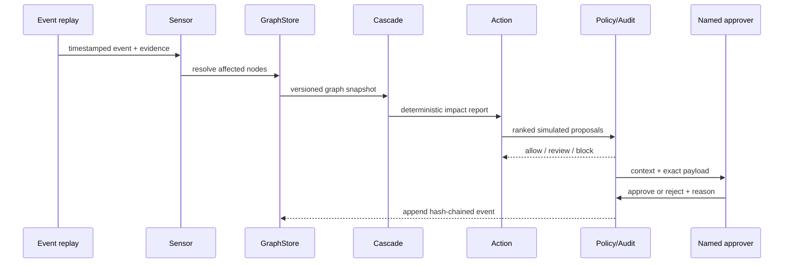

# Substrata architecture proposal

The approved production-platform migration adds `substrata.platform` alongside
the legacy replay, with portable tenant-scoped persistence, immutable graph
revisions, measurement provenance and atomic graph/audit writes. See
[Platform migration](PLATFORM_MIGRATION.md) for implemented contracts and gates.
Platform endpoints use verified OIDC claims and role checks. Tenant IDs are never
selected by request headers; the legacy reset route is absent in platform mode.
The tenant cascade uses deterministic services, conservative evidence-support
bounds and full-interruption exposure ranges. It reuses the existing runway and
bounded path calculations; LLMs have no arithmetic authority.
Tenant workflow records store staged import validation, human entity resolution,
applied versions and rollback reasons. Import application and graph/audit writes
use a shared transaction.
Policies and approval decisions use verified actor roles, sourced spend limits,
graph/policy hashes and SLA expiry; execution requires a separate adapter gate.
Read-only OData, REST and signed webhooks enter through adapter contracts and
validated graph/import services; external endpoint credentials stay on the server.
The feature-flagged tenant surface uses OIDC/PKCE and in-memory bearer tokens;
product workflows call typed tenant endpoints and reuse the existing graph view.
The platform workspace, printable report and supplier confirmation portal share
an English/Hindi catalog and browser-persisted language choice; full locale and
accessibility QA remains a release gate.
The platform adds tenant-scoped event feeds, durable leased work records and
stateless authenticated MCP/A2A adapters around deterministic services. Request
correlation, database readiness and basic process metrics support local operations.
ASGI observability follows each response through its complete body, including
streaming responses and failures. HTTP metrics use bounded method/route-template
labels and include response counts, in-flight requests and latency histograms.
Trace IDs follow validated W3C traceparent contexts; optional application-owned
OpenTelemetry providers export batches over OTLP/HTTP with a locally enforced
sample ratio. Vendor tracestate, baggage, credentials, raw paths/query strings
and business payloads are excluded, and providers shut down with the API lifespan.
Queue submission creates a producer span and stores only traceparent alongside
the durable job metadata. Each worker attempt starts a consumer span linked to
that producer; a restart does not require in-memory trace state. HTTP provider and
connector operations use child client spans and pass only traceparent. Worker
logs include coarse job type, attempt, status, duration and trace/span IDs without
business payloads. Persisted assessment ISO timestamps are validated back into
aware datetimes at dispatch, preserving the deterministic engine's time contract.
Tenant document vectors, exact passages and provider-neutral extraction feed only
inferred link proposals. Durable cost reservations gate live provider calls.
Single-use supplier tokens bind confirmation to tenant/request/link inputs;
responses revise the graph and emit attributable training labels atomically.
Supplier labels feed a versioned gradient-boosted scorer with independent
calibration/test supplier groups and explicit activation gates.
Tenant-scoped RSS/Atom event ingestion, durable work records, and authenticated
MCP/A2A facades now connect to the same deterministic services. Request logs,
readiness checks and process counters are implemented; deployment/backups and
feed coverage remain subject to the operational gates in PLATFORM_MIGRATION.md.
PostgreSQL regression checks run through the restricted runtime role and cover
every tenant table, transaction-local context reset, pgvector retrieval, immutable
import history, concurrent graph/audit commits and a checkpointed agent plan
resumed through a new connection pool before governed dry-run execution.
`scripts/verify_postgres.py` starts a disposable pgvector database on an ephemeral
loopback port and supplies the test admin URL only to its pytest child process.
It uses a generated local password and removes its owned container/anonymous
volume afterward; it does not reuse the application's Compose database.

> **Current implementation:** The local prototype implements SQLite/SQLAlchemy/Alembic, NetworkX graph/cascade services, mock-first evidence mapping, confirmations, replay, simulated actions, approval/audit, FastAPI/SSE and the static-exported Next.js dashboard. See BUILD_PLAN.md for verification and DECISIONS.md D010–D015 for simplifications. Broader integrations and production topology below remain design targets.

## 1. Goals and boundaries

Substrata is proposed as an evidence-aware analysis and response layer above supply-chain systems of record. **[Design]** It must preserve the distinction between declared, inferred, confirmed and rejected relationships; reproduce every impact calculation from versioned inputs; and require a named human for high-impact actions. **[Design]**

It is not an ERP, master-data replacement, sanctions-screening product, legal due-diligence service or autonomous purchasing system. **[Design]** The prototype uses synthetic SAP-shaped records and simulated actions only. **[Design]**

## 2. System context

*Figure 3 — Integration targets are shown for context; no production SAP connection is claimed. **[Design]** **[TBD]***

| Actor or system | Exchanges with Substrata | Boundary |
|---|---|---|
| Supply-risk analyst | Scenario, evidence review, inferred-link decision | Authenticated user role **[Design]** |
| Procurement/planning approver | Action review, reason and approve/reject decision | Cannot approve a stale snapshot **[Design]** |
| Synthetic ERP adapter | Vendor master, purchasing documents, BOM, plant stock and lead times | Stand-in for SAP-shaped data **[Design]** |
| Declared-network adapter | Declared supplier relationships | Stand-in for SAP Business Network / Ariba-shaped records **[Design]** |
| Public-signal adapter | Tenant RSS, GDELT DOC, U.S. NWS alerts, European MeteoAlarm warnings, OFAC SDN and ITA CSL name candidates, and field-mapped JSON APIs | Host allowlists, source attribution, provider field maps and area selection are operator-controlled; screening candidates require human review |
| Ownership adapter | Direct/ultimate parent data shaped like GLEIF output | Not a beneficial-ownership register **[Design]** |
| Notification adapter | Signed supplier portal reply, SMTP confirmation email and optional tenant approval notices | Recipients are tenant-scoped, encrypted at rest and delivered only by configured production workers |
| Simulated execution adapter | Alert, requisition draft, safety-stock change and supplier-message preview | Cannot mutate a real external system **[Design]** |

## 3. Layered architecture

*Figure 4 — Each layer is replaceable through typed interfaces. **[Design]***

### Layer 1 — Data

- Synthetic ERP-style vendor, purchasing, BOM, stock and lead-time records. **[Design]**
- Declared supplier relationships as a Business Network / Ariba-shaped stand-in. **[Design]**
- Replayed and submitted events, with tenant-configured RSS, GDELT DOC and U.S. NWS active weather adapters. **[Design]**
- Direct and ultimate parent records; never represent these as beneficial ownership. **[Design]**
- Simulated supplier confirmations. **[Design]**

### Layer 2 — Persistence

SQLAlchemy is the proposed data-access boundary. SQLite in WAL mode is the local default and must be resettable by a deterministic seed; PostgreSQL in Docker Compose is the drop-in shared option. **[Design]** See [Data model](DATA_MODEL.md).

### Layer 3 — Knowledge graph

`GraphStore` projects versioned database records into a NetworkX working graph and writes governed relationship changes back to the database. **[Design]** A SAP HANA Cloud Knowledge Graph adapter is a stretch target only if the finale environment supplies a suitable service and entitlement. **[TBD]** Neo4j is intentionally not in the proposal. **[Design]**

### Layer 4 — Agents and tools

LangGraph is the proposed orchestration layer; a plain typed state machine is the fallback. **[Design]** Three MCP boundaries keep capabilities narrow:

| Proposed MCP server | Example tools | Permitted effects |
|---|---|---|
| Evidence and graph | `evidence.search`, `entity.resolve`, `graph.paths`, `graph.propose_edge` | Read evidence/graph; propose an inferred edge **[Design]** |
| Planning | `inventory.snapshot`, `bom.where_used`, `simulation.calculate`, `sourcing.alternatives` | Read inputs and calculate/draft options **[Design]** |
| Governance | `policy.evaluate`, `approval.request`, `audit.append`, `audit.verify_chain` | Block/review, queue a human, append audit events **[Design]** |

Authenticated MCP and A2A endpoints expose typed tenant tools; broad external
client interoperability has not been verified, and no SAP affiliation is claimed.

The current offline slice exposes typed Mapper, Sensor, Cascade-caller, Action and
Compliance/Audit skills over the shared tool registry. Tenant jobs persist typed
inputs, retries and results and cap active work. A fixed, version-pinned risk-review
plan coordinates Cascade-caller assessment with Compliance/Audit verification and
stores a checkpoint after each role step. The flow creates an assessment only; it
does not propose or execute a mitigation. Adaptive plan authoring, cross-role flows
beyond this path, push notifications and hosted agent interoperability remain
deployment/integration work. A2A `tasks/send` queues this plan and `tasks/get`
returns its tenant-scoped state and completed artifacts.

### Layer 5 — API and experience

FastAPI contains all calculations, orchestration, policies and persistence. **[Design]** Next.js App Router and TypeScript are the preferred client; it is mostly client-rendered and uses Cytoscape.js for the graph and MapLibre for the map. **[Design]** Browser-only libraries load dynamically with server-side rendering disabled. **[Design]**

Replay updates travel directly from FastAPI to the browser by SSE; WebSocket is reserved for a proven two-way need. **[Design]** Next.js route handlers and Server Actions contain no domain logic and do not proxy the stream. **[Design]** Vite/React is the fallback if the team cannot operate Next.js reliably. **[Design]**

### Layer 6 — Execution

The demo can render SAP-shaped alert, requisition-draft, safety-stock-update and supplier-message payloads. **[Design]** All are stand-ins and carry `external_execution: simulated_only`. **[Design]**

## 4. Agent sequence and human gate

*Figure 5 — Agents use bounded tools; deterministic policy controls the approval gate. **[Design]***

Mermaid sequence fallback

## 5. State machine

| State | Entry condition | Allowed next states | Failure handling |
|---|---|---|---|
| `INGESTED` | Valid event/evidence schema | `MATCHED`, `IGNORED`, `NEEDS_REVIEW` | Invalid input is rejected **[Design]** |
| `MATCHED` | Entity match above configured rule | `ANALYSING`, `NEEDS_REVIEW` | Preserve candidates and scores **[Design]** |
| `ANALYSING` | Immutable snapshots acquired | `OPTIONS_READY`, `INCOMPLETE` | Missing units/stock never become zero **[Design]** |
| `OPTIONS_READY` | Tool-returned options scored | `AUTO_RECORDED`, `AWAITING_APPROVAL`, `BLOCKED` | Policy defaults to review/block **[Design]** |
| `AWAITING_APPROVAL` | Named approval required | `APPROVED`, `REJECTED`, `EXPIRED` | Snapshot/version change expires request **[Design]** |
| `APPROVED` | Valid role and reason | `SIMULATED`, `FAILED` | Prototype has no real execution method **[Design]** |
| `SIMULATED` | Payload rendered | `AUDITED` | Record failure and correlation ID **[Design]** |
| `AUDITED` | Hash-chained event appended | terminal | Chain verification remains available **[Design]** |

## 6. Deterministic and model boundaries

| Work | Pretrained model allowed? | Deterministic authority |
|---|---:|---|
| Candidate name retrieval | Yes: embeddings **[Design]** | Identifier normalization and candidate constraints |
| Relationship extraction | Yes: schema-constrained LLM with evidence spans **[Design]** | JSON validation, evidence requirement and status transition |
| Event classification/rationale | Yes **[Design]** | Entity thresholds, deduplication and scenario trigger |
| Graph traversal/path confidence | No | Versioned graph algorithms **[Design]** |
| Inventory, runway and priority arithmetic | No | Typed formula service **[Design]** |
| Action feasibility and spend/risk policy | Rationale only | Rules and tool-returned values **[Design]** |
| Audit hashes and approval validity | No | Governance service **[Design]** |

No model training is planned for core scope. **[Design]** An optional GNN is a synthetic-only research baseline and cannot replace the governed graph record. **[Design]**

## 7. Failure and recovery design

| Failure | Observable behavior | Recovery |
|---|---|---|
| LLM timeout or invalid JSON | Agent step marked failed; no edge/action written | Retry once with same schema or use cached fixture **[Design]** |
| Event source unavailable | Live adapter reports unavailable | Continue deterministic replay **[Design]** |
| Ambiguous entity | Scenario enters `NEEDS_REVIEW` | Analyst selects/rejects candidate **[Design]** |
| Graph cycle/path explosion | Calculation stops at configured depth/node budget | Return partial result plus explicit truncation **[Design]** |
| Unit or snapshot mismatch | Impact result is `INCOMPLETE` | Correct data and create new snapshot **[Design]** |
| Approval becomes stale | Decision endpoint rejects it | Regenerate options under current versions **[Design]** |
| Audit chain mismatch | Scenario blocked from further action | Preserve evidence and investigate copied chain **[Design]** |
| SAP adapter unavailable | Readiness reports adapter unavailable | Use local adapter; do not relabel it SAP **[Design]** |

## 8. Security and governance work still required

Role design, identity provider, secret management, encryption, field-level authorization, tenant isolation, retention, source licensing, threat modelling and incident handling are not complete. **[TBD]** The prototype should begin with least privilege, synthetic data, no external mutation and redacted structured logs. **[Design]** These controls are necessary but not sufficient for production. **[Design]**
