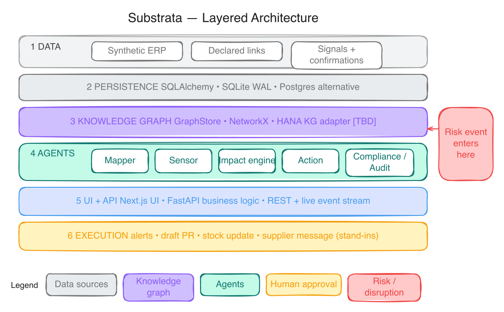
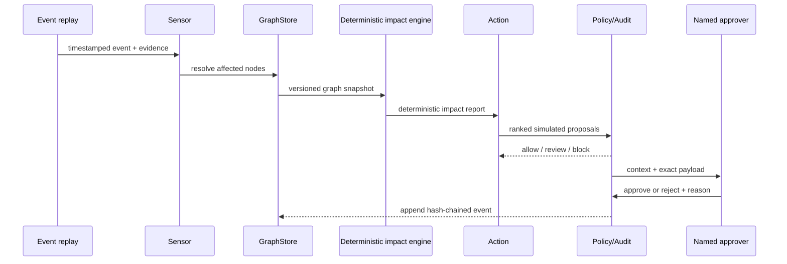

# Substrata architecture proposal

The approved production-platform migration adds `substrata.platform` alongside
the legacy replay, with portable tenant-scoped persistence, immutable graph
revisions, measurement provenance and atomic graph/audit writes. See
[Platform migration](PLATFORM_MIGRATION.md) for implemented contracts and gates.
Platform endpoints use verified OIDC claims and role checks. Tenant IDs are never
selected by request headers; the legacy reset route is absent in platform mode.
The tenant impact analysis uses deterministic services, conservative evidence-support
bounds and full-interruption exposure ranges. It reuses the existing runway and
bounded path calculations; LLMs have no arithmetic authority.
Tenant workflow records store staged import validation, human entity resolution,
applied versions and rollback reasons. Import application and graph/audit writes
use a shared transaction.
Policies and approval decisions use verified actor roles, sourced spend limits,
graph/policy hashes and SLA expiry; execution requires a separate adapter gate.
Read-only OData, REST and signed webhooks enter through adapter contracts and
validated graph/import services; external endpoint credentials stay on the server.
The feature-flagged tenant surface uses OIDC/PKCE and in-memory bearer tokens;
product workflows call typed tenant endpoints and reuse the existing graph view.
The platform workspace, printable report and supplier confirmation portal share
an English/Hindi catalog and browser-persisted language choice; full locale and
accessibility QA remains a release gate.
The platform adds tenant-scoped event feeds, durable leased work records and
stateless authenticated MCP/A2A adapters around deterministic services. Request
correlation, database readiness and basic process metrics support local operations.
ASGI observability follows each response through its complete body, including
streaming responses and failures. HTTP metrics use bounded method/route-template
labels and include response counts, in-flight requests and latency histograms.
Trace IDs follow validated W3C traceparent contexts; optional application-owned
OpenTelemetry providers export batches over OTLP/HTTP with a locally enforced
sample ratio. Vendor tracestate, baggage, credentials, raw paths/query strings
and business payloads are excluded, and providers shut down with the API lifespan.
Queue submission creates a producer span and stores only traceparent alongside
the durable job metadata. Each worker attempt starts a consumer span linked to
that producer; a restart does not require in-memory trace state. HTTP provider and
connector operations use child client spans and pass only traceparent. Worker
logs include coarse job type, attempt, status, duration and trace/span IDs without
business payloads. Persisted assessment ISO timestamps are validated back into
aware datetimes at dispatch, preserving the deterministic engine's time contract.
Tenant document vectors, exact passages and provider-neutral extraction feed only
inferred link proposals. Durable cost reservations gate live provider calls.
Single-use supplier tokens bind confirmation to tenant/request/link inputs;
responses revise the graph and emit attributable training labels atomically.
Supplier labels feed a versioned gradient-boosted scorer with independent
calibration/test supplier groups and explicit activation gates.
Tenant-scoped RSS/Atom event ingestion, durable work records, and authenticated
MCP/A2A facades now connect to the same deterministic services. Request logs,
readiness checks and process counters are implemented; deployment/backups and
feed coverage remain subject to the operational gates in PLATFORM_MIGRATION.md.
PostgreSQL regression checks run through the restricted runtime role and cover
every tenant table, transaction-local context reset, pgvector retrieval, immutable
import history, concurrent graph/audit commits and a checkpointed agent plan
resumed through a new connection pool before governed dry-run execution.
`scripts/verify_postgres.py` starts a disposable pgvector database on an ephemeral
loopback port and supplies the test admin URL only to its pytest child process.
It uses a generated local password and removes its owned container/anonymous
volume afterward; it does not reuse the application's Compose database.
The `platform.backups` envelope uses a distinct 32-byte key and a random GCM nonce
per archive. Its encrypted manifest and custom-format dump share one authentication
tag. Recovery stages a private ciphertext copy, verifies the whole tag, then streams
dump bytes to its consumer. Changes to the original archive cannot affect that
verified stream. Key/artifact creation is exclusive; existing evidence is never
overwritten, and interrupted encryption removes only its own incomplete artifact.

The local workspace integrates document storage, evidence indexing/search/discovery,
signed supplier confirmation previews and durable job operations through the same
verified bearer transport. Risk-review controls invoke the existing A2A task handler;
job status, pinned graph version and checkpoints are visible, and dispatch refreshes
the current assessment/runway/audit views. Viewers can retrieve evidence and inspect
work; write controls follow analyst/admin roles and the API remains authoritative.
English and Hindi copy cover these panels. Local supplier previews require a separate
development signing key and never send outbound mail.
Supplier portal fragments are captured only in memory before URL removal; effect
cancellation preserves the captured token during React development checks. Report
exports use the saved assessment's input snapshot and reject a missing or mismatched
snapshot instead of substituting the current network.
Workspace event intake calls the existing sourced-event endpoint, with local
observation times converted to UTC. Named alert-rule controls reuse the tenant
subscription policy and retain the administrator requirement. Heuristic category,
severity and entity-review boundaries are explicit; rule edits affect new intake
and do not resend historical alerts. No new feed transport is introduced.
Approval delegation controls reuse the existing governed endpoint, require a
reviewer subject/reason and display the resulting assignment and portal notice.
They do not create roles or approvals; the backend checks assignment, tenant,
approver role, policy and separation of duties when a decision is submitted.
The same tenant approver-role restriction applies to delegation, including an
administrator excluded by that policy. Unauthorized attempts leave assignment,
notifications and audit unchanged. An authorized delegation against changed graph
or policy inputs, or an elapsed SLA, records expiry and requires a fresh action
instead of issuing a new review assignment.
Policy edits start from the complete stored policy instead of replacing hidden
controls with defaults. The editor exposes approval hours and the optional USD
inference budget, preserves configured roles/separation/action kinds, and retains
provenance for unchanged measurements. Changed measurements carry the named
administrator's stated reason as a workspace assumption; the audit still records
the authenticated actor. Empty required inputs are rejected instead of becoming
zero; a blank inference budget explicitly removes live-inference authorization,
while zero remains a configured budget. A cross-stack regression submits the
actual TypeScript edit through the policy API and verifies unchanged tenant
controls and enforced cost reservations. The component resets when the server
policy changes and preserves draft fields across unrelated workspace refreshes.
Connector controls enumerate only the authenticated tenant's configured resources.
The browser flattens bounded JSON rows into UTF-8 CSV, quoting multiline/Unicode
values and rejecting ambiguous flattened columns. Preview staging keeps the
connector provenance and uses the existing import schema fingerprint, mapping,
review/apply and rollback endpoints. A cross-stack test runs the actual TypeScript
converter against the Python import API with the synthetic OData fixture; it checks
tenant scoping, provenance, idempotent apply and retained history after rollback.
The Python CI job installs Node 24 for this bridge test; backend-only environments
without Node skip that one check.
Identity review presents name-rule and embedding similarity separately and requires
an explicit decision for every incoming identity plus a reason. The existing
resolution endpoint validates tenant, role and candidate membership; resolving
only stages the reviewed import, while applying creates the graph revision.
Reviewed identity merges and same-ID updates retain existing identifiers,
attributes and sourced measures omitted by incoming columns. Explicit incoming
facts replace the corresponding values. Within-upload candidates follow a stable
ID ordering, creating an acyclic review graph; chained decisions resolve to a
survivor before aliases are deleted. Overlapping scalar/nested mapping paths fail
validation before parsing rows. The connector bridge verifies that similar mock
vendor names cannot bypass this review simply because the graph was empty.
The scorer panel reads a dedicated tenant model-record list during workspace
refresh, so older versions are not hidden by unrelated recent workflow records.
Training and activation reuse existing administrator-only endpoints; the server
enforces supplier-label minimums, independent holdouts, activation quality gates
and the synthetic-data restriction. API regressions cover these controls, tenant
isolation and retirement of the previous active version. Local Docker artifacts
live in a named registry volume writable by the API's unprivileged user and
mounted read-only by workers. Database records and artifact hashes remain linked;
model files are server-generated and cannot be uploaded through the workspace.
Impact formula `platform-runway-v2` composes source-to-material and
material-to-plant paths before establishing impact certainty, support bounds and
citations. Product revenue requires both plant and product support, counting
shared edges once in each conjunction. A BOM product without a graph route keeps
a conservative zero-to-upper revenue range with an explicit missing-route reason.
Full-route depth, path and combination limits propagate truncation. These remain
Fréchet/union evidence-support bounds, not calibrated disruption probabilities.
Durable jobs fence each lease with a fresh internal ownership marker. Workers
verify ownership and the lease deadline before starting work, before each plan
step/checkpoint, and before persisting success or retry state under row locks.
Late attempts return `lease_lost` without changing a newer attempt's state or
audit entries; ownership markers are redacted from record responses. Recovery can
reuse the existing idempotent assessment result if a tool completed before its
lease was lost. SQLite and PostgreSQL regressions simulate both late success and
late failure after reclamation. Fencing does not preempt an in-flight provider
call; whole-job cancellation/deadlines and tenant-wide execution-rate budgets
remain separate pending work.
Public auth configuration/exchange and supplier describe/reply endpoints enforce
a bounded per-process budget of 30 requests per minute per fixed endpoint and
transport peer before provider or token work. Forwarding headers and credentials
are not used as keys; authenticated tenant limits remain independent. This is a
local guard, not a distributed ingress limiter. Manual `/events/poll` calls now
enqueue a new job per request instead of reusing a date-only terminal job.
Clients needing retry idempotency can still submit an explicit key through
`/jobs`; feed-item deduplication remains authoritative during repeated polls.
`platform.backup_ops` exports a REPEATABLE READ snapshot; native `pg_dump` and the
encrypted manifest use the same committed state. The manifest records graph hashes,
audit heads, schema version and table counts. Native tool credentials stay in the
child environment and tool execution has a deadline. Restore authenticates before
creating a new database and uses a single transaction; existing databases are
refused. Database roles/ACLs are provisioned separately after recovery. CI runs the
two-container synthetic recovery drill, including a concurrent graph write,
historical reads, audit verification, RLS/vector checks and a restored queued job.

> **Current implementation:** The local prototype implements SQLite/SQLAlchemy/Alembic, NetworkX graph/impact services, mock-first evidence mapping, confirmations, replay, simulated actions, approval/audit, FastAPI/SSE and the static-exported Next.js dashboard. See BUILD_PLAN.md for verification and DECISIONS.md D010–D015 for simplifications. Broader integrations and production topology below remain design targets.

## 1. Goals and boundaries

Substrata is proposed as an evidence-aware analysis and response layer above supply-chain systems of record. **[Design]** It must preserve the distinction between declared, inferred, confirmed and rejected relationships; reproduce every impact calculation from versioned inputs; and require a named human for high-impact actions. **[Design]**

It is not an ERP, master-data replacement, sanctions-screening product, legal due-diligence service or autonomous purchasing system. **[Design]** The prototype uses synthetic SAP-shaped records and simulated actions only. **[Design]**

## 2. System context

*Figure 3 — Integration targets are shown for context; no production SAP connection is claimed. **[Design]** **[TBD]***

| Actor or system | Exchanges with Substrata | Boundary |
|---|---|---|
| Supply-risk analyst | Scenario, evidence review, inferred-link decision | Authenticated user role **[Design]** |
| Procurement/planning approver | Action review, reason and approve/reject decision | Cannot approve a stale snapshot **[Design]** |
| Synthetic ERP adapter | Vendor master, purchasing documents, BOM, plant stock and lead times | Stand-in for SAP-shaped data **[Design]** |
| Declared-network adapter | Declared supplier relationships | Stand-in for SAP Business Network / Ariba-shaped records **[Design]** |
| Public-signal adapter | Tenant RSS, GDELT DOC, U.S. NWS alerts, European MeteoAlarm warnings, OFAC SDN and ITA CSL name candidates, and field-mapped JSON APIs | Host allowlists, source attribution, provider field maps and area selection are operator-controlled; screening candidates require human review |
| Ownership adapter | Direct/ultimate parent data shaped like GLEIF output | Not a beneficial-ownership register **[Design]** |
| Notification adapter | Signed supplier portal reply, SMTP confirmation email and optional tenant approval notices | Recipients are tenant-scoped, encrypted at rest and delivered only by configured production workers |
| Simulated execution adapter | Alert, requisition draft, safety-stock change and supplier-message preview | Cannot mutate a real external system **[Design]** |

## 3. Layered architecture

*Figure 4 — Each layer is replaceable through typed interfaces. **[Design]***

### Layer 1 — Data

- Synthetic ERP-style vendor, purchasing, BOM, stock and lead-time records. **[Design]**
- Declared supplier relationships as a Business Network / Ariba-shaped stand-in. **[Design]**
- Replayed and submitted events, with tenant-configured RSS, GDELT DOC and U.S. NWS active weather adapters. **[Design]**
- Direct and ultimate parent records; never represent these as beneficial ownership. **[Design]**
- Simulated supplier confirmations. **[Design]**

### Layer 2 — Persistence

SQLAlchemy is the proposed data-access boundary. SQLite in WAL mode is the local default and must be resettable by a deterministic seed; PostgreSQL in Docker Compose is the drop-in shared option. **[Design]** See [Data model](DATA_MODEL.md).

### Layer 3 — Knowledge graph

`GraphStore` projects versioned database records into a NetworkX working graph and writes governed relationship changes back to the database. **[Design]** A SAP HANA Cloud Knowledge Graph adapter is a stretch target only if the finale environment supplies a suitable service and entitlement. **[TBD]** Neo4j is intentionally not in the proposal. **[Design]**

### Layer 4 — Agents and tools

LangGraph coordinates the implemented risk-review states—evidence mapping, event sensing, relationship review, deterministic impact, mitigation drafting, policy checks, approval and audit—and pauses at named human checkpoints. A typed workflow remains the offline compatibility fallback. A separate LangGraph workflow controls the read-only assistant's retrieval, optional web-search, generation and validation states. Neither graph replaces deterministic assessment, policy or approval services. **[Implemented]** Three MCP boundaries keep capabilities narrow:

| Proposed MCP server | Example tools | Permitted effects |
|---|---|---|
| Evidence and graph | `evidence.search`, `entity.resolve`, `graph.paths`, `graph.propose_edge` | Read evidence/graph; propose an inferred edge **[Design]** |
| Planning | `inventory.snapshot`, `bom.where_used`, `simulation.calculate`, `sourcing.alternatives` | Read inputs and calculate/draft options **[Design]** |
| Governance | `policy.evaluate`, `approval.request`, `audit.append`, `audit.verify_chain` | Block/review, queue a human, append audit events **[Design]** |

Authenticated MCP and A2A endpoints expose typed tenant tools; broad external
client interoperability has not been verified, and no SAP affiliation is claimed.

The current offline slice exposes typed Mapper, Sensor, deterministic-impact, Action and
Compliance/Audit skills over the shared tool registry. The code retains `cascade`
only in legacy internal API names; every user-facing responsibility is the deterministic
impact engine, not an LLM agent. Tenant jobs persist typed inputs, retries, results and
checkpoints. The LangGraph risk-review plan maps evidence, resolves the event, pauses for
relationship review when needed, invokes version-pinned deterministic impact, gathers
mitigation drafts, applies policy, pauses for named approval, and verifies audit integrity.
All external actions remain simulated. A2A `tasks/send` queues this plan and `tasks/get`
returns its tenant-scoped state and completed artifacts.

The domain assistant retrieves tenant-scoped graph facts, exact evidence passages
and saved deterministic reports, then may add bounded Tavily results for current
public information. LangChain assembles only this controlled context. Every
material claim must cite a returned source and is labelled `known`, `inferred` or
`unknown`; public-web evidence is always `inferred`. The assistant has no mutation
tools, does not require a vector database, and cannot confirm a relationship,
calculate impact, approve an action or write to SAP.

### Layer 5 — API and experience

FastAPI contains all calculations, orchestration, policies and persistence. **[Design]** Next.js App Router and TypeScript are the preferred client; it is mostly client-rendered and uses Cytoscape.js for the graph and MapLibre for the map. **[Design]** Browser-only libraries load dynamically with server-side rendering disabled. **[Design]**

Replay updates travel directly from FastAPI to the browser by SSE; WebSocket is reserved for a proven two-way need. **[Design]** Next.js route handlers and Server Actions contain no domain logic and do not proxy the stream. **[Design]** Vite/React is the fallback if the team cannot operate Next.js reliably. **[Design]**

### Layer 6 — Execution

The demo can render SAP-shaped alert, requisition-draft, safety-stock-update and supplier-message payloads. **[Design]** All are stand-ins and carry `external_execution: simulated_only`. **[Design]**

## 4. Agent sequence and human gate

*Figure 5 — Agents use bounded tools; deterministic policy controls the approval gate. **[Design]***

Mermaid sequence fallback

## 5. State machine

| State | Entry condition | Allowed next states | Failure handling |
|---|---|---|---|
| `INGESTED` | Valid event/evidence schema | `MATCHED`, `IGNORED`, `NEEDS_REVIEW` | Invalid input is rejected **[Design]** |
| `MATCHED` | Entity match above configured rule | `ANALYSING`, `NEEDS_REVIEW` | Preserve candidates and scores **[Design]** |
| `ANALYSING` | Immutable snapshots acquired | `OPTIONS_READY`, `INCOMPLETE` | Missing units/stock never become zero **[Design]** |
| `OPTIONS_READY` | Tool-returned options scored | `AUTO_RECORDED`, `AWAITING_APPROVAL`, `BLOCKED` | Policy defaults to review/block **[Design]** |
| `AWAITING_APPROVAL` | Named approval required | `APPROVED`, `REJECTED`, `EXPIRED` | Snapshot/version change expires request **[Design]** |
| `APPROVED` | Valid role and reason | `SIMULATED`, `FAILED` | Prototype has no real execution method **[Design]** |
| `SIMULATED` | Payload rendered | `AUDITED` | Record failure and correlation ID **[Design]** |
| `AUDITED` | Hash-chained event appended | terminal | Chain verification remains available **[Design]** |

## 6. Deterministic and model boundaries

| Work | Pretrained model allowed? | Deterministic authority |
|---|---:|---|
| Candidate name retrieval | Yes: embeddings **[Design]** | Identifier normalization and candidate constraints |
| Relationship extraction | Yes: schema-constrained LLM with evidence spans **[Design]** | JSON validation, evidence requirement and status transition |
| Event classification/rationale | Yes **[Design]** | Entity thresholds, deduplication and scenario trigger |
| Graph traversal/path confidence | No | Versioned graph algorithms **[Design]** |
| Inventory, runway and priority arithmetic | No | Typed formula service **[Design]** |
| Action feasibility and spend/risk policy | Rationale only | Rules and tool-returned values **[Design]** |
| Audit hashes and approval validity | No | Governance service **[Design]** |

The implemented platform trains and calibrates a small gradient-boosted link
scorer on supplier-response labels; the registry enforces explicit activation and
synthetic-data gates. It does not fine-tune an LLM. A GNN remains an unimplemented
research idea rather than the current scorer or governed graph record.

## 7. Failure and recovery design

| Failure | Observable behavior | Recovery |
|---|---|---|
| LLM timeout or invalid JSON | Agent step marked failed; no edge/action written | Retry once with same schema or use cached fixture **[Design]** |
| Event source unavailable | Live adapter reports unavailable | Continue deterministic replay **[Design]** |
| Ambiguous entity | Scenario enters `NEEDS_REVIEW` | Analyst selects/rejects candidate **[Design]** |
| Graph cycle/path explosion | Calculation stops at configured depth/node budget | Return partial result plus explicit truncation **[Design]** |
| Unit or snapshot mismatch | Impact result is `INCOMPLETE` | Correct data and create new snapshot **[Design]** |
| Approval becomes stale | Decision endpoint rejects it | Regenerate options under current versions **[Design]** |
| Audit chain mismatch | Scenario blocked from further action | Preserve evidence and investigate copied chain **[Design]** |
| SAP adapter unavailable | Readiness reports adapter unavailable | Use local adapter; do not relabel it SAP **[Design]** |

## 8. Security and governance work still required

The retained prototype is not a production security boundary. The separate
platform implements verified OIDC roles, tenant RLS, encrypted contact storage,
file-based secrets and redacted logs. Customer IdP validation, production secret
management/TLS, retention, source licensing, threat modelling and incident handling
remain release gates. Remaining local implementation gaps are tracked in
[PLATFORM_REMAINING.md](PLATFORM_REMAINING.md); passing offline controls alone does
not establish production readiness.
