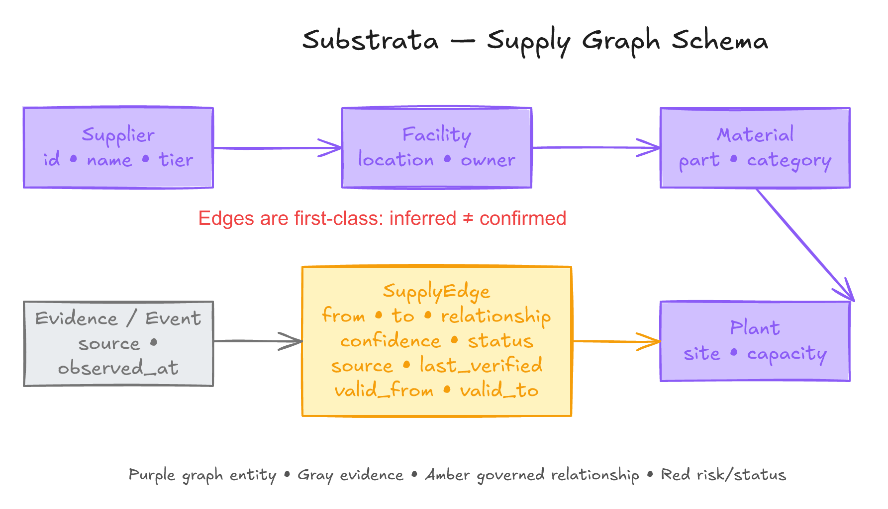

# Data model proposal

> **Status:** M1.1 implements SQLite WAL connection/transaction helpers and an Alembic baseline containing only schema history. Domain tables and the logical model below remain planned. **[Design]**

## 1. Modelling rules

- The relational database is authoritative; the graph is a versioned projection. **[Design]**
- Tier is calculated relative to a focal product/plant and path, not stored as universal truth. **[Design]**
- Every relationship carries confidence, source, status and verification time. **[Design]**
- Quantities require a unit and snapshots require an `as_of` time. **[Design]**
- Missing, zero and not-applicable are different values. **[Design]**
- Synthetic IDs and facts are visibly separated from public event context. **[Design]**



*Figure 7 — Conceptual view; the authoritative graph types are listed below. **[Design]***

## 2. Graph node types

| Type | Proposed minimum fields | Key constraint |
|---|---|---|
| `Product` | `id`, `name`, `product_family`, `manufacturer_id` | Synthetic product IDs in demo **[Design]** |
| `Component` | `id`, `part_number`, `description`, `unit`, `requalification_days` | Unit and lead-time provenance required **[Design]** |
| `SupplierSite` | `id`, `legal_entity_name`, `site_name`, `country_code`, `identifiers` | Legal entity and producing site remain distinguishable **[Design]** |
| `Plant` | `id`, `name`, `country_code`, `capacity_unit` | Manufacturer's consuming/assembly site **[Design]** |
| `Region` | `id`, `name`, `region_type`, `geometry_ref` | Geography is not proof of supply **[Design]** |
| `Event` | `id`, `event_type`, `observed_at`, `source_id`, `severity` | Immutable source time and replay time are separate **[Design]** |
| `AlternativeSupplier` | `id`, `supplier_site_id`, `component_id`, `qualification_status` | Candidate, not approved source **[Design]** |

## 3. Graph edge types

| Edge | Direction and fields | Meaning |
|---|---|---|
| `SUPPLIES` | `SupplierSite → Component`; `share`, `lead_time_days` | Site supplies component or input **[Design]** |
| `USED_IN` | `Component → Product` or `Component → Plant`; BOM quantity/unit | Where-used relationship **[Design]** |
| `LOCATED_IN` | entity/site/plant → `Region` | Geographic containment **[Design]** |
| `OWNED_BY` | `SupplierSite → SupplierSite/legal entity reference` | Direct/ultimate-parent relationship with source scope **[Design]** |

Every edge also has `confidence`, `source_ids`, `status`, `last_verified`, `valid_from`, `valid_to` and `graph_version`. **[Design]** Allowed status values are `declared`, `inferred`, `confirmed`, `rejected` and `expired`. **[Design]** Only a confirmation workflow may move `inferred` to `confirmed`; expiry and rejection are retained for history. **[Design]**

## 4. Relational persistence

| Table group | Proposed tables | Important fields / constraints |
|---|---|---|
| Graph | `graph_nodes`, `graph_edges`, `edge_evidence` | Unique typed IDs; foreign keys; status transition check **[Design]** |
| Synthetic ERP | `vendor_master`, `purchasing_documents`, `bom_items`, `plant_stock`, `lead_times` | Dataset version, unit, `as_of`, source kind **[Design]** |
| Evidence | `evidence_records`, `source_snapshots` | URL, observed time, hash, permitted excerpt, license note **[Design]** |
| Events | `events`, `event_entity_matches` | Event time vs ingest/replay time; candidate scores **[Design]** |
| Agents | `agent_runs`, `tool_calls` | Agent, input/output schema version, status, correlation ID **[Design]** |
| Scenarios | `scenarios`, `impact_results`, `action_proposals` | Graph/inventory/formula/policy/prompt versions **[Design]** |
| Human work | `confirmation_requests`, `confirmation_responses`, `approval_queue`, `approval_decisions` | Named actor, role, reason, expiry and snapshot IDs **[Design]** |
| Audit | `audit_events` | Sequence, previous hash, payload hash, actor, timestamp **[Design]** |
| Evaluation | `evaluation_runs`, `evaluation_examples`, `evaluation_metrics` | Dataset split/version, seed, model/prompt, target/result distinction **[Design]** |
| Embeddings | `embeddings` | Entity/evidence ID, provider/model, vector, created time **[Design]** |

### Proposed indexes

- `(node_type, normalized_name)` and unique external identifier where authoritative. **[Design]**
- `(from_node_id, to_node_id, edge_type, valid_from)` on graph edges. **[Design]**
- `(status, last_verified)` for confirmation/expiry queues. **[Design]**
- `(event_type, observed_at)` and `(entity_id, match_score)` for sensing. **[Design]**
- `(scenario_id, sequence)` unique on audit events. **[Design]**
- `(dataset_version, split)` for reproducible evaluation. **[Design]**

## 5. Confidence and provenance

Confidence is a versioned workflow score, not automatically a calibrated probability. **[Design]** An inferred edge is invalid without one or more `edge_evidence` rows. **[Design]** A source record includes reliability/recency features separately so the UI can explain why a score changed. **[Design]** Thresholds and weights remain **[TBD]** until synthetic evaluation.

```json
{
  "edge_id": "edge_site_b_shared_chip",
  "edge_type": "SUPPLIES",
  "from_node_id": "supplier_site_b",
  "to_node_id": "component_shared_chip",
  "confidence": 0.72,
  "status": "inferred",
  "source_ids": ["evidence_public_2025_10_22"],
  "last_verified": null,
  "graph_version": 3,
  "synthetic": true
}
```

This record is an illustrative synthetic shape, not a statement about a real supplier. **[Design]**

## 6. Snapshots and versioning

Each scenario pins:

```text
scenario
 ├─ graph_version
 ├─ erp_dataset_version
 ├─ inventory_snapshot_id
 ├─ event_snapshot_id
 ├─ formula_version
 ├─ policy_version
 ├─ prompt_version
 └─ model/provider identifier (when used)
```

Changing any pinned input creates a new run rather than editing the old result. **[Design]** The hash-chained audit log detects later modification of copied records but cannot prove that the original source was true. **[Design]**

## 7. Retention and access questions

Retention periods, regional residency, role-to-field access, supplier confidentiality, deletion handling and licensing of public excerpts are **[TBD]**. Production design would require tenant isolation, encrypted backups, field-level authorization and a formal data-processing assessment; none is claimed here. **[Design]**
