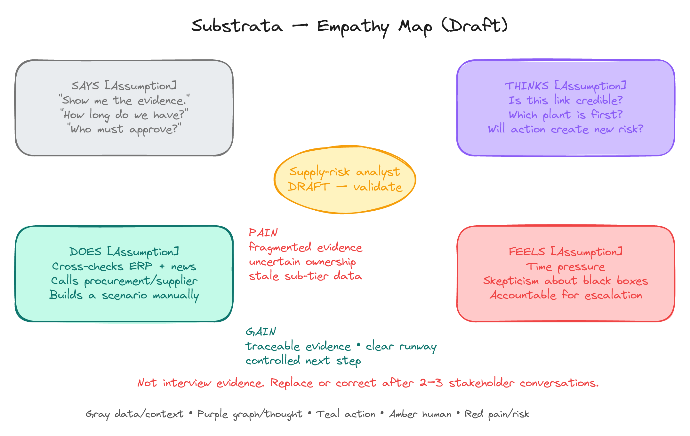
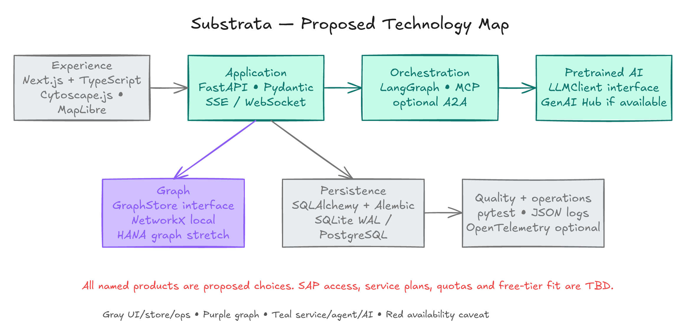
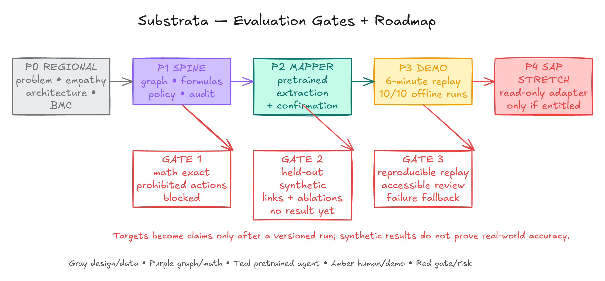
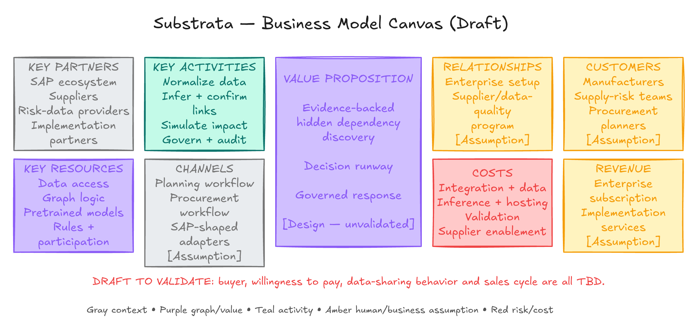

# Substrata: SAP Hackfest Regional Idea Pitch Handoff

This handoff maps Substrata to every slide in the official 11-slide regional-round template. It is written for a 10-minute pitch and separates short on-slide copy from the explanation the presenter should give aloud.

## 1. Use this handoff correctly

- Keep the project name **Substrata**.
- Replace every square-bracket placeholder for team details or completed SAP learning before submission.
- Keep the words **synthetic**, **simulated**, **proposed**, and **target** wherever they appear. They prevent the pitch from claiming evidence that the team does not have.
- Do not say that Substrata is connected to a live SAP system. The current product uses synthetic SAP-shaped data and read-only adapter patterns. SAP BTP, SAP HANA graph/vector, SAP Business Network, SAP S/4HANA, SAP AI Core, and Joule/A2A are integration targets subject to access and entitlement.
- Do not say that an LLM calculates supply-chain impact. LLMs only assist with evidence extraction, event classification, and drafting. Deterministic Python code performs graph traversal, stock-cover arithmetic, policy checks, and audit verification.
- Do not claim real-world accuracy, ROI, cost savings, customers, or deployed procurement actions. The current measurements come from a constructed synthetic fixture.
- The **18, 90, and 72 days** are business-scenario assumptions, not a hackathon schedule.
- The core system does not fine-tune an LLM or train a GNN. The broader platform contains an optional, separately governed gradient-boosted link scorer trained from reviewed labels. Keep this out of the main pitch unless a judge asks.

## 2. Ten-minute narrative

| Time | Slides | Narrative job |
|---:|---|---|
| 0:00-0:35 | 1-2 | Introduce Substrata, the team, and the one-line purpose. |
| 0:35-2:05 | 3-4 | Explain false diversification, the user, and the current decision gap. |
| 2:05-4:15 | 5 | Explain how evidence becomes a verified link, deterministic runway, and a governed response. |
| 4:15-5:35 | 6 | Show the implemented stack, the SAP fit, and what the team learned rather than claiming a live SAP integration. |
| 5:35-7:10 | 7 | Define impact, success measures, assumptions, and risks. |
| 7:10-8:35 | 8 | Show a feasible finale plan built around the smallest credible proof. |
| 8:35-9:35 | 9 | Close with why the idea should advance and show the evidence sources. |
| 9:35-10:00 | 10 | Invite questions. |
| Internal | 11 | Complete the submission checklist; do not present this as content. |

## 3. Slide-by-slide content

### Slide 1: Event cover

**Template heading:** Hackfest 2026, Regional College Round, Idea Pitch

**Action:** Keep the official event cover unchanged. Do not place product content over sponsor or partner marks.

**Presenter opening:**

> Good morning. We are presenting Substrata under the Resilient Supply Chains theme. Substrata helps a manufacturer see when apparently independent suppliers share the same hidden upstream dependency, calculate how long remains before production is exposed, and prepare a governed response.

### Slide 2: Project and team

**Project / Idea Name**

> **Substrata**<br>
> *See what your suppliers secretly share.*

**Team Name**

> [TEAM NAME]

**Team Members**

> 1. [NAME - role in this project]<br>
> 2. [NAME - role in this project]<br>
> 3. [NAME - role in this project]<br>
> 4. [NAME - role in this project]<br>
> 5. [NAME - role in this project, only if applicable]

**Department / Semester**

> [DEPARTMENT] | [SEMESTER]

**Small footer line, if space permits**

> Agentic early warning for hidden Tier-N supply dependencies.

**Presenter note:** Do not spend time listing technologies here. Give each person a responsibility such as research and business design, data and graph, backend and AI, frontend and experience, or testing and presentation.

### Slide 3: Problem and theme

**Template heading:** What problem are you solving?

**Selected theme**

> **Resilient Supply Chains**

**Problem statement, 2-3 sentences**

> Manufacturers can see their direct Tier-1 suppliers, yet several of those suppliers may rely on the same deeper supplier, site, material, owner, region, or route. A disruption at that hidden Tier-N node can disable multiple supposedly independent supply paths at once. Evidence is fragmented, so planners may discover the concentration only after stock is already running out.

**Who experiences the problem?**

> Supply-risk analysts, procurement teams, plant planners, and the managers who approve mitigation decisions.

**When and where does it occur?**

> During supplier onboarding, periodic risk reviews, and fast-moving disruptions, especially when Tier-N relationships are split across ERP records, documents, news, and supplier responses.

**Concrete example**

> In our synthetic automotive scenario, three Tier-1 supplier groups appear independent but share one deeper semiconductor source. A replayed disruption exposes the common point of failure.

**Visual placement**

Use the hidden-dependency diagram on the right half or across the lower 40% of the slide. Crop the outer whitespace, but do not remove the words “Mapper agent confidence” or “Supplier confirms or rejects link.”


**What to say**

> The failure is not simply that data is missing. The dangerous failure is false diversification. Three contracts look like three independent options, but the graph beneath them may contain only one real source. Substrata treats that relationship as a claim with evidence and confidence, then asks for verification rather than silently declaring it true.

**Truth note:** The suppliers and network shown are invented. The problem framing is inspired by public supply disruption reporting, but Substrata does not claim access to any company's private supplier graph.

### Slide 4: Users and current gap

**Template heading:** Who needs this solution, and why?

#### Target users

> **Primary:** supply-risk analyst or supply planner<br>
> Needs traceable evidence, affected plants/components, and clear decision time.<br>
> **Secondary:** procurement approver<br>
> Needs exact options, assumptions, cost/risk context, and an accountable approval record.<br>
> **Participant:** supplier contact<br>
> Confirms or rejects an uncertain relationship through a bounded request.

#### Current approach

> Teams often reconcile direct-supplier records, spreadsheets, documents, alerts, and calls manually. A conventional Tier-1 view can show who has a contract without revealing the upstream dependency shared by multiple contracts. Analysis and approval are separated, so the reason for a decision may be difficult to reconstruct later.

#### Opportunity

> Join evidence and supply relationships in a versioned knowledge graph, keep uncertain links visibly inferred, ask humans or suppliers to confirm them, and calculate decision runway before recommending a response. The result is earlier attention with less false certainty.

**Concrete scenario to place under the three boxes**

> **Synthetic example:** 1,800 units available at 100 units/day gives 18 days of cover. A replacement takes an assumed 90 days to qualify, leaving a 72-day exposure window.

**Business model sentence for this slide**

> Proposed buyer: a manufacturer or supply-risk function. Proposed value: evidence-backed hidden-dependency discovery, decision runway, and governed response. Subscription and implementation pricing remain unvalidated assumptions.

**Optional Q&A visual:** The full empathy map is a draft, not interview evidence. Use it only as a backup slide or when the judges ask about design thinking.



**What to say**

> Our primary persona is not asking for another red risk score. The analyst asks three practical questions: Is this relationship credible? Which plant is affected first? Who is authorized to act? The current empathy map is explicitly a hypothesis that we must correct through stakeholder interviews.

### Slide 5: Proposed solution

**Template heading:** How will your idea work?

#### Solution summary

> Substrata combines supplier records and cited evidence to propose missing Tier-N relationships, then keeps them marked as inferred until a supplier or analyst confirms or rejects them. When a disruption is sensed, deterministic graph code traces the impact to components and plants, calculates remaining runway, compares simulated mitigations, and pauses high-stakes decisions for a named human approver.

#### Key differentiator

> Substrata connects **evidence to confirmation, confirmation to runway, and runway to governed action**. It does not let uncertain AI output become supply-chain truth or allow an LLM to perform the impact arithmetic.

#### User journey / solution flow

Use the four template boxes exactly as follows:

| Template box | Paste this content |
|---|---|
| **Input** | ERP-shaped supplier, BOM, inventory and lead-time records; documents; declared links; disruption event |
| **Analyse / Decide** | Mapper proposes cited links; supplier/analyst verifies; Sensor matches event; deterministic Cascade traces impact and runway |
| **Action** | Compare buffer, expedite, transfer, or alternate-qualification drafts; policy chooses allow, review, or block |
| **Outcome** | Earlier warning, explicit uncertainty, named approval, simulated SAP-shaped payload, verifiable audit trail |

**Architecture sentence beneath the flow**

> Data and evidence feed a versioned graph; bounded agents call deterministic tools; policy and a human gate control all high-impact actions.

**Preferred visual for presenter notes or backup:**


**Optional visual if the slide can replace the four-box flow without becoming crowded:**


**Worked calculation to explain aloud**

```text
cover_days = (on_hand + in_transit) / daily_use
           = (1,200 + 600) / 100
           = 18 days

exposure_window = qualification_days - cover_days
                = 90 - 18
                = 72 days
```

> A positive exposure window means stock cover ends before an alternative is ready. It is not a prediction that the project takes 72 days.

**What is agentic here?**

- **Mapper:** proposes evidence-backed hidden links.
- **Sensor:** classifies a disruption and resolves affected entities.
- **Cascade:** calls deterministic graph and runway services; it does not improvise numbers.
- **Action:** prepares and compares mitigation drafts.
- **Compliance/Audit:** applies policy and records provenance.
- **Human gate:** approves or rejects high-impact actions with a reason.

### Slide 6: SAP technology and learning

**Template heading:** Where do SAP technologies fit?

This slide must distinguish the **working local prototype** from the **SAP-aligned finale path**.

#### Left box: Technology / concept

> **Current prototype**<br>
> Next.js + TypeScript + Cytoscape.js interface<br>
> FastAPI + Pydantic service layer<br>
> NetworkX deterministic graph analysis<br>
> SQLAlchemy + Alembic with SQLite/PostgreSQL<br>
> Gemini primary, Groq fallback, and offline mock for structured extraction<br>
> SSE updates, human approval, and SHA-256 audit chain

> **SAP-aligned integration path, subject to access**<br>
> Read-only SAP S/4HANA procurement, BOM, inventory, and lead-time data<br>
> SAP Business Network / Ariba supplier relationships<br>
> SAP BTP deployment and integration<br>
> SAP HANA Cloud graph/vector services<br>
> SAP AI Core generative AI hub and Joule/A2A as optional adapters

#### Right box: Learning Hub connection

> **Concepts applied**<br>
> End-to-end supply-chain process thinking<br>
> Master data, procurement, BOM, inventory, and planning context<br>
> Clean-core extension and API-first integration<br>
> Responsible AI, human oversight, traceability, and governed automation

> **Before submission**<br>
> Replace this line with the exact SAP Learning Hub course or learning journey completed by each team member: [COURSE / JOURNEY NAME]. Do not claim course completion until it is visible in the learner account.

#### Answer the template prompts

- **Information and process SAP would support:** supplier master, purchasing data, BOM where-used, plant stock, lead times, planning context, approval workflow, and supplier collaboration.
- **Where AI adds value:** extracting relationship claims from text, suggesting entity matches, classifying events, and drafting explanations.
- **Where deterministic logic remains:** graph paths, impact ranges, stock cover, policy checks, approval validity, and audit hashing.

**Visual placement:** If space permits, place the technology map as a narrow lower band. Add a caption: “Current local stack plus entitlement-dependent SAP adapters.” The existing image says “proposed”; keep that word visible.



**Important correction to the diagram:** LangGraph, MapLibre, SAP HANA graph, and SAP generative AI hub are proposed or optional. They are not dependencies in the current working build. The implemented orchestration uses typed Python services and state machines, and the current UI manifest includes Cytoscape.js but not MapLibre.

**What to say**

> We are not using SAP's name as decoration. The workflow naturally consumes procurement, BOM, inventory, planning, and supplier-network information. Our current prototype proves the decision flow locally. If the finale provides the required services, the same interfaces can be connected to SAP data and AI services without moving graph mathematics into a language model.

### Slide 7: Impact and validation

**Template heading:** How will you know it works?

#### Expected impact

> Surface common upstream dependencies before a Tier-1-only view would.<br>
> Express urgency as decision runway rather than a vague risk score.<br>
> Reduce false certainty by separating inferred, confirmed, rejected, and expired links.<br>
> Make every proposed action reviewable through evidence, versions, approver, reason, and audit history.

#### Success measures

> **Link quality:** held-out synthetic precision and recall, with false positives and review volume.<br>
> **Warning:** days of warning gained over an identical Tier-1-only snapshot.<br>
> **Calculation safety:** exact results on hand-calculated cascade fixtures.<br>
> **Governance:** prohibited actions blocked and stale approvals rejected.<br>
> **Human factors:** analyst completion time, errors, and confidence in the explanation.

**Targets, not current claims**

| Measure | Proposed target |
|---|---:|
| Hidden-link precision at review threshold | at least 0.80 |
| Hidden-link recall at review threshold | at least 0.70 |
| Curated cascade calculations | 100% exact |
| Prohibited test actions blocked | 100% |
| Seeded offline replay consistency | 10 out of 10 identical runs |

**Current narrow synthetic baseline, speaker note only**

> The frozen mock fixture produced precision 1.00, recall 0.50, three reviewed claims, and 18 days of warning over the Tier-1-only view. This demonstrates the fixture pipeline, not generalisation or real-world accuracy.

#### Assumptions and risks

| Risk | Mitigation |
|---|---|
| Incomplete or conflicting Tier-N data | Preserve provenance, show uncertainty, and request confirmation. |
| LLM hallucination or malformed output | Require structured JSON, exact evidence spans, schema validation, and review. |
| Confidentiality and source licensing | Use tenant isolation, minimum excerpts, access control, and approved sources. |
| False urgency from assumptions | Show units, source, observation time, range, and incomplete status instead of guessing. |
| Unsafe automation | Keep real procurement changes prohibited; use named approval and dry-run execution. |
| SAP service unavailable at the finale | Keep the offline synthetic replay as the core path; connect only verified entitlements. |

**Optional backup visual:**



### Slide 8: Feasibility and roadmap

**Template heading:** What would it take to build the prototype?

The repository already contains a working local synthetic vertical slice. Frame this slide as the plan to turn it into a finale-ready, SAP-aligned proof, not as starting from zero.

#### 1. Plan

> Interview 2-3 supply-risk or procurement practitioners. Confirm the user decision, required inputs, acceptable uncertainty, and SAP services available to finalists.

#### 2. Design

> Freeze the minimum data contract and user journey. Keep the system boundary clear: cited inference, deterministic impact, policy, human approval, and audit.

#### 3. Build

> Harden Mapper, Cascade, approval, and audit on synthetic data. Add one read-only SAP adapter only if entitlement and test data are available. Preserve an offline replay fallback.

#### 4. Test

> Run hidden-edge evaluation, exact cascade fixtures, failure cases, stale approval tests, usability sessions, and repeated judge rehearsals. Report targets and measured results separately.

#### Feasibility check

- **Smallest finale proof:** discover one hidden dependency, verify it, replay one event, calculate runway, compare simulated actions, approve one, and verify the audit chain.
- **Already available:** interactive graph, evidence-backed discovery, simulated confirmations, event replay, deterministic 18/90/72 runway, mitigation drafts, approval, audit, a tenant workspace, imports, jobs, and report exports on synthetic data.
- **Needed skills:** Python service development, TypeScript/React UI, graph modelling, testing, SAP process learning, and stakeholder interviewing.
- **Needed support:** a confirmed SAP practice environment, a supply-chain mentor, legally usable test data, and feedback from real target users.
- **Deliberate exclusions:** autonomous purchasing, production SAP writes, unbounded web crawling, customer-accuracy claims, and a custom GNN.

**Do not paste a 30-day schedule here.** Use capability gates. The supply-chain values 18, 90, and 72 days are unrelated to project delivery.

**Optional visual:**


### Slide 9: Team and closing

**Template heading:** Why should this idea move forward?

**One-sentence pitch**

> Substrata turns hidden Tier-N uncertainty into evidence-backed links, quantified decision runway, and human-approved response drafts, giving supply teams time to act before a shared dependency stops production.

**Short closing paragraph for the presenter**

> The idea is focused enough to test, relevant to SAP's supply-chain domain, and safe by design. It combines agentic assistance where interpretation is useful with deterministic services where correctness and accountability matter. The regional round can validate the user and business assumptions; the finale can demonstrate one end-to-end, SAP-aligned scenario without pretending to be a production procurement system.

**References / sources for the slide**

Use shortened titles on the slide and keep full URLs in speaker notes:

1. [SAP Hackfest Bengaluru 2026](https://events.sap.com/in-hackfest-bangalore-2026/en_us/home.html)
2. [SAP Learning Hub, student edition](https://learning.sap.com/students)
3. [SAP guidance for building AI agents](https://architecture.learning.sap.com/docs/golden-path/ai-golden-path/build-and-deliver/build-ai-agents)
4. [SAP Supply Chain Orchestration announcement](https://news.sap.com/2025/10/sap-connect-innovative-updates-supply-chain-management/)
5. [Cambridge Supply Chain AI Lab: link prediction](https://www.ifm.eng.cam.ac.uk/research/supply-chain-ai-lab/current-themes/supply-chain-link-prediction/)
6. [Nexperia disruption timeline used as public replay context](https://blog.findchips.com/nexperia-supply-disruption/)

**Draft business model, for Q&A rather than the crowded closing slide**



> The customer, buyer, pricing, willingness to share data, and sales cycle are unvalidated. Present the canvas as a hypothesis and state that stakeholder interviews are the next validation step.

### Slide 10: Questions and answers

Keep the template text:

> **THANK YOU | Questions & Answers**

Optionally add one small footer:

> Substrata | Evidence -> Runway -> Governed Action

**Best opening for Q&A**

> We can show the hidden-link evidence, the deterministic 18/90/72 calculation, or the human approval and audit boundary in more detail.

### Slide 11: Presenter checklist

This is an internal submission-control slide. Complete it honestly and hide it during the live pitch if the organiser permits hidden slides.

| Checklist item | Required action |
|---|---|
| Team has 4-5 eligible students | Confirm names and eligibility. |
| Every member registered for SAP Learning Hub student edition | Verify individually; do not assume team registration covers everyone. |
| Every member has a Universal ID and Hackfest registration | Confirm with the college coordinator. |
| One theme and one idea | Use Resilient Supply Chains and Substrata only. |
| Software-based idea | Substrata is a software platform; no hardware claim. |
| 10-minute pitch plus 5-minute Q&A | Rehearse to 9:30 so there is recovery time. |
| Problem, users, solution, SAP relevance, impact, feasibility | Covered by slides 3-8. |
| Team details shared with coordinator | Complete before submission. |

## 4. Architecture and technology summary for the main deck

If a judge asks for the architecture, answer in six layers:

1. **Inputs:** synthetic ERP-shaped supplier, purchasing, BOM, inventory, lead-time, document, event, and supplier-response data.
2. **Persistence:** SQLAlchemy and Alembic with SQLite for the offline demo and PostgreSQL/pgvector for the tenant platform.
3. **Knowledge graph:** versioned entities and relationships projected into NetworkX for transparent traversal.
4. **Agent workflow:** Mapper and Sensor interpret evidence; Cascade calls deterministic calculations; Action prepares options; Compliance/Audit enforces controls.
5. **Application:** FastAPI/Pydantic owns domain logic; Next.js/TypeScript/Cytoscape.js renders the workspace and receives updates through SSE.
6. **Governance and execution:** named approval, separation of duties, dry-run SAP-shaped payloads, and a hash-chained audit record. No real procurement mutation is enabled.

## 5. Diagram placement map

| Asset | Best use in the official deck | Backup/Q&A use | Important caption |
|---|---|---|---|
| `01-visibility-gap.png` | Slide 3 | Problem explanation | Three visible Tier-1 suppliers can share one hidden Tier-N source. |
| `02-runway-timeline.png` | Slide 4 or 5 if space permits | Explain 18/90/72 | Synthetic business runway, not the hackathon schedule. |
| `03-system-context.png` | Slide 5 | Architecture Q&A | SAP systems are integration targets, not current live connections. |
| `04-layered-architecture.png` | Do not crowd the main deck | Technical Q&A | Current implementation plus explicitly proposed adapters. |
| `05-agent-collaboration.png` | Slide 5 presenter notes | Agent/human Q&A | Deterministic policy and a named human gate control action. |
| `06-autonomy-matrix.png` | Slide 7 if replacing text | Safety Q&A | Separate automatic analysis, review-required action, and prohibited action. |
| `07-graph-schema.png` | Not needed in main deck | Data-model Q&A | Every relationship carries status, confidence, evidence, and version. |
| `08-link-inference-pipeline.png` | Slide 5 alternative | AI Q&A | Pretrained extraction proposes a cited edge; verification changes status. |
| `09-cascade-simulation.png` | Slide 5 alternative | Math Q&A | Graph paths identify impact; deterministic code performs arithmetic. |
| `10-demo-replay.png` | Slide 8 | Demo Q&A | A repeatable synthetic replay proves the workflow, not real-world accuracy. |
| `11-persistence-model.png` | Not needed in main deck | Audit/versioning Q&A | Results pin immutable inputs and versions. |
| `12-tech-stack.png` | Slide 6, small lower strip | Tech Q&A | Some products in the diagram are proposed or entitlement-dependent. |
| `13-deployment-topology.png` | Not needed in main deck | SAP/deployment Q&A | Local path works offline; SAP BTP path is a verified-access stretch. |
| `14-evaluation-roadmap.png` | Slide 7 or 8 | Evaluation Q&A | Targets become claims only after versioned measurement. |
| `15-empathy-map.png` | Slide 4 only if replacing boxes | Design-thinking Q&A | Draft assumptions, not interview evidence. |
| `16-business-model-canvas.png` | Avoid shrinking onto slide 9 | Business Q&A | Buyer, pricing, and data-sharing behavior remain unvalidated. |

## 6. Likely judge questions and short answers

### How is this different from existing supplier-risk or SAP products?

Substrata is not claiming that established products lack multi-tier risk functions. The hackathon thesis is narrower: cited link proposals, a confirmation loop, deterministic runway, and an explicit human approval gate in one traceable workflow.

### Where does Tier-N data come from?

The current prototype uses synthetic ERP-shaped records, synthetic declared relationships, documents, replayed public event context, and simulated supplier responses. A real deployment would require customer-authorized data, licensed sources, and supplier participation.

### What if an inferred link is wrong?

It remains `inferred`, carries evidence and confidence, and enters review. Confirmation, rejection, and expiry are stored as separate states. Inferred exposure is shown as uncertainty rather than silently treated as fact.

### Why use agents instead of one dashboard?

Evidence extraction, event matching, graph analysis, option drafting, policy, and approval have different permissions and failure modes. Named agent roles make those boundaries inspectable. The critical calculations still run in deterministic services.

### Did you train a model?

The core flow does not fine-tune an LLM or train a GNN. It uses pretrained models for structured extraction and deterministic graph code for analysis. The broader platform has an optional gradient-boosted link scorer trained from reviewed supplier labels, with explicit activation gates; it is not the core pitch and has no claimed customer accuracy.

### Is accuracy proven?

No. The current measurements are from a narrow synthetic fixture. They verify pipeline behavior and reproducibility only. Real accuracy requires legally usable enterprise data, held-out evaluation, calibration, and prospective user testing.

### Can the system buy stock or switch suppliers?

No. The prototype creates simulated drafts only. Supplier changes, spend, or real external execution require a named human and a separately configured production adapter that does not exist in the current demo.

### What is SAP doing in this solution today?

Today the data is SAP-shaped, and the interfaces are designed for procurement, BOM, inventory, supplier-network, and approval processes. Live SAP access is not claimed. SAP BTP, HANA graph/vector, Business Network, AI Core, and Joule/A2A are possible finale adapters after entitlement and data access are confirmed.

### Why should the idea advance?

It tackles a specific failure mode, has a working and safe synthetic proof, defines measurable validation gates, and fits SAP's supply-chain domain without pretending to be production-ready.

## 7. Final pitch quality check

- Every slide answers one question and uses no more than one main visual.
- No slide presents a target as a result.
- All synthetic numbers are labelled.
- SAP services are split into “current concept/shape” and “future verified integration.”
- The presenter can explain why 90 minus 18 equals a 72-day exposure window.
- The presenter can explain exactly where the LLM stops and deterministic code begins.
- The presenter can explain who approves a high-impact action and what is recorded.
- The presenter can name the primary user, buyer hypothesis, and unvalidated assumptions.
- The final deck contains team names, exact completed Learning Hub resources, and the required registration details.
