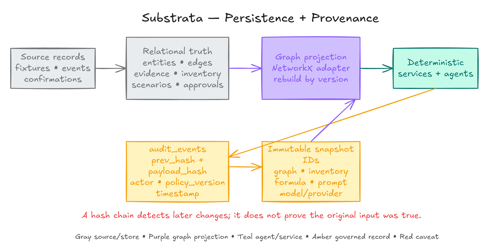
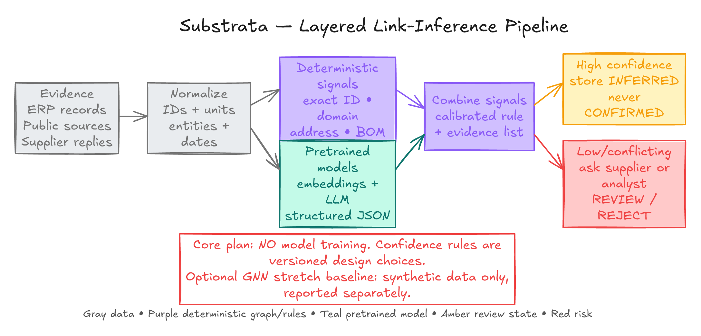
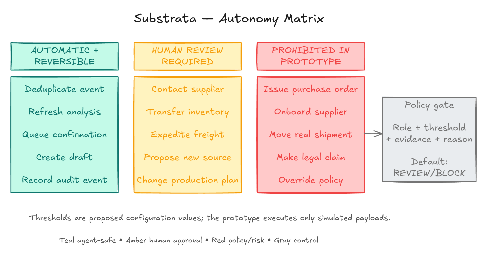

# Substrata Technical Architecture and Technology Handoff

This document is the expanded technical companion to the regional pitch handoff. It explains what the repository currently implements, what remains simulated, how the data and agent flows work, where pretrained AI is used, where deterministic code is authoritative, and how SAP technologies can fit later without being misrepresented as current integrations.

## 1. Executive summary

Substrata is a supply-chain resilience prototype for the **Hidden Tier-N Supplier Dependency AI** problem. It addresses false diversification: multiple Tier-1 suppliers may appear independent while sharing a deeper supplier, facility, material, owner, region, or route.

The working product demonstrates this sequence on synthetic data:

1. Ingest or load supplier, component, plant, inventory, lead-time, document, and event data.
2. Propose missing upstream relationships with evidence and a workflow score.
3. Keep proposed relationships visibly `inferred` until a supplier or authorized reviewer confirms or rejects them.
4. Match a disruption to a graph entity.
5. Traverse a pinned graph snapshot and calculate affected components, plants, stock cover, qualification time, and exposure.
6. Prepare simulated mitigation options.
7. Pause governed actions for a named approver.
8. Record the input versions, actor, reason, payload, and decision in a verifiable audit chain.

Substrata does **not** currently claim:

- a live connection to SAP S/4HANA, SAP Business Network, Ariba, IBP, HANA, SAP AI Core, or Joule;
- access to a real manufacturer's private supplier network;
- real supplier messages or purchase execution in the development demo;
- validated customer accuracy, ROI, service levels, or business value;
- LLM authority over graph traversal, supply arithmetic, approval validity, or audit hashing.

## 2. Product surfaces

The repository now contains a retained demonstration flow and a broader tenant platform.

| Surface | URL | Purpose | Data and execution status |
|---|---|---|---|
| Synthetic replay dashboard | `/` | Judge-friendly hidden-link discovery, supplier reply simulation, event replay, runway, mitigation, approval, and audit | Invented records and simulated actions |
| Tenant platform workspace | `/platform/` | Organisation setup, imports, connectors, graph history, evidence, events, jobs, policies, approvals, reports, and model registry | Local platform scaffold with synthetic fixtures; production configuration still required |
| Supplier confirmation portal | `/confirm/` | Describe a bounded confirmation request and submit confirm/reject response | Development preview uses signed tokens and sends no supplier email by default |
| API documentation | `/docs` | FastAPI-generated endpoint reference | Default CDN assets may require internet; `/openapi.json` remains available locally |
| Health, readiness, metrics | `/health`, `/ready`, `/metrics` | Service and operations checks | Local process and configured-dependency state |

The dashboard is the clearest regional pitch demo. The platform workspace is useful in technical Q&A because it shows how the same idea can become tenant-aware, auditable, and integration-ready.

## 3. Architecture at a glance


**Use this diagram for:** the boundary between data, Substrata, the analyst, simulated actions, and audit.

**Reading note:** “SAP-shaped” means the schema and workflow resemble an SAP enterprise process. It does not mean a live SAP system is connected.

### Six logical layers


| Layer | Current implementation | Expansion path |
|---|---|---|
| Data | Synthetic vendor, purchasing, BOM, stock, lead-time, documents, events, declared links, and simulated confirmations | Customer-authorized SAP data, licensed external signals, and real supplier participation |
| Persistence | SQLAlchemy and Alembic; SQLite for the local replay; PostgreSQL/pgvector for the platform path | Managed PostgreSQL or SAP HANA, after entitlement and performance validation |
| Knowledge graph | Versioned relational records projected into NetworkX through graph services | SAP HANA graph adapter if the finale environment supports it |
| Agent and tool layer | Typed Python workflows, bounded tools, durable jobs, authenticated MCP and A2A endpoints | Additional agent plans or Joule interoperability after contract testing |
| API and experience | FastAPI/Pydantic backend; Next.js/React/TypeScript/Cytoscape.js frontend; REST and SSE | BTP-hosted delivery, enterprise SSO, production observability, and wider accessibility validation |
| Governance and execution | Policies, named approval, separation of duties, dry-run actions, audit chain, exports | Explicitly enabled production adapters with customer controls; no such adapter is assumed today |

## 4. Implemented technology stack

The versions below come from the current project manifests. Use product families rather than patch versions on a pitch slide; keep exact versions for technical questions and reproducibility.

### Frontend

| Technology | Current version / role | Why it is present |
|---|---|---|
| Node.js | 24.x | Supported frontend runtime declared by the project |
| Next.js | 16.4.0, App Router | Static-exportable React application and route structure |
| React | 19.3.0 | Component rendering and local workspace state |
| TypeScript | 5.9.3 | Typed API contracts and UI code |
| Cytoscape.js | 3.34.3 | Interactive supplier/component/plant graph |
| Tailwind CSS | 4.3.3 | Available styling utility pipeline; the product also contains substantial custom CSS |
| Browser `EventSource` | Native browser API | Direct server-sent event stream from FastAPI for the retained replay |

The browser renders server results. It should not independently recalculate confidence, runway, policy, or audit validity.

### Backend and graph

| Technology | Current version / role | Authority |
|---|---|---|
| Python | 3.12+ | Service and domain implementation |
| FastAPI | 0.142.4 | REST, SSE, authentication dependencies, health, readiness, and OpenAPI |
| Pydantic | 2.13.5 | Typed request, response, and structured-output validation |
| NetworkX | 3.7 | Transparent deterministic graph traversal in the local engine |
| SQLAlchemy | 2.0.54 | Database abstraction and transactions |
| Alembic | 1.20.0 | Versioned schema migrations |
| Uvicorn | 0.54.0 | ASGI development/runtime server |
| OpenTelemetry API | 1.45.1 | Trace context and optional export integration |

### Platform-only or optional dependencies

| Technology | Current version / role | Guardrail |
|---|---|---|
| PostgreSQL + pgvector | PostgreSQL 17 image with pgvector | Tenant platform, row-level security, vector retrieval, concurrency |
| psycopg | 3.3.6 | PostgreSQL driver |
| scikit-learn | 1.9.1 | Optional small gradient-boosted link scorer and calibration pipeline |
| cryptography | 50.0.2 | Encrypted supplier contact fields and encrypted backup envelopes |
| PyJWT | 2.15.1 | OIDC/JWT validation |
| openpyxl | 3.1.5 | Bounded Excel ingestion |
| OpenTelemetry SDK/exporter | 1.45.1 | Optional OTLP/HTTP trace export |

### AI providers

The retained demonstration uses an `LLMClient` boundary:

1. **Gemini** is attempted first for structured ownership-claim extraction.
2. **Groq** is attempted once when Gemini fails at the transport, provider, incomplete-output, or invalid-JSON boundary.
3. **Offline mock** is an explicit configuration for a deterministic rehearsal; it is never silently substituted for live AI.

The platform path also contains provider-neutral structured extractors and optional embedding providers. Provider credentials remain server-side and must never be committed, pasted into slides, logs, or screenshots.

### Important corrections to the existing technology diagram


- The diagram is a design map, not a literal dependency inventory.
- **LangGraph is the selected next-step orchestrator but is not yet in the current Python manifest.** Current orchestration uses typed Python workflow/state-machine services, durable jobs, and tool contracts; it remains the offline fallback.
- **LangChain is planned for the grounded domain assistant.** It will retrieve path-specific evidence and return citations with known/inferred/unknown labels; it will not calculate impact or confirm relationships.
- **Google Gen AI SDK is the planned Gemini adapter.** The current provider-neutral `LLMClient`, Groq fallback, and offline mock remain the resilience boundary.
- **MapLibre is not in the current frontend manifest.** The implemented core visualization is Cytoscape.js.
- SAP HANA graph/vector and SAP generative AI hub are entitlement-dependent integration targets, not current connections.
- NetworkX, FastAPI, Next.js, TypeScript, SQLAlchemy, Alembic, SQLite/PostgreSQL, pytest, and OpenTelemetry support are grounded in the current codebase.

## 5. Component map

| Concern | Main repository area | Responsibility |
|---|---|---|
| App assembly | `backend/substrata/app.py` | Mounts the retained API, platform API, health, readiness, metrics, and lifecycle |
| Retained demo API | `backend/substrata/api.py` | State, graph, discovery, simulated confirmations, replay, approvals, audit, SSE |
| Retained LLM clients | `backend/substrata/llm.py` | Gemini/Groq/mock structured extraction and failover |
| Mapper | `backend/substrata/mapper.py` | Evidence-backed candidate relationship extraction |
| Graph services | `backend/substrata/graph.py` | Versioned graph projection and relationship operations |
| Cascade and runway | `backend/substrata/cascade.py` | Deterministic traversal and impact calculations |
| Actions and governance | `backend/substrata/actions.py`, `governance.py`, `audit.py` | Mitigation drafts, policy, approval, hash-chain records |
| Platform API | `backend/substrata/platform/api.py` | Tenant endpoints for imports, evidence, events, jobs, policies, approvals, models, connectors, and exports |
| Platform domain/store | `backend/substrata/platform/domain.py`, `store.py`, `models.py`, `records.py` | Tenant-aware business types and persistence |
| Platform graph and cascade | `backend/substrata/platform/cascade.py` | Full-route deterministic assessment with uncertainty ranges |
| Ingestion and connectors | `backend/substrata/platform/ingestion.py`, `connectors.py` | CSV/XLSX staging, OData/REST/webhook inputs, mapping, review, apply, rollback |
| Evidence | `backend/substrata/platform/evidence.py`, `vector.py`, `providers.py` | Immutable documents, chunks, retrieval, exact citations, provider calls, budgets |
| Jobs and agents | `backend/substrata/platform/jobs.py`, `agent_protocols.py` | Durable leased work, checkpointed plans, MCP/A2A tool access |
| Confirmations | `backend/substrata/platform/confirmations.py` | Signed requests, supplier replies, graph revisions, training labels |
| Scoring | `backend/substrata/platform/scoring.py` | Optional versioned gradient-boosted link scorer |
| Events and alerts | `backend/substrata/platform/events.py`, `notifications.py` | Sourced event intake, polls, alert rules, acknowledgements, notices |
| Platform governance | `backend/substrata/platform/governance.py`, `budgets.py`, `auth.py`, `oidc.py` | Policy, roles, delegation, spend/inference budgets, OIDC identity |
| Dashboard UI | `frontend/app/dashboard.tsx`, `network.tsx` | Judge replay, graph inspection, controls, approval, and audit |
| Platform UI | `frontend/app/platform/workspace.tsx` and related panels | Tenant onboarding, imports, evidence, jobs, policies, decisions, and reports |
| Confirmation UI | `frontend/app/confirm/page.tsx` | Bounded supplier-response experience |

## 6. Data and knowledge graph model


### Core entities

| Entity | Meaning | Important fields |
|---|---|---|
| Supplier / SupplierSite | Legal or operational source in a supply path | identifiers, name, site, country, provenance |
| Material / Component | Purchased input used by a plant or product | part number, unit, qualification time |
| Product | Finished or higher-level item | product family, manufacturer, revenue provenance where used |
| Plant | Consuming or assembly location | country, capacity unit, inventory relationship |
| Region | Geographic containment | region type and geometry reference |
| Event | A sourced or synthetic disruption signal | category, severity, observed time, source |
| AlternativeSupplier | A candidate source, not an approved source | component, qualification state, quote/source |

The platform names and exact types vary slightly from the original conceptual diagram, but the business meaning is preserved.

### Core relationships

| Relationship | Direction | Meaning |
|---|---|---|
| `SUPPLIES` | supplier/site to material/component | Supply share and lead time for an input |
| `USED_IN` or BOM route | component/material to plant/product | Where the item is consumed |
| `LOCATED_IN` | supplier/site/plant to region | Geographic containment, not proof of supply |
| `OWNED_BY` | site/entity to parent entity | Direct or ultimate-parent claim with source scope |

Every governed relationship should carry:

- stable identity and graph revision;
- `declared`, `inferred`, `confirmed`, `rejected`, or `expired` status;
- confidence or support information that is never presented as automatic truth;
- exact evidence and source provenance for inferred links;
- business validity dates and recorded time;
- last verification where applicable;
- synthetic/public/customer source classification.

### Why versions matter

A scenario pins its graph, ERP dataset, inventory snapshot, event snapshot, formula, policy, prompt, and provider/model identifiers. A changed relationship or policy creates a new result rather than rewriting the old decision context.



The database is authoritative. NetworkX is a working projection for transparent algorithms. The audit chain detects later modification of recorded entries, but it cannot prove that the original evidence was true.

## 7. Evidence-to-link pipeline



### Retained demonstration flow

1. Load a bounded synthetic evidence corpus.
2. Ask the configured LLM client for structured ownership/supply claims.
3. Require the response to match a Pydantic schema.
4. Match extracted names to known synthetic entities.
5. Associate the exact evidence record and source hash.
6. Write a proposed edge as `inferred`, never `confirmed`.
7. Create review work for uncertain claims.
8. Simulate supplier replies that confirm supported claims and reject a planted rumor.

### Platform flow

1. Save an immutable document with tenant, source URI, observation time, content hash, and permitted text.
2. Split it into offset-preserving passages.
3. Index passages with a lexical baseline or configured embeddings.
4. Search and extract through a provider-neutral structured-output contract.
5. Require exact citations that resolve to the same tenant's document.
6. Reserve and record inference cost before a live provider call.
7. Propose a review-only link under the current graph revision.
8. Request a signed supplier confirmation when policy requires it.
9. Apply the reply atomically as a new graph revision and attributable label.

### LLM authority boundary

The LLM may:

- extract a relationship claim from evidence;
- suggest an entity match;
- classify or explain an event;
- draft a rationale or supplier message.

The LLM may not:

- create an unvalidated confirmed relationship;
- invent a citation;
- traverse the authoritative graph;
- calculate inventory cover or exposure;
- approve an action;
- bypass policy, role, budget, tenant, or audit controls.

### Training truth

- No LLM fine-tuning is used.
- No GNN is implemented in the core system. A synthetic-only GNN remains a possible research baseline.
- The platform contains a separate small gradient-boosted link scorer. It trains only after minimum reviewed-label and supplier-group requirements, uses grouped calibration/test splits, stores metrics and artifact hashes, and requires explicit activation.
- Synthetic scorer behavior is not customer accuracy. Synthetic-trained versions cannot be activated in production.
- In the regional pitch, describe the core system as pretrained extraction plus deterministic graph code. Mention the optional scorer only if a judge asks about future learning from verified responses.

## 8. Agent responsibilities and human control


| Role | Input | Output | Model use | Deterministic boundary | Escalation |
|---|---|---|---|---|---|
| Mapper | Documents, declared links, entity candidates | Cited inferred-edge proposals | Structured extraction and optional similarity | Schema, entity constraints, evidence requirement, status transition | Ambiguous name, conflicting evidence, or low support |
| Sensor | Sourced event and candidate entities | Classified event and affected-node candidates | Classification or explanation may use a model | Deduplication, thresholds, source fields, scenario trigger | Ambiguous entity or severity |
| Deterministic impact engine (legacy internal `cascade` name) | Pinned graph, inventory, BOM, lead times, event | Affected paths, products/plants, cover, exposure, support range | None for arithmetic | Graph traversal, units, formulas, bounds, truncation | Reports incomplete or truncated; does not make a business decision |
| Action | Impact report, quotes, constraints, policy | Ranked simulated mitigation drafts | Rationale drafting may use a model | Feasibility, values, spend/risk thresholds, payload shape | Supplier switch, elevated risk, spend, missing source |
| Compliance/Audit | Proposed action, actor, roles, policy, snapshots | Allow/review/block result and audit event | None required | Role checks, separation of duties, staleness, expiry, hashes | Missing authority, policy conflict, stale snapshot, invalid chain |
| Human gate | Exact option, evidence, uncertainty, policy reason | Approve or reject with actor and reason | None | Server validates identity, assignment, role, versions, and expiry | Fresh analysis required when inputs change |

### Implemented orchestration detail

The current system does not yet depend on LangGraph. It uses typed Python services and state transitions. LangGraph is the selected orchestration upgrade, while the current workflow remains the offline fallback. The platform adds durable jobs with leases, retries, ownership fencing, and checkpoints. Authenticated MCP tools and an A2A task endpoint call the same deterministic services. The fixed risk-review plan pins the graph and checkpoints deterministic impact assessment plus audit verification across retries.

### Autonomy policy



Safe framing:

- Automatic: read, classify, retrieve, propose, calculate, and log low-risk internal analysis.
- Review required: supplier contact, spend-bearing drafts, inventory movements, alternate qualification, or elevated-route choices.
- Prohibited in the prototype: purchase-order mutation, supplier onboarding, shipment movement, or bypassing approval.

## 9. Deterministic cascade and runway


### Core formula

```text
cover_days = (on_hand + eligible_in_transit) / average_daily_consumption

exposure_window = qualification_days - cover_days
```

For the synthetic judge scenario:

```text
on_hand = 1,200 units
eligible_in_transit = 600 units
daily_consumption = 100 units/day
qualification_days = 90 days

cover_days = 18 days
exposure_window = 72 days
```

Interpretation: current supply supports 18 days of production, while the alternative is assumed to require 90 days to qualify. Production cover therefore ends 72 days before the alternative is ready.

### Why this is stronger than a generic risk score

A generic score may indicate “high risk” without telling the planner when a decision becomes irreversible. Runway connects graph exposure to operational quantities and qualification time. It also makes missing inputs visible. Missing stock, unit, or qualification data must produce `incomplete`, not a fabricated zero.

### Graph confidence and uncertainty

The retained prototype multiplies edge confidences along a bounded path and can combine multiple paths with a noisy-OR style formula. These are workflow scores, not calibrated probabilities.

The platform assessment is more conservative. It composes source-to-material and material-to-plant support, reports lower/upper evidence-support bounds, and widens affected ranges when downstream usage is inferred. These Fréchet/union bounds are not disruption probabilities.

### Safety properties

- Calculations use a pinned graph and data snapshot.
- Units and observation times are required.
- Eligible arrivals are evaluated against the scenario date.
- Full-route support is required before calling impact known.
- Missing product routes keep conservative revenue ranges rather than creating certainty.
- Traversal depth, path count, and combination limits are explicit; truncation is surfaced.
- A changed graph or policy invalidates the old approval request.

## 10. End-to-end workflows

### A. Regional judge replay

1. Start with twelve synthetic supplier sites and the visible graph.
2. Select **Discover links**.
3. Gemini attempts structured extraction; Groq is the configured fallback; offline mock is used for a repeatable network-independent rehearsal.
4. Inspect an inferred edge, exact source quote, source URI, score, and content hash.
5. Select **Simulate supplier replies** to confirm supported links and reject a planted rumor.
6. Replay one event.
7. The Sensor matches the event, the deterministic impact engine calculates exposure and runway, and Action prepares options.
8. Inspect the 18-day cover, 90-day assumed qualification time, and 72-day exposure.
9. Enter an approver name and decision reason.
10. Approve one simulated draft.
11. Verify the audit chain and inspect the frozen inputs.


The existing diagram shows a six-minute version. The exact repository demo script has a compressed three-minute click path. Choose one duration for the actual presentation and rehearse it rather than mixing timings.

### B. Tenant import workflow

1. Authenticate through development identity or configured OIDC/PKCE.
2. Create or select an organisation.
3. Upload bounded CSV/XLSX data or preview a read-only configured connector.
4. Map incoming columns to the typed domain schema.
5. Validate units, dates, identifiers, row limits, and schema fingerprint.
6. Review ambiguous identities. Choose an existing entity or keep a separate entity, and record a reason.
7. Apply the staged import atomically to a new graph revision.
8. Preserve import history and support rollback by creating a later revision rather than erasing history.

### C. Evidence and confirmation workflow

1. Save and index a sourced document.
2. Search exact passages.
3. Run cited relationship discovery.
4. Create a signed, expiring, single-use confirmation request.
5. Preview locally without sending email in development.
6. Supplier confirms or rejects.
7. Apply the response atomically to a new graph revision and store an attributable training label.
8. Recalculate affected assessments under the new revision.

### D. Event-to-decision workflow

1. Submit an event or poll a configured bounded feed.
2. Deduplicate and record the source.
3. Match candidate entities and pause ambiguous matches for analyst review.
4. Run a pinned assessment directly or through a durable job.
5. Create sourced mitigation drafts.
6. Evaluate tenant policy and create an approval task where required.
7. Delegate only to an allowed named reviewer with a reason.
8. Approve or reject before the SLA and while graph/policy inputs remain unchanged.
9. Execute only through dry-run in development.
10. Export the saved report with its original graph revision and audit head.

## 11. API shape

### Retained demo endpoints

| Endpoint | Purpose |
|---|---|
| `GET /state` | Complete synthetic workspace state |
| `GET /graph` | Current graph snapshot |
| `POST /mapper/run` | Discover cited candidate links |
| `POST /confirmations/simulate` | Apply simulated supplier outcomes |
| `POST /replay/start` | Process the next event |
| `POST /replay/pause` | Pause replay |
| `POST /replay/reset` | Reset disposable demo session |
| `POST /events/{event_id}/resolve` | Resolve an ambiguous event match |
| `POST /scenarios/{scenario_id}/refresh` | Recalculate under current inputs |
| `POST /approvals/{action_id}/decision` | Approve or reject a simulated action |
| `GET /audit/verify` | Verify the hash chain |
| `GET /stream` | Direct persisted SSE updates |

### Platform endpoint groups

| Group | Examples | Guardrail |
|---|---|---|
| Identity and organisation | `/identity`, `/auth/config`, `/auth/exchange`, `/organisation` | Verified identity; tenant is not selected by an arbitrary header |
| Graph and assessments | `/graph`, `/scenarios/assess`, `/seeds` | Immutable versions and development-only synthetic seeding |
| Imports | `/imports/stage`, `/imports/{id}/resolve`, `/apply`, `/rollback` | Mapping, validation, explicit identity choice, idempotency, revision history |
| Evidence | `/documents`, `/evidence/index`, `/search`, `/discover` | Immutable documents, exact passages, tenant budget |
| Events and alerts | `/events`, `/events/subscriptions`, `/events/poll`, `/alerts/{id}/acknowledge` | Sourced, bounded, deduplicated, reviewed when ambiguous |
| Jobs and agents | `/jobs`, `/jobs/dispatch`, `/mcp`, `/a2a` | Typed inputs, retries, leases, tenant scope, deterministic tool authority |
| Policy and decisions | `/policy`, `/mitigations`, `/approvals/{id}/decision`, `/delegate`, `/actions/{id}/execute` | Roles, separation of duties, expiry, staleness, dry run |
| Supplier portal | `/confirmations`, `/supplier-portal/describe`, `/reply` | Signed, expiring, single-use request |
| Models | `/models/train`, `/models/{id}/activate` | Admin-only, label minimums, held-out gates, synthetic restriction |
| Integrations and exports | `/connectors`, `/ingest`, `/webhooks/{name}`, `/exports/graph.csv` | Read-only/bounded connector contracts, HMAC webhooks, tenant-scoped exports |

## 12. Persistence, tenancy, and audit

### Local replay

- SQLite in WAL mode for a resettable single-machine demo.
- Deterministic seed data makes the replay reproducible.
- Migration history is managed by Alembic.
- The graph is stored relationally and projected into NetworkX.

### Tenant platform

- PostgreSQL is the shared platform path.
- Every business record is tenant-scoped.
- PostgreSQL row-level security uses transaction-local tenant context.
- Runtime roles must not be superusers or `BYPASSRLS` roles.
- Migration credentials are separated from runtime credentials.
- Graph revisions are complete immutable snapshots.
- Graph writes and audit events commit atomically.
- Imports, rollbacks, confirmations, policy changes, decisions, and events retain history.

### Audit chain

Each audit event includes sequence, previous hash, payload hash, actor, time, and relevant input versions. Verification detects modification or deletion inside a copied chain. It does not prove that the source document, human statement, or original business measurement was true.

## 13. Security and governance

### Implemented controls

- OIDC authorization-code flow with PKCE for the platform path.
- Access tokens held in component memory rather than local storage.
- Server-derived tenant identity and role checks.
- PostgreSQL row-level security for tenant tables.
- Named approver, allowed roles, separation of duties, delegation, reason, and SLA expiry.
- Stale graph or policy inputs invalidate an approval.
- Supplier portal tokens are signed, expiring, single-use, and bound to the request/link.
- Portal token fragments are removed from browser URLs after capture.
- Supplier contact data is encrypted at rest in configured production paths.
- Public authentication and supplier endpoints have local request budgets before expensive work.
- Logs and traces exclude credentials, query strings, raw business payloads, and provider baggage.
- Backup envelopes use AES-256-GCM and authenticate the complete archive before restore input is exposed.

### Still required before production

- Customer identity-provider validation and operational access reviews.
- Production secret management, TLS termination, distributed ingress rate limits, and network policy.
- Threat modelling, penetration testing, incident response, and retention/deletion policy.
- Source licensing and data-processing assessments.
- Representative performance and availability testing.
- Real SAP integration contracts, permissions, and safe write controls.
- Customer-shaped validation and human-factors testing.

## 14. SAP fit without overclaiming

### Business process fit

Substrata naturally consumes or complements information found in enterprise supply processes:

- vendor and supplier master data;
- purchasing documents and source relationships;
- bill of materials and where-used structures;
- plant stock, in-transit quantities, and consumption;
- supplier lead times and alternate qualification time;
- supplier-network relationships and collaboration;
- planning and mitigation approval workflows.

### Proposed SAP integration boundaries

| SAP area | Proposed role | Current truth |
|---|---|---|
| SAP S/4HANA | Read supplier, purchasing, BOM, inventory, and lead-time data through configured APIs/OData | Local synthetic OData mock and adapter contracts only |
| SAP Business Network / Ariba | Declared supplier relationships and supplier collaboration | Explicit stub/stand-in; no live connection |
| SAP BTP | Host or extend the application and integration services | Deployment target only |
| SAP HANA Cloud graph/vector | Enterprise graph query and semantic retrieval | Entitlement-dependent stretch; NetworkX/PostgreSQL currently used |
| SAP AI Core generative AI hub | Governed access to pretrained models | Adapter target; current demo uses Gemini/Groq/mock |
| Joule / A2A | Invoke a bounded Substrata task from an enterprise assistant | Authenticated A2A-style endpoint exists locally; Joule interoperability is not verified |

### Learning Hub evidence to collect

Before submission, record the exact completed learning item for each team member and one applied concept. Suitable topic areas include supply-chain planning, procurement, SAP Business Network, BTP extension patterns, HANA graph/vector concepts, generative AI hub, agent design, and responsible AI. Do not invent course names or mark a course complete before it appears in the learner account.

## 15. Deployment topology


### Local judge path

- Static/client Next.js interface on port 3000.
- FastAPI service on port 8000.
- SQLite for the retained demo or PostgreSQL/pgvector for the platform.
- Optional worker for durable jobs.
- Offline mock extraction for a deterministic no-network rehearsal.

### Container path

The Compose file defines:

- `db`: PostgreSQL 17 with pgvector;
- `migrate`: schema migration job;
- `api`: FastAPI service;
- `worker`: durable background job worker;
- named data and model-registry volumes.

### SAP BTP stretch

A future deployment can place the web experience and Python service on SAP BTP and replace local adapters with verified SAP services. The team must first confirm account, region, service plan, quota, network, model availability, data terms, and student access. The local path remains the fallback.

## 16. Build, run, and verify

### Local setup

```powershell
python scripts/dev.py setup
python scripts/dev.py migrate
python scripts/dev.py seed
python scripts/dev.py demo
```

Open:

- `http://127.0.0.1:3000/`
- `http://127.0.0.1:3000/platform/`
- `http://127.0.0.1:8000/health`
- `http://127.0.0.1:8000/ready`
- `http://127.0.0.1:8000/docs`

For a reliable offline presentation, configure the explicit mock provider. For provider testing, place credentials only in the ignored root `.env`; never commit or paste them into documentation.

### Quality commands

```powershell
python scripts/dev.py test
python scripts/dev.py lint
python scripts/dev.py build
python scripts/dev.py evaluate
```

- `test` runs backend checks and frontend type checking.
- `lint` runs Python and frontend lint/format validation.
- `build` creates the static frontend export, which still requires the FastAPI API.
- `evaluate` measures the frozen synthetic fixture. It does not train the core system.

### Recorded verification

The platform migration record states that on 15 October 2026 the disposable PostgreSQL run completed 296 Python tests with no skips, and twelve frontend tests, type checking, lint, and the static build passed. Treat this as dated repository evidence and rerun the commands on the presentation machine before claiming the current checkout is green.

## 17. Evaluation and claim discipline


### What the current synthetic result means

The frozen retained-demo fixture records:

| Metric | Measured synthetic value |
|---|---:|
| True positives | 2 |
| False positives | 0 |
| False negatives | 2 |
| Precision | 1.00 |
| Recall | 0.50 |
| Review volume | 3 |
| Warning days gained over the Tier-1-only view | 18 |

This is a deterministic template fixture, not an independent benchmark. It shows that the pipeline can recover some planted relationships and produce a repeatable scenario. It does not establish real supplier-link quality.

### Broader evaluation targets

| Area | Proposed target, not current result |
|---|---:|
| Retrieval Recall@5 | at least 0.90 |
| Link precision | at least 0.80 |
| Link recall | at least 0.70 |
| First-pass schema-valid extraction | at least 0.98 |
| Event macro-F1 | at least 0.80 |
| Curated cascade calculations | 100% exact |
| Prohibited actions blocked | 100% |
| Injected audit mutations detected | 100% |
| Canonical offline replay | 10/10 identical runs |

The team must always show raw counts, prevalence, threshold, failure examples, dataset version, and synthetic limitation. Do not present “accuracy” as one number for an imbalanced link problem.

## 18. Business and user validation still needed

The repository includes a design-thinking starting point, not completed discovery.


Validate these questions with 2-3 practitioners:

- Which decision is painful enough to justify a new workflow?
- Which evidence can an analyst legally and practically access?
- When is a link useful enough to request supplier confirmation?
- How much false-positive review is acceptable?
- Which measurements and units are trustworthy?
- Who owns approval, and what makes a request stale?
- Does “runway” improve comprehension over existing risk views?


Unvalidated business hypotheses include:

- customer and buyer: manufacturers, supply-risk functions, and procurement/planning leaders;
- value: evidence-backed hidden dependency discovery, decision runway, and governed action;
- channel: enterprise planning/procurement workflow and SAP-shaped integration;
- revenue: subscription and implementation services;
- cost: integration, data, inference, hosting, validation, and supplier enablement;
- partners: SAP ecosystem, suppliers, data providers, and implementation partners.

Do not claim willingness to pay, pricing, buyer ownership, or sales-cycle length until interviews support them.

## 19. Known gaps and honest answers

| Question | Current answer |
|---|---|
| Is there live SAP data? | No. Current data is synthetic and SAP-shaped. |
| Does Gemini always work? | No. The provider path can fail; Groq is the configured fallback and offline mock is the rehearsal path. A prior live run verified Groq fallback, not Gemini quality. |
| Does the LLM calculate impact? | No. It proposes/explains structured claims; deterministic code owns the calculations. |
| Are inferred links true? | Not until verified. Evidence, status, and uncertainty remain visible. |
| Is the 72-day result real? | No. It is a synthetic calculation from an 18-day cover and assumed 90-day qualification input. |
| Are suppliers contacted? | Not in development. Preview links and simulated replies are used. |
| Can it execute procurement? | No. Actions are dry-run/simulated. |
| Is the audit chain proof of truth? | No. It detects later record changes; it does not establish that the original claim was true. |
| Is accuracy validated? | No. Only constructed fixture behavior is measured. |
| Is LangGraph implemented? | Not yet. It is the selected next-step orchestrator; current typed Python workflows remain the offline fallback. |
| Is a custom GNN required? | No. It is deliberately excluded from the finale scope. |
| Is any model trained? | The core LLM/graph flow is not trained. The platform has a separate optional gradient-boosted link scorer trained from reviewed labels under gates. |

## 20. Diagram catalog and recommended use

| Diagram | Technical handoff use | Accuracy note |
|---|---|---|
| `01-visibility-gap.png` | Explain the core business problem | Supplier names and link are synthetic |
| `02-runway-timeline.png` | Explain cover, qualification, and exposure | 90 days is an assumption, not a project timeline |
| `03-system-context.png` | Explain external actors and system boundary | SAP-shaped inputs and outputs are not live SAP integrations |
| `04-layered-architecture.png` | Explain replaceable layers | Some adapters remain proposed |
| `05-agent-collaboration.png` | Explain bounded roles and the human gate | Current orchestration is not LangGraph-dependent |
| `06-autonomy-matrix.png` | Explain allow/review/prohibit policy | Real external execution is disabled |
| `07-graph-schema.png` | Explain entities, edges, status, confidence, provenance | Conceptual names may differ slightly from platform models |
| `08-link-inference-pipeline.png` | Explain evidence to inferred edge to confirmation | Pretrained extraction does not confirm truth |
| `09-cascade-simulation.png` | Explain deterministic event impact | Synthetic values only |
| `10-demo-replay.png` | Rehearse the presentation sequence | Diagram is six minutes; current script also has a three-minute version |
| `11-persistence-model.png` | Explain snapshots, provenance, and audit | Audit proves integrity, not source truth |
| `12-tech-stack.png` | Explain interfaces and choices | LangGraph/MapLibre/SAP services are not all implemented |
| `13-deployment-topology.png` | Explain local and SAP stretch paths | BTP/HANA/AI services require verified entitlement |
| `14-evaluation-roadmap.png` | Explain gates before claims | Targets are not results |
| `15-empathy-map.png` | Guide interviews | Draft assumptions only |
| `16-business-model-canvas.png` | Discuss value and commercial hypotheses | Buyer, pricing, and data sharing are unvalidated |

Editable `.excalidraw` and scalable `.svg` sources are stored beside every PNG in `docs/diagrams/`.

## 21. Recommended finale scope

### Minimum credible prototype

- one synthetic automotive scenario;
- one evidence-backed hidden dependency;
- one supplier/analyst verification loop;
- one disruption replay;
- deterministic plant/component impact and runway;
- two or three sourced mitigation drafts;
- named human approval;
- audit verification;
- one read-only SAP-shaped data adapter or verified SAP service if entitlement is available;
- offline fallback for the full demo.

### Valuable extensions after the minimum works

- richer entity resolution and multilingual supplier names;
- licensed event feeds and source monitoring;
- representative held-out evaluation;
- practitioner usability study;
- SAP HANA graph/vector adapter;
- generative AI hub provider adapter;
- Joule/A2A invocation;
- a validated second vertical such as medicines or food.

### Avoid during the hackathon

- autonomous supplier switching or purchase-order creation;
- an unbounded crawler;
- a new custom foundation model;
- a GNN added only for presentation value;
- unsupported ROI or accuracy claims;
- multiple verticals before the automotive flow is coherent;
- replacing deterministic formulas with prompts;
- adding SAP product names that the team cannot explain or access.

## 22. One-minute technical explanation

> Substrata stores supplier, component, plant, inventory, evidence, and event records as a versioned graph-backed model. A pretrained LLM can extract a cited candidate relationship, but the edge remains inferred until verified. When a disruption is matched, deterministic Python services traverse a pinned graph snapshot and calculate stock cover, qualification time, and exposure. An action service prepares dry-run mitigations, while policy checks roles, separation of duties, thresholds, freshness, and expiry. High-impact drafts pause for a named human. FastAPI owns these rules and exposes them to a Next.js/Cytoscape interface through typed REST and SSE. Every decision pins its inputs and enters a verifiable audit chain. The current data and actions are synthetic; SAP systems are the next integration boundary, not a claimed live connection.
