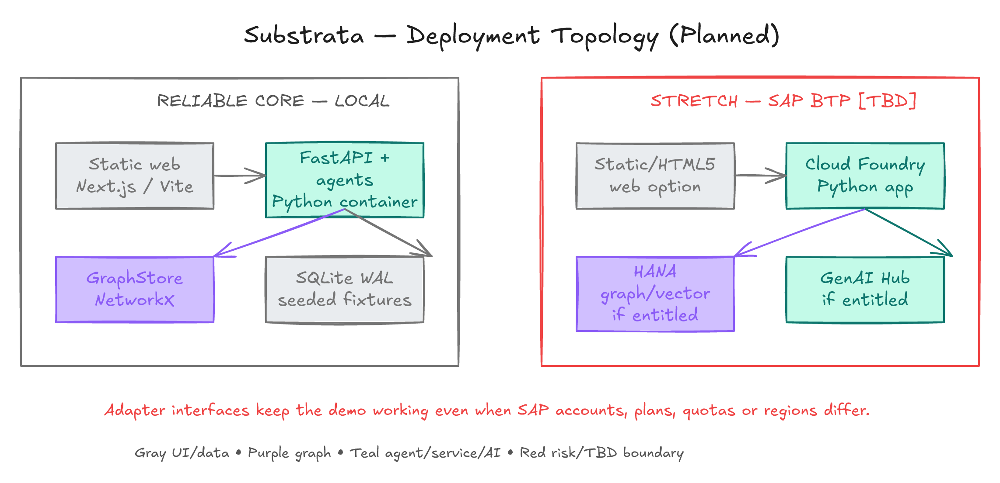

# Proposed technology stack

> **Current implementation:** Implemented locally: Python/FastAPI/Pydantic 2, SQLAlchemy 2/SQLite WAL/Alembic, NetworkX, mock extraction plus an optional HTTP adapter, Next.js/TypeScript/Tailwind/Cytoscape and direct SSE. Exact pins are in project manifests and lockfiles. SAP, live retrieval, authentication and cloud deployment remain unimplemented design targets.

## Decision principles

1. The offline judge replay must not depend on SAP entitlement or internet access. **[Design]**
2. Business logic lives once, in the Python service layer. **[Design]**
3. Pretrained AI, graph storage and external actions sit behind replaceable interfaces. **[Design]**
4. The smallest reliable implementation wins over adding named products for presentation value. **[Design]**


*Figure 12 — Proposed defaults and adapter boundaries. **[Design]***

## Stack map

| Area | Proposed choice | Why it fits | Decision trigger / fallback |
|---|---|---|---|
| Language | Python 3.12+ for services; TypeScript for web | Graph/data libraries and typed browser client **[Design]** | Exact versions selected during scaffold **[TBD]** |
| API | FastAPI + Pydantic | Typed REST/SSE schemas and generated API description **[Design]** | No second business-logic API layer |
| Web | Next.js App Router | Static export option and familiar React ecosystem **[Design]** | Vite + React if team experience favors it |
| Graph UI | Cytoscape.js | Interactive path and evidence views **[Design]** | Performance tested against planned graph size **[TBD]** |
| Map UI | MapLibre | Region/facility view without coupling to a proprietary map API **[Design]** | Map can be omitted from minimum demo |
| Orchestration | LangGraph | Explicit state and pause/resume points **[Design]** | Plain state machine if simpler |
| Tool protocol | MCP | Narrow, typed agent capabilities **[Design]** | In-process adapters retain same contracts in tests |
| Agent interoperability | A2A wrapper | SAP-aligned stretch integration **[Design]** | Excluded from core scope |
| Graph engine | NetworkX through `GraphStore` | Transparent deterministic prototype algorithms **[Design]** | HANA Cloud adapter only if entitled **[TBD]** |
| ORM and migrations | SQLAlchemy + Alembic | SQLite/PostgreSQL portability **[Design]** | Schema migration discipline begins in Phase 1 |
| Local database | SQLite WAL | Resettable, offline and zero-service demo **[Design]** | PostgreSQL in Compose for concurrency/shared preview |
| Vector retrieval | Stored embeddings + NumPy | Sufficient first baseline **[Design]** | pgvector/HANA vector only if measured need exists |
| AI access | `LLMClient` | Keeps provider/model details out of domain logic **[Design]** | SAP generative AI hub adapter preferred if supplied; permitted fallback otherwise **[TBD]** |
| Tests | pytest + schema/contract fixtures | Exact graph math and policy behavior **[Design]** | Browser tests selected with UI scaffold **[TBD]** |
| Observability | Structured JSON logs + correlation IDs | Inspectable agent/tool trail **[Design]** | OpenTelemetry optional after core flow works |

## Interface boundaries

```python
from typing import Protocol


class LLMClient(Protocol):
    async def generate_structured(
        self, *, task: str, schema: dict, evidence: list[dict]
    ) -> dict: ...

    async def embed(self, texts: list[str]) -> list[list[float]]: ...


class GraphStore(Protocol):
    def snapshot(self, version: int | None = None) -> "GraphSnapshot": ...
    def paths(self, query: "PathQuery") -> list["EvidencePath"]: ...
    def propose_edge(self, edge: "InferredEdge") -> "EdgeRecord": ...
```

These are illustrative contracts, not implemented code. **[Design]** The `LLMClient` must record provider/model, prompt version, latency and schema outcome while avoiding sensitive content in ordinary logs. **[Design]**

## Front-end rules

- The browser reads typed API responses; it does not recalculate runway, confidence or policy. **[Design]**
- Cytoscape.js and MapLibre load with `ssr: false` if Next.js is used. **[Design]**
- Agent events stream directly from FastAPI with explicit CORS configuration. **[Design]**
- Every color/status also has a text or icon cue; accessibility cannot depend on the legend alone. **[Design]**
- The experience keeps evidence and uncertainty accessible from every inferred edge and impact row. **[Design]**

## Deployment choices



*Figure 13 — Local is the core path; SAP BTP remains an entitlement-dependent stretch. **[Design]** **[TBD]***

### Local proposal

| Container/process | Responsibility | Persistent data |
|---|---|---|
| `web` | Static/client UI | None **[Design]** |
| `api` | FastAPI, orchestration, MCP adapters, deterministic services | None outside DB/fixture mount **[Design]** |
| `db` (optional) | PostgreSQL shared mode | Named local volume **[Design]** |
| SQLite mode | Default single-demo persistence | Explicit file plus deterministic reset **[Design]** |

### SAP-aligned stretch

The proposed stretch is a static/HTML5-style web delivery plus the Python app on SAP BTP Cloud Foundry, with HANA graph/vector and SAP AI Core generative AI hub adapters only where the supplied environment supports them. **[Design]** Account, region, quota, model, service-plan, cost, network and student-access assumptions are all **[TBD]**.

## Preflight checklist

- [ ] Confirm the event account and allowed services with the faculty coordinator. **[TBD]**
- [ ] Verify region, service plan, quota, expiry and team access in the actual cockpit. **[TBD]**
- [ ] Verify data-processing and retention terms before sending any non-synthetic record to a model. **[TBD]**
- [ ] Confirm whether Cloud Foundry, HANA graph/vector and generative AI hub are available. **[TBD]**
- [ ] Run the complete demo with network disabled. **[Design]**
- [ ] Ensure every SAP-shaped fallback screen says “simulated” or “local adapter.” **[Design]**

## Deliberate exclusions

Neo4j, a second API layer in Next.js, live procurement mutation, unbounded crawlers and custom model training are excluded from core scope. **[Design]** A technology should be added only when a testable requirement cannot be met by the current boundary. **[Design]**
